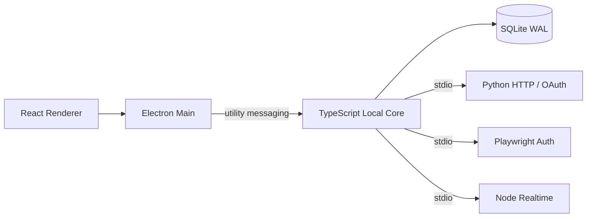

# BiliMonitor Desktop

最新续迁（2026-10-07）：[工作台标签/绑定/布局 JSON 保存](docs/implementation/2026-10-07-subject-json-storage-audit.md)已补齐新写入文本编码、空字节拒绝和实际落库返回。一个新增代表流程RED→GREEN、相关12项/类型/当前生产构建和真实Electron IPC/重启保留通过；最终四源限定复核无遗留问题，最后测试定向通过。一次阶段check仍exit1（Core1038通过/1个Subject501对象5秒超时），桌面及后续未执行；原布局逐条提交与客户端原子保存差异已向用户询问，未擅自修改。下方目录版是本片之前的版本，不含此次JSON修复，本轮未重打包。全量目标继续，不把定向结果称为全部验收。

当前进度（2026-10-07）：**全量迁移继续推进，尚未全部验收完成。** 本批已对齐[普通材料API、共享错误传递与直播媒体文本](docs/implementation/2026-10-07-material-api-and-live-media-audit.md)：原错误分类/返回码、空消息、nav解析日志归属、弹幕材料错误回退，以及头像/封面/关键帧原文。原业务范围不缩减，不重做已完成切片。

完整状态见[交接文档](docs/implementation/2026-09-13-migration-handoff.md)和[总台账](docs/implementation/2026-09-13-full-migration-tracker.md)。材料、导出、工作台输入与[资料回填/绑定](docs/implementation/2026-10-07-subject-backfill-and-binding-audit.md)的限定复查已闭合；阶段check终态exit1（Core1036通过/1个Subject批量5秒超时）。三处陈旧夹具对齐后，一次桌面阶段检查为664通过/3失败/19跳过；剩粉丝界面、平台采集超时未核定根因，不称整套绿色。新的schema16独立目录版已通过限定启动/重启/本地绑定保留与退出验收，见[阶段审计](docs/implementation/2026-10-07-stage-regression-and-directory-audit.md)。随后[直播添加输入](docs/implementation/2026-10-07-live-add-identifier-audit.md)复用精确解析，保留原有效数值写法并拒绝真实小数/Long64越界；一个既有浏览器流程、类型和生产构建通过，限定复查无问题。该目录版生成于此次Renderer修改前，不当作包含最新表单修复。原B/S/API只读、工具和新数据在D盘，保留全部未提交改动，未提交推送/更新安装包/接触用户库或真实凭据。下方检查点仅为历史记录。

最新续迁：[工作台三个直接文本字段](docs/implementation/2026-10-07-subject-direct-text-audit.md)已补原数据库编码的新写入规则；一个既有Core流程、两个旧Follower存储流程、相关类型与当前生产构建通过，四源限定复查无问题。新隔离生产IPC创建→Core重启→资料保持→删除/退出及自有密钥OS保护原语通过，不等于真人凭据/剪贴板/原生保存/安装验收。最新目录版在这两次后续修复前生成，当前bundle已更新；跨资源回滚、JSON字段及其他全量缺口继续保留。

随后[工作台创建整体回滚](docs/implementation/2026-10-07-subject-create-transaction-audit.md)已实现：创建失败不残留相关监控、快照、场次、请求日志和Outbox，准备期间独立添加保留；先准备资料再同步提交，不在网络等待期间持有数据库事务，改绑原行为不变。只新增一个代表流程，相关三个文件12项、类型/当前生产构建与实际隔离启停通过，五源限定复查无问题。JSON字段/其他失败行为、配置、阶段超时及真人/原生仍待收尾，完整迁移继续。

当前独立目录版：[BiliMonitor Desktop.exe](release/migration-20261007-subject-transaction/win-unpacked/BiliMonitor%20Desktop.exe)，包含上述后续修复。已实际脱离开发环境验证内置Worker、IPC、对象重启保留与退出，未安装NSIS/使用真人凭据；旧包与历史结果保持。详细证据见事务审计，不把目录启动等同全量验收。

本片后最新阶段check仍exit1：Core1035通过/3个原5秒超时（工作台501、直播批量配置、弹幕101容量），新增回滚流程通过；后续阶段未由check执行。后两项原流程有限诊断通过，不等同并行问题已解决。上方Core1失败及旧目录版都是此前结果，完整迁移与阶段收尾继续。

此前检查点（弹幕指标时间范围）：

最新检查点（2026-10-06）：[弹幕指标时间范围](docs/implementation/2026-10-06-danmaku-metrics-range-audit.md)已按原Java解析/回退和日期越界规则接通Core/SQLite；正常闭区间/最新2000升序保持。仅2个新业务用例及1个共享样例，5项定点、三包类型与一次构建通过。任务差量审查/安全检查结论见审计。

下一项继续原事实写入时间等M09业务；全M01–M18及旧整体缺口仍open。每功能少量关键验证，完整回归留阶段末；原项目只读、产物D盘、未提交推送。以下为历次当时状态。

此前检查点（弹幕连接容量）：

最新检查点（2026-10-06）：[弹幕连接容量](docs/implementation/2026-10-06-danmaku-capacity-audit.md)已去除Worker额外100连接限制，遵循Core原配置默认10/至少1/手动自动共享名额；操作队列背压和停止保护不变。仅1新贯穿用例、4项复用通过，两包类型与一次生产构建通过，2路径增量审查通过；非阻断测试清理建议记入阶段收尾，不追加验证。

下一项继续原指标查询规则；其它M09、全M01–M18和旧整体验证缺口仍未完成。保持少量关键验证、阶段末完整回归，原项目只读、产物D盘、未提交推送。以下为历次当时状态。

此前检查点（弹幕指标分桶）：

最新检查点（2026-10-06）：[弹幕指标分桶](docs/implementation/2026-10-06-danmaku-metric-buckets-audit.md)已按原规则接通：配置原值入库/返回、至少10秒仅用于对齐、无额外3600上限，追加SQLite v15保留历史。原15个启动输入字段已绑定，probe无消费者不新增任务。仅新增3项，定点10项、三包类型及一次生产构建通过；19路径任务增量审查通过，无需修复或追加验证。

按用户要求加快迁移：每功能2–3个关键用例，不铺矩阵/重复历史套件，完整回归留阶段收尾。其它M09、全M01–M18、真人/原生/安装及旧整体验证缺口仍未完成；原源码只读、产物D盘、未提交推送。下方历次状态仅作历史记录。

此前检查点（WBI / Buvid 缓存时长）：

最新检查点（2026-10-06）：[WBI / Buvid 缓存时长](docs/implementation/2026-10-06-danmaku-cache-configuration-audit.md)已接通弹幕与 Python 榜单。保留原默认12小时、消费下限300秒及成功后计时；登录过期保留Buvid/强刷WBI，风控清两项，nav匿名。仅新增3个测试，新旧定点10项、类型/格式及一次生产构建通过，27路径任务增量审查PASS，无需修复。

每个功能只做少量主流程/关键边界验证，不再逐项跑历史套件或铺矩阵，完整检查留阶段结束。现13/15配置，余统计桶/probe；跨Worker共享缓存、同步双检、完整多段fallback及其它M09/全量M01–M18仍未完成。旧整体验证缺口保留，原源码只读、产物D盘，未提交推送。以下保留历次当时状态，当前范围以上方和最新台账为准。

此前检查点（连接配置与身份策略）：

最新检查点（2026-10-06）：[弹幕连接配置与身份策略](docs/implementation/2026-10-06-danmaku-connection-configuration-audit.md)已迁移，心跳、WS超时、登录凭据开关、webLocation与clientVersion贯通配置→Core→实际连接。禁凭据时不读取/发送登录凭据；补正单调心跳计时与花括号文本读取。相关验证、修复后构建、任务复审通过。

仅新增3个代表业务场景，复用已有回归；不重复全历史check/累计审查，阶段收尾再全量。弹幕配置现11/15项，余统计桶/WBI缓存/Buvid缓存/probe、其它M09、完整M01–M18及真人/原生/安装未完成。旧全量缺口保留，源码只读、产物D盘，未提交推送。以下历次检查点保留当时结果，当前剩余范围以上方为准。

最新检查点（2026-10-06）：[弹幕连接、认证与心跳生命周期](docs/implementation/2026-10-06-danmaku-auth-lifecycle-audit.md)已按原 B/S 迁移：每候选重新获取信息/首host、发认证后返回、异步认证成功或拒绝、独立尝试会话、发后心跳、关闭/停止与迟到结果保护。鉴权期间可停止。主要复用既有用例，只新增一个贯穿业务的Core集成用例；相关定向、类型、最终生产构建及独立任务复审通过。首两次构建失败已最小修正，原日志保留。

后续以原业务实现为主，少量正常/关键失败/停止安全验证，阶段收尾再全量；不为每个分支新增测试或重复历史检查。旧整体验证缺口保留，剩余9项弹幕属性、其它M09及完整M01–M18/真人/原生/安装仍未完成。原源码只读、产物D盘，未提交推送或更新安装客户端。

此前检查点（2026-10-06）：[弹幕协议选择](docs/implementation/2026-10-06-danmaku-protocol-selection-audit.md)已按原 B/S 贯通配置→Core→Worker→实际认证包：自动优先配置协议、手动覆盖、越界请求按自动处理、活动连接复用。只新增3个代表性业务场景及少量契约样例；相关定向验证、类型检查、生产构建及独立任务复审通过。本轮不重复全量历史检查；旧整体验证缺口保留。其当时的下一功能已由上方生命周期检查点接续，历史记录不作为当前未完成清单。

以下为弹幕正文与最近消息准入此前检查点，保留当时结果：

当前检查点（2026-10-06）：[弹幕正文与最近消息准入](docs/implementation/2026-10-06-danmaku-text-admission-audit.md)已按原 B/S 实现：保留正文原文/标量、精确数字文本；Java 空白消息不进 recent、不裁剪，但事实与指标保留。独立任务复审 Approved，最终串行定向310项通过。一次冻结完整check仍exit1：此前阶段1716项通过，桌面Vitest进程异常退出（3221226505），没有桌面用例汇总，不冒称旧两项已修好。全部类型/Black60/isort/mypy18/Python1037/build及实际Electron bundle/CJS另行补验exit0。完整M01–M18、余10弹幕属性与真人/原生/安装仍未完成；下一协议偏好仅只读提案。原B/S/API只读、产物D盘，未提交推送或更新安装客户端。

以下为最近弹幕保留数量此前检查点，保留当时结果：

当前检查点（2026-10-06）：[最近弹幕保留数量](docs/implementation/2026-10-06-danmaku-recent-retention-audit.md)已按原配置→Core→SQLite迁移：默认200/服务至少20/无额外500上限，独立查询仍限200，永久事件与指标不裁剪，重启及两房隔离有真实回归。独立task审查Approved；[UID/Worker测试边界](docs/implementation/2026-10-06-uid-worker-observation-audit.md)另task Approved。一次冻结check仍exit1：Node2276过/2失败/2278无跳过，Core989全过；当前失败是pending Worker add的10秒marker等待及四用户2000点趋势5秒body超时。UID12轮本次执行完成，不宣称稳定性根因修复。

全部类型/Black60/isort/mypy18/Python1037/build各0；补验末尾main用了错误Worker输出路径致命令exit1，原日志保留，随后只核实际Electron bundle路径/CJS通过，不把补验或整套check改称exit0。最终69路径累计审查完成：实现质量Approved，无新增生产缺陷，当前两项whole验证Important仍开放，merge/ship NOT READY。M01–M18、余10弹幕属性与真人/原生/安装仍未完成。下一原文/空白消息准入仅只读提案，未实现；不重复旧观察任务或放宽预算。原B/S/API只读、产物D盘、未提交推送/更新安装客户端。

以下为六处浏览器启动边界此前检查点，保留当时结果：

此前一次全量Node2181/2183、Desktop653/655、两失败无跳过；六startup路径完成但UID循环与首次Worker marker失败。TypeScript/Black60/isort/mypy18/Python1022/build补验通过；60路径累计审查slice Approved/merge With fixes/ship No。UID循环和当前完整失败清单以后续最近弹幕保留审计为准，不能把此历史状态当当前结果。

以下为Worker首读与目录保护此前检查点，保留当时结果：

最新迁移检查点（2026-10-06）：[Worker首次读取与测试目录保护](docs/implementation/2026-10-06-worker-first-read-audit.md)已完成测试侧取证与创建前D盘保护，独立task审查Approved。本次原预算全量运行中，首次粉丝add/refresh实际完成取消、子进程退出和SQLite无迟到写入断言；不称此前间歇启动根因已修复。完整check仍退出1：Node2151通过/4失败/19跳过（2174），6个浏览器文件在setup/导航阶段失败；未执行的19项不计通过。全类型、Black60/isort/mypy18、Python1022与生产构建另行通过。下一步定位这6处浏览器验收缺口，再继续下一业务；完整M01–M18未完成，原B/S只读、产物D盘、未提交推送或更新安装客户端。

本轮完整55路径独立审查已结束：切片质量Approved，merge With fixes / ship No，无新增生产Critical/Important；此前Worker取消执行缺口和D预检Minor已按本次证据关闭，当前6处浏览器整体验证Important保持。下一最小observer只是提案、未实施，详见新审计。

以下为粉丝投影刷新此前检查点，保留当时结果：

最新迁移进度（2026-10-06）：[粉丝趋势投影刷新](docs/implementation/2026-10-06-follower-projection-verification-audit.md)已区分无变化后台读取与显式成功刷新，保持原共享请求、操作顺序及700/900提示；真实浏览器RED→GREEN，独立task复审Approved，最终定向浏览器98/Worker11通过。冻结后一次完整check退出1：Node2170/2171、Desktop644/645、无跳过，唯一失败为首次粉丝Worker尚未到HTTP启动标记；其余三项旧失败本次未出现，不冒称稳定性根因已修复。全部类型、Black58/isort/mypy18、Python1016与生产构建另行通过。完整51项增量审查切片质量Approved、merge With fixes/ship No：无新增生产Critical/Important，但Worker全量验证Important仍开放，auto-target创建前D预检Minor保留。下一步单次fix wave处理这两项，先取证首次真实stdin读取，不豁免旧失败或放宽预算；M06/M09及完整M01–M18继续迁移。本轮未提交推送、启动原B/S或更新安装客户端，产物仍在D盘，实际项目进程/监听0。

以下为弹幕启动控制的此前检查点，保留当时结果：

最新迁移进度（2026-10-06）：[弹幕启动控制及完成后调度](docs/implementation/2026-10-06-danmaku-startup-scheduler-audit.md)已实现四字段配置与开关/容量、首次0延迟、每轮结束后固定等待和退出保护，独立task审查Approved。修改后完整check退出1：Node2161通过/2165、4旧失败、无跳过，Core937/Contracts475全部通过；全部类型、Python1016及生产构建另行通过，新Python格式问题已修正。最终完整分支审查切片质量Approved、合并With fixes、发布No：四项未关闭验证失败为Important，优先补Worker启动/请求和浏览器状态证据，不豁免旧失败。不能称全量绿色；原15属性余11、完整M09/M01–M18及真人/原生仍未完成；删除probe通过不等于已证明冷启动修复，旧测试稳定性保留。

弹幕配置位于实际数据目录的 `config/bilibili-live-danmaku.json`，只读加载、重启生效，缺失时不写文件；[示例](config/bilibili-live-danmaku.example.json)支持15个原输入字段，兼容原环境别名与规范名覆盖。关闭自动监听仍可手动连接，总开关关时拒绝新连接但保留查询/停止和历史。容量消费最少1，自动调度每轮完成/失败后再等delay，退出不续排。直播storage关闭时不创建该服务；只关两flag仍不能绕过storage存在时的正数raw调度校验。协议、连接认证、五项连接配置、两缓存时长与统计桶已接；probe原无消费者，只绑定，不添加探测业务。其它M09仍未完成。

`bucketSeconds` 默认60，保留原signed32值，只有桶起点计算使用至少10秒，不设3600上限；保存/返回保留raw，配置修改不重算历史桶。`listenProbeSeconds` 默认20，没有原业务消费者。原环境别名和v15升级规则见[分桶审计](docs/implementation/2026-10-06-danmaku-metric-buckets-audit.md)。

`wbiCacheSeconds`、`buvidCacheSeconds` 默认均43200，缓存成功解析后按至少300秒计时；WBI配置也用于Python榜单采集。进程缓存仍独立，跨Worker共享/同步双检和完整多段fallback留后续，见[缓存时长审计](docs/implementation/2026-10-06-danmaku-cache-configuration-audit.md)。

新增连接配置默认 `heartbeatSeconds=30`、`connectTimeoutMs=8000`、`useLoginCredential=true`、`webLocation="444.8"`、`clientVersion="1.14.3"`。实际心跳至少5秒、WS握手至少1000ms，HTTP超时独立。禁登录凭据保留原激活重连但仍匿名；非空白版本不裁剪。字段与别名见[本轮审计](docs/implementation/2026-10-06-danmaku-connection-configuration-audit.md)。

`protocolVersion` 为自动模式的启动偏好：0..3 先尝试配置值，再按3/2/1/0去重；其他合法signed32配置值回退默认顺序。手动选择0..3只尝试该协议，省略或其他signed32请求值视为自动并复用已活动连接。兼容原 `SOCIAL_MONITOR_BILIBILI_LIVE_DANMAKU_PROTOCOL_VERSION`，规范名 `APP_BILIBILI_LIVEMONITOR_DANMAKU_PROTOCOLVERSION` 优先。

`recentMessageLimitPerRoom` 保留原signed32整数配置，实际每房至少保留20条，不设额外500条上限；查询仍最多返回200条。兼容原 `SOCIAL_MONITOR_BILIBILI_LIVE_DANMAKU_RECENT_LIMIT`，规范环境名 `APP_BILIBILI_LIVEMONITOR_DANMAKU_RECENTMESSAGELIMITPERROOM` 优先覆盖。降低配置不会在启动时清理，按原规则在新弹幕入库后裁剪最近列表；永久场次事件及统计不随裁剪删除。文件类型/越界错误不能用环境覆盖掩盖，启动错误不泄露配置值。

以下为自动候选/容量切片的此前检查点，保留当时结果：

最新进度（2026-10-06）：按原B/S续迁[弹幕自动监听候选与容量仲裁](docs/implementation/2026-10-06-danmaku-auto-targets-audit.md)，已修复创建顺序、完整候选、先跳过手动再填容量；停止/启动顺序、手动保护和失败后重试有真实Core/SQLite回归。新增9项和相关旧33项通过，task独立复审Approved。完整check退出1：Node2076通过、4失败、9跳过（2089总数）；Core884通过，4个旧浏览器断言/hook失败，粉丝删除suite初始化失败致9项跳过。全部类型、Python1003及生产构建另行通过，不能称全量绿色或M09完成。下一独立业务核对自动监听配置与fixedDelay，旧测试稳定性、M06共享recycler及完整M01–M18继续保留；不自动提交/推送、启动原B/S或更新安装客户端。当前总览见[迁移台账](docs/implementation/2026-09-13-full-migration-tracker.md)。

以下为此前同日粉丝操作检查点，保留当时验证结果：

2026-10-06 已恢复逐项迁移，本轮按原 B/S 完成[粉丝暂停/恢复与删除](docs/implementation/2026-10-06-follower-monitor-actions-audit.md)的交互对齐及定向验收：新增33项真实浏览器/V2/Core/SQLite测试、主代理新旧84项通过，两个操作独立复审通过。此前[立即刷新](docs/implementation/2026-10-05-follower-manual-refresh-audit.md)、[间隔保存](docs/implementation/2026-10-05-follower-interval-audit.md)、[添加成功链](docs/implementation/2026-10-05-follower-add-flow-audit.md)、[Long64精确链路](docs/implementation/2026-10-05-follower-long64-audit.md)与[UID输入](docs/implementation/2026-10-05-follower-uid-input-audit.md)保留。最终完整check仍退出1（Node2072/2080，8项旧浏览器导航hook超时）；类型、Python1003项及生产构建另行通过，不冒称全量绿色。独立缓存没有消除旧超时，冷预打包仍是未证实候选。历史提交范围见[提交快照](docs/implementation/2026-10-06-commit-snapshot.md)，剩余业务见[全量台账](docs/implementation/2026-09-13-full-migration-tracker.md)。本轮未自动提交/推送或更新安装客户端，不代表粉丝模块或全部业务迁移完成。

BiliMonitor Desktop 是把原 BiliMonitor B/S 项目的真实业务改造成完全本地桌面应用的独立仓库。它不依赖远程业务后端，也不要求本机维护数据库服务、消息队列、容器或 WSL。

当前导航只显示已接到本地 Contract、Core、SQLite、Worker、IPC 与真实 UI 的原业务：B站用户工作台、粉丝监控、扫码登录、直播间 REST、实时弹幕、观众/大航海榜、直播场次、数据中心、场次洞察与导出，以及抖音本人 Web/OAuth 登录态。源码中的 SQLite schema 为 v16；敏感凭据由 Electron `safeStorage` 封装的本机密钥进行 AES-256-GCM 加密。B站真人扫码和抖音真人扫码/开放平台授权仍是发布前手工验收项，不把未执行的人机操作写成已通过。

原项目更新至 `fa2faa6` 后正在重新逐项迁移、验收，已有入口不代表全部业务等价。最新范围及未完成项见 [全量迁移台账](docs/implementation/2026-09-13-full-migration-tracker.md)。当前场次面板读取最近 20 场，数据中心/分析可选择最近 200 场；查询数量非正数回退 20、超过 200 截断为 200。

直播导出建议名称为 `主播名-2026-09-13-第1次导出-弹幕.csv`，昵称为空回退 UID，按原规则清理文件名并截取最多 80 个 Unicode 码点。每位主播按北京时间日期累计编号，不同场次与 CSV/XLSX/ZIP 共享；已经生成但未保存、或文件写入失败，已分配编号不复用。v12 仅新增本地每日计数表，不删除历史场次；重新启动客户端后自动升级，构建通过不等于已更新安装包。

直播间的展开详情与用户工作台共用弹幕/观众/大航海组件：每 2 秒读取最近 60 条弹幕并展示 UID，支持未开播监听、协议选择、阅读时暂停自动滚动。榜单按类型保留排序与选择，只刷新当前选中榜单（最多 4 页），显示陪伴天数/大航海等级；读取失败保留组件内上次数据，重新打开时读取最新本地快照。此项不代表独立弹幕页、全部榜单采集规则及全量业务已验收。

直播间列表、汇总、全部房间趋势及用户资源绑定不再隐含截断为 100/500 间；显式列表 limit 仍保留兼容。历史未传或非正数取最近 500 点，正数最大 2000 点，按时间升序返回；起止包含边界，支持时区偏移和微秒。事件缺省取最近 20 条，请求数限制在 1..200。详见[直播查询迁移审计](docs/implementation/2026-09-13-live-query-audit.md)。

[直播采集与快照应用](docs/implementation/2026-09-13-live-collection-audit.md)现按原规则只回填资料/关注，不把旧热度和开播时间当作新事实；重新添加与普通采集区分处理，旧结果重新添加只激活设置，事件按实际落库时间记录。原重试类别/次数/退避、失败来源、场次与快照事务顺序均有真实SQLite回归；数据库/场次内部错误不冒充平台失败。

[直播Python与Worker链路](docs/implementation/2026-09-13-live-worker-audit.md)已补0分区/short ID、昵称与字段回退、时间解析、旧接口空结果及原错误分类；共享契约校验输入/输出，真实Python子进程→NDJSON→Core→SQLite验证中文、错误metadata与原始响应证据。测试仅替换外部HTTP，不能代替真人平台/原生安装包验收。原宽松数值范围、边缘解析与配置仍在M08待办中，不代表全量迁移完成。

v13 按原业务保留接口返回的有符号热度/关注计数，不用负值错误拒绝整批采集；契约、房间/快照存储和用户工作台投影同步兼容。升级仅移除两张直播表的非负计数约束，保留记录、rowid、索引和关联，并在事务提交前检查外键。新代码启动时才执行升级；直播计数超过 JavaScript 安全整数范围仍待完整迁移。

v14 仅移除粉丝监控/快照四个计数的额外非负约束，保留监控/绑定正 UID、记录身份、rowid、索引、触发器、视图及外键；失败原子回滚，重开幂等。粉丝计数在内核/SQLite 使用 bigint，在 v2 通信使用精确十进制字符串，覆盖原 signed64 数值与回绕差分；旧 v1 无法准确表示的值明确失败，不静默舍入。粉丝及工作台的文本、合计、排序、趋势轴和提示也走精确路径。没有打开用户实际数据库、制作安装包或更新已安装客户端，原生及真人验收仍未完成。

粉丝页[添加UID输入](docs/implementation/2026-10-05-follower-uid-input-audit.md)按用户确认保留精度，兼容前导零、空白、正号及结果为整数的科学/进制写法；真实小数、非正数和Long越界在本地拒绝，不发采集请求。未恢复原网页的Number舍入缺陷；失败保留草稿。[添加成功链](docs/implementation/2026-10-05-follower-add-flow-audit.md)已恢复提交清UID/保留间隔、共享读完成后清理与最多4人自动选择、raw-ID趋势请求及独立成功确认；旧请求不影响新抽屉。重读失败保留旧数据且不回滚或重试成功添加，不代表M06已完整验收。

[直播调度与退出恢复](docs/implementation/2026-09-13-live-lifecycle-audit.md)已恢复原默认每秒到期扫描，按每批完成后的固定延迟执行，保留1500ms接口限流。关闭Core立即停止直播采集，取消限流/重试等待，迟到成功或失败不再写库；重启按本地保存的启用、间隔、到期和退避状态恢复。实际Python子进程退出已自动验证，原生安装应用验收仍单列。

[直播自动采集配置](docs/implementation/2026-09-13-live-collection-configuration-audit.md)从实际D盘数据目录的 `config/bilibili-live-collection.json` 读取，重启生效；[示例文件](config/bilibili-live-collection.example.json)包含已实现的 `enabled`、`schedulerDelayMs`、`dueBatchSize`、`statusBatchSize`，缺省分别true/1000/20/30，支持原同名环境变量覆盖。关闭自动REST不禁用手工操作或粉丝/弹幕调度；30只是默认批量，不再是Worker硬上限。配置错误在建库前拒绝，并经bootstrap返回不含堆栈/启动诊断的明确提示。后续已接入[间隔、限流、重试与失败退避策略](docs/implementation/2026-09-13-live-collection-policy-audit.md)，并接入[四个REST端点的HTTP配置与请求存活](docs/implementation/2026-09-13-live-http-lifetime-audit.md)，示例现包含17项配置。配置默认值不改已有房间排程，手工输入/数据库仍限1..2592000秒；[榜单及其WBI HTTP配置、长请求/退出处理](docs/implementation/2026-09-13-rank-http-audit.md)随后已接入，并补真实Python管道失联验证；[Node弹幕三端点HTTP配置、请求存活与在途取消](docs/implementation/2026-09-25-danmaku-http-audit.md)已接入；随后接入[storageEnabled及工作台开关](docs/implementation/2026-09-25-live-storage-audit.md)：直播存储关闭时不创建相关服务/调度，原工作台必须显式一并关闭（`config/subject-monitor.json` 的 `enabled=false`），冲突在建库前报错；关闭不删除历史。完整弹幕业务及原生应用验收仍未完成。

[粉丝监控启动配置](docs/implementation/2026-09-26-follower-configuration-audit.md)独立支持16项原设置及环境覆盖：区分停止自动扫描与关闭全部粉丝存储业务，工作台依赖同时校验，关闭再启用保留历史/绑定。默认启动即扫描、每批完成后等待1秒；间隔、批量、重试/退避和HTTP设置贯通到Python。直播遮罩昵称使用独立无落盘查询，不要求开启粉丝存储，也不产生无引用原始响应文件；长请求保活、父管道失联取消和迟到写库保护已有自动回归。完整Spring绑定、解析域及共享限流仍在后续清单。

[直播监控操作区](docs/implementation/2026-09-13-live-monitor-panel-audit.md)现按原页面显示横向房间列表、默认首房详情、八项事实字段与完整性提示；卡片每秒显示采集节奏，优先显示暂停/异常，倒计时不发起采集。间隔草稿跨收起、切房及页签保留，成功保存后清理，失败不丢失；按原规则夹取1..2592000秒并使用相对步长，滚轮不会误改值。添加成功展开实际返回房间，包含复用已有房间；浅粉白/深色与窄窗口已做浏览器回归。详情场次区仍保留在M11，不等于全量迁移完成。

[直播趋势](docs/implementation/2026-09-13-live-trend-audit.md)在房间页同页展示，也保留独立页签；最多4房按选择顺序采用单图/双列/主次/2×2布局。最近500点使用真实时间、原轴留白和精确万/亿格式，鼠标/键盘可看具体值；缺失热度沿用原页面以0绘图，但空心点与提示明确原始值缺失，不写假快照。历史不足依次回退近期快照和当前值参考。选房180ms合并、成功重读刷新、清空后成功重读恢复live-first；旧在途结果和15秒缓存不再挡住新数据。浅粉白/深色、窄屏及错误重试已做隔离浏览器回归。

[直播整体刷新与状态事件](docs/implementation/2026-09-13-live-overview-audit.md)现按原loadAll规则，房间、汇总和最近20条事件全部读取成功后一起更新；任一路失败保留完整旧投影，首次失败不冒充空数据。汇总恢复“最近状态变化”，事件同页展示当前主播名、六类原事件名称和每秒更新的相对时间。命令成功后立即标记间隔已保存或关闭被删除房间的详情，后续读取失败不回滚成功事实；删除后重新添加相同房间号使用新监控ID，不复用旧趋势。全部沿用本地桥接，15秒轮询只读本地投影，不新增业务服务。

粉丝查询默认返回全部监控用户，不再默默截断为 100/500 人；界面仍最多选 4 人对比。历史查询未传/非正数取最近 500 点，最大 2000 点，按时间升序返回；`from/to` 包含边界并支持时区和微秒精度。页面沿用原项目的最近 500 点查询，不是固定小时范围。采集仅重试网络、HTTP 限流与服务端错误；卡片成功但无头像时清掉旧值，relation/stat 回退保留原资料。

粉丝页现按原业务展示总粉丝、最近净增、最早排程及间隔汇总；横向用户块显示每秒更新的采集节奏，点击或键盘展开一位用户的详情。切换/收起保留各用户未保存的间隔草稿，后台重读不覆盖草稿，删除仍需确认。界面倒计时不发起采集；手动立即刷新按原页面不设置自动“采集中”标记或重复点击锁，失败不重读，成功等待共享列表读取但不等待历史，列表读取失败仍确认已完成刷新。

勾选用户后在同页显示趋势：1人单图、2人双列、3人主次、4人网格；拖动或键盘按钮交换位置。图表按真实时间间距、原数值/时间轴留白显示最近500点，支持万/亿刻度和鼠标/键盘数值提示；无完整历史时依次使用最近快照、已知当前值单点（标为“当前值参考”，不落库伪造快照）。本地历史读取按180ms合并、单请求在途、120ms补读，刷新提示至少700ms、结果提示900ms；失败保留已有图，迟到数据和旧错误不串到新用户，清空选择/离开页面停止后续读取。

粉丝监控已补齐[逐操作代码与自动闭环审计](docs/implementation/2026-09-13-follower-workflow-audit.md)：通过实际 Preload 校验、Core、SQLite 验证增删改、失败退避、历史和重开保留。Core 停止时取消粉丝限流/重试等待，迟到结果不再写库，也不把退出当作平台失败。测试替换了 Electron 传输和外部平台响应；真人采集、原生客户端/安装包验收及 M07 登录等后续业务仍见全量台账，不代表全部迁移完成。

B站登录交互已补未登录刷新状态、扫码期间刷新二维码、成功账号展示、凭据分字段/完整复制和操作反馈；关闭弹窗后的迟到结果不再回填，新旧二维码轮询保持单请求在途。界面已独立审查，窄屏单列覆盖问题已修复。合成数据浏览器回归不使用真实凭据或系统剪贴板。

登录采集与本地生命周期已补[逐操作审计](docs/implementation/2026-09-13-bilibili-auth-core-audit.md)：HTTP会话Cookie和登录展示Cookie分离，保留原响应优先级、删除/到期与作用域；二维码计时、清理和重复激活有回归。撤销、换账号或退出后的旧响应不能恢复凭据，未知内部错误不再误判过期。真实Preload校验/Core/隔离SQLite验证六类操作与重开恢复。

[登录与弹幕联动](docs/implementation/2026-09-13-auth-danmaku-link-audit.md)现只在凭据首次激活后升级匿名连接，保留原协议和自动/手动归属；单房失败不阻断后续房间，重复扫码成功回读不再触发断线。按原业务，撤销仅停用凭据，不强制关闭已有LOGIN连接，后续建连不再携带旧凭据。应用退出会取消在途建连并终止专属Worker，迟到事件不写关闭的数据库。真人扫码、原生客户端及M09全部弹幕规则仍待验收。

## 当前技术栈

| 领域 | 选择 |
| --- | --- |
| 桌面与 UI | Electron 43、React 19、TypeScript 7、electron-vite |
| 本地核心 | TypeScript Local Core，运行在 Electron `utilityProcess` |
| 控制数据 | Node `node:sqlite`、SQLite WAL、schema migration |
| 进程契约 | JSON Schema + Zod + Pydantic；utility messaging / NDJSON stdio |
| HTTP / OAuth Worker | Python httpx |
| 浏览器登录 Worker | Node Playwright |
| 实时采集 | Node WebSocket Worker |
| 当前业务分析 | TypeScript Core + SQLite 查询投影 |

项目源码只使用 TypeScript、Python、PowerShell、SQL 和声明式配置，不包含 C、C++、Rust 源码或对应编译工具链。第三方依赖只安装官方/上游预编译产物。

## 运行结构



应用不开放业务 HTTP/TCP 端口。Renderer 只能访问窄化 Preload API；Local Core 独占控制数据库；当前未实现的 AI、Agent、Tool 能力不对外声明。

## 目录

```text
apps/desktop/          Electron Main、Preload 与 React Renderer
packages/contracts/    JSON Schema、Zod DTO 和 Runtime Envelope
packages/core-runtime/ TypeScript Local Core
packages/storage/      SQLite WAL 与迁移
packages/task-engine/  Durable Task 状态机
workers/python/        B站 HTTP 与抖音 OAuth Worker
workers/node-browser/  Playwright 登录 Worker
workers/node-realtime/ WebSocket Worker
scripts/               D 盘 bootstrap、dev、check、build
docs/                   架构、ADR、UI 与路线图
```

## 本地开发

所有项目工具、缓存、临时文件、浏览器、构建物和运行数据都会固定到 D 盘；Python 基础解释器来自 E 盘，项目 venv 位于 D 盘。运行目录和导出保存位置会拒绝 C、E 与 UNC 路径，只接受 `D:\`。

```bat
bootstrap.cmd
dev.cmd
check.cmd
build.cmd
```

首次 `bootstrap.cmd` 会准备 Node 24 LTS、pnpm 11、Python 依赖、Crawlee/Playwright Chromium 和锁文件依赖。不要绕过脚本调用 C 盘全局 `pnpm` 或 `python`。

## Windows 安装包与运行数据

```bat
build.cmd -Package
```

安装目录固定为 `D:\BiliMonitor Desktop`，不可改到系统盘；可变数据固定为 `D:\BiliMonitor Desktop Data`，升级和卸载不会删除其中的 SQLite、CAS、凭据、Chromium Profile 与导出文件。安装包内自带 Python Worker、Node Worker 和 Playwright Chromium，不依赖开发仓库的 Python 环境。

## 抖音 OAuth 正式配置

首次启动会生成：

```text
D:\BiliMonitor Desktop Data\config\douyin-oauth.env.example
```

复制为同目录的 `douyin-oauth.env`，填写抖音开放平台的 `client key`、`client secret`，并把回调地址配置为 `bilimonitor://douyin-oauth`，然后重启应用。应用会立即使用 Electron `safeStorage` 将完整配置加密为 `douyin-oauth.secure`，并删除明文 `douyin-oauth.env`。浏览器 Worker、爬虫 Worker 和 Renderer 都拿不到 client secret。

## 当前边界

当前业务事实源为原仓库 `fa2faa6`，按全量迁移台账逐项核对真实功能。Mock/占位页面不在桌面导航中冒充已实现业务；Platform adapter、CollectTask run-once 等已有接口继续按 M16/M17 核实可执行行为，不能仅因相邻页面使用 Mock 就整体排除。新的 AI、Agent 扩展暂不开发，不缩减原项目真实功能的迁移范围。

历史控制器、Service、状态机和本地映射见 [原 B/S 业务复刻基线](docs/implementation/original-bs-business-parity.md)；当前状态以[全量迁移台账](docs/implementation/2026-09-13-full-migration-tracker.md)为准。

## 文档

- [当前运行时蓝图](docs/architecture/typescript-python-local-runtime.md)
- [ADR-0006](docs/adr/0006-typescript-python-local-runtime.md)
- [本地开发环境](docs/development.md)
- [实施路线图](docs/roadmap.md)
- [初版桌面 UI 设计](docs/ui/initial-ui-design.md)
