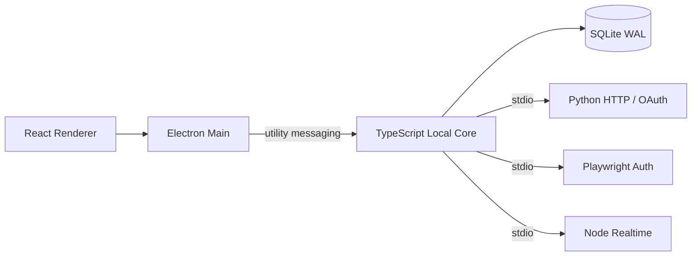

# BiliMonitor Desktop

BiliMonitor Desktop 是把原 BiliMonitor B/S 项目的真实业务改造成完全本地桌面应用的独立仓库。它不依赖远程业务后端，也不要求本机维护数据库服务、消息队列、容器或 WSL。

当前导航只显示已接到本地 Contract、Core、SQLite、Worker、IPC 与真实 UI 的原业务：B站用户工作台、粉丝监控、扫码登录、直播间 REST、实时弹幕、观众/大航海榜、直播场次、数据中心、场次洞察与导出，以及抖音本人 Web/OAuth 登录态。SQLite 当前 schema 为 v12；敏感凭据由 Electron `safeStorage` 封装的本机密钥进行 AES-256-GCM 加密。B站真人扫码和抖音真人扫码/开放平台授权仍是发布前手工验收项，不把未执行的人机操作写成已通过。

原项目更新至 `fa2faa6` 后正在重新逐项迁移、验收，已有入口不代表全部业务等价。最新范围及未完成项见 [全量迁移台账](docs/implementation/2026-09-13-full-migration-tracker.md)。当前场次面板读取最近 20 场，数据中心/分析可选择最近 200 场；查询数量非正数回退 20、超过 200 截断为 200。

直播导出建议名称为 `主播名-2026-09-13-第1次导出-弹幕.csv`，昵称为空回退 UID，按原规则清理文件名并截取最多 80 个 Unicode 码点。每位主播按北京时间日期累计编号，不同场次与 CSV/XLSX/ZIP 共享；已经生成但未保存、或文件写入失败，已分配编号不复用。v12 仅新增本地每日计数表，不删除历史场次；重新启动客户端后自动升级，构建通过不等于已更新安装包。

直播间卡片的“展开直播数据”与用户工作台共用弹幕/观众/大航海组件：每 2 秒读取最近 60 条弹幕并展示 UID，支持未开播监听、协议选择、阅读时暂停自动滚动。榜单按类型保留排序与选择，只刷新当前选中榜单（最多 4 页），显示陪伴天数/大航海等级；读取失败保留组件内上次数据，重新打开时读取最新本地快照。此项不代表独立弹幕页、全部榜单采集规则及全量业务已验收。

粉丝查询默认返回全部监控用户，不再默默截断为 100/500 人；界面仍最多选 4 人对比。历史查询未传/非正数取最近 500 点，最大 2000 点，按时间升序返回；`from/to` 包含边界并支持时区和微秒精度。页面沿用原项目的最近 500 点查询，不是固定小时范围。采集仅重试网络、HTTP 限流与服务端错误；卡片成功但无头像时清掉旧值，relation/stat 回退保留原资料。

粉丝页现按原业务展示总粉丝、最近净增、最早排程及间隔汇总；横向用户块显示每秒更新的采集节奏，点击或键盘展开一位用户的详情。切换/收起保留各用户未保存的间隔草稿，后台重读不覆盖草稿，删除仍需确认。界面倒计时不发起采集，只有实际手动刷新请求在途显示“采集中”，本地投影重读仍由独立忙碌状态保护。

勾选用户后在同页显示趋势：1人单图、2人双列、3人主次、4人网格；拖动或键盘按钮交换位置。图表按真实时间间距、原数值/时间轴留白显示最近500点，支持万/亿刻度和鼠标/键盘数值提示；无完整历史时依次使用最近快照、已知当前值单点（标为“当前值参考”，不落库伪造快照）。本地历史读取按180ms合并、单请求在途、120ms补读，刷新提示至少700ms、结果提示900ms；失败保留已有图，迟到数据和旧错误不串到新用户，清空选择/离开页面停止后续读取。趋势UI子项有针对性自动回归，M06完整链路复核和M07登录等后续验收仍见台账。

## 当前技术栈

| 领域 | 选择 |
| --- | --- |
| 桌面与 UI | Electron 43、React 19、TypeScript 7、electron-vite |
| 本地核心 | TypeScript Local Core，运行在 Electron `utilityProcess` |
| 控制数据 | Node `node:sqlite`、SQLite WAL、schema migration |
| 进程契约 | JSON Schema + Zod + Pydantic；utility messaging / NDJSON stdio |
| HTTP / OAuth Worker | Python httpx |
| 浏览器登录 Worker | Node Playwright |
| 实时采集 | Node WebSocket Worker |
| 当前业务分析 | TypeScript Core + SQLite 查询投影 |

项目源码只使用 TypeScript、Python、PowerShell、SQL 和声明式配置，不包含 C、C++、Rust 源码或对应编译工具链。第三方依赖只安装官方/上游预编译产物。

## 运行结构



应用不开放业务 HTTP/TCP 端口。Renderer 只能访问窄化 Preload API；Local Core 独占控制数据库；当前未实现的 AI、Agent、Tool 能力不对外声明。

## 目录

```text
apps/desktop/          Electron Main、Preload 与 React Renderer
packages/contracts/    JSON Schema、Zod DTO 和 Runtime Envelope
packages/core-runtime/ TypeScript Local Core
packages/storage/      SQLite WAL 与迁移
packages/task-engine/  Durable Task 状态机
workers/python/        B站 HTTP 与抖音 OAuth Worker
workers/node-browser/  Playwright 登录 Worker
workers/node-realtime/ WebSocket Worker
scripts/               D 盘 bootstrap、dev、check、build
docs/                   架构、ADR、UI 与路线图
```

## 本地开发

所有项目工具、缓存、临时文件、浏览器、构建物和运行数据都会固定到 D 盘；Python 基础解释器来自 E 盘，项目 venv 位于 D 盘。运行目录和导出保存位置会拒绝 C、E 与 UNC 路径，只接受 `D:\`。

```bat
bootstrap.cmd
dev.cmd
check.cmd
build.cmd
```

首次 `bootstrap.cmd` 会准备 Node 24 LTS、pnpm 11、Python 依赖、Crawlee/Playwright Chromium 和锁文件依赖。不要绕过脚本调用 C 盘全局 `pnpm` 或 `python`。

## Windows 安装包与运行数据

```bat
build.cmd -Package
```

安装目录固定为 `D:\BiliMonitor Desktop`，不可改到系统盘；可变数据固定为 `D:\BiliMonitor Desktop Data`，升级和卸载不会删除其中的 SQLite、CAS、凭据、Chromium Profile 与导出文件。安装包内自带 Python Worker、Node Worker 和 Playwright Chromium，不依赖开发仓库的 Python 环境。

## 抖音 OAuth 正式配置

首次启动会生成：

```text
D:\BiliMonitor Desktop Data\config\douyin-oauth.env.example
```

复制为同目录的 `douyin-oauth.env`，填写抖音开放平台的 `client key`、`client secret`，并把回调地址配置为 `bilimonitor://douyin-oauth`，然后重启应用。应用会立即使用 Electron `safeStorage` 将完整配置加密为 `douyin-oauth.secure`，并删除明文 `douyin-oauth.env`。浏览器 Worker、爬虫 Worker 和 Renderer 都拿不到 client secret。

## 当前边界

原仓库 commit `01200f3c21c264963f2ad92a23b991ced5b0c9c0` 是当前业务事实源。System overview、CollectTask run-once、AI mock、Analytics summary placeholder 和 Platform adapter 骨架不是可用业务，因此不会在桌面端导航中冒充已实现功能。当前只迁移原项目已经形成闭环的 B站与抖音本人登录态业务；AI、Agent 和通用平台扩展暂不开发。

逐控制器、Service、状态机和本地映射见 [原 B/S 业务复刻基线](docs/implementation/original-bs-business-parity.md)。

## 文档

- [当前运行时蓝图](docs/architecture/typescript-python-local-runtime.md)
- [ADR-0006](docs/adr/0006-typescript-python-local-runtime.md)
- [本地开发环境](docs/development.md)
- [实施路线图](docs/roadmap.md)
- [初版桌面 UI 设计](docs/ui/initial-ui-design.md)
