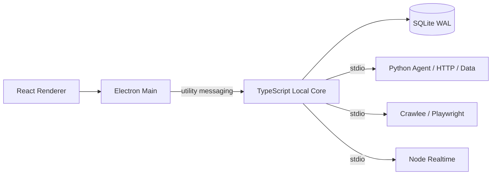

# BiliMonitor Desktop

BiliMonitor Desktop 是从 BiliMonitor 领域经验出发重新设计的本地优先桌面应用，面向社交平台采集、数据整理、AI 分析和 Agent 工作流。它不依赖远程业务后端，也不要求本机维护数据库服务、消息队列、容器或 WSL。

当前已从 Slice 0 框架进入 Slice 1：樱花雾白工作台中的“平台与账号”和“监控对象”已接通真实 Local Core、SQLite v2 与类型化 IPC，可在本地创建、查询账号和对象，并原子写入绑定、粉丝监控策略与 Outbox。其他业务页面仍以演示 ViewModel 为主，尚不包含生产可用的 Bilibili 登录和在线采集。

## 当前技术栈

| 领域 | 选择 |
| --- | --- |
| 桌面与 UI | Electron 43、React 19、TypeScript 7、electron-vite |
| 本地核心 | TypeScript Local Core，运行在 Electron `utilityProcess` |
| 控制数据 | Node `node:sqlite`、SQLite WAL、schema migration |
| 进程契约 | JSON Schema + Zod + Pydantic；utility messaging / NDJSON stdio |
| HTTP 爬虫 | Python Scrapy + httpx |
| 浏览器爬虫 | Node Crawlee + Playwright |
| 实时采集 | Node WebSocket Worker |
| Agent | PydanticAI + LangGraph + Pydantic Evals + MCP |
| 本地分析 | DuckDB + PyArrow + Parquet |

项目源码只使用 TypeScript、Python、PowerShell、SQL 和声明式配置，不包含 C、C++、Rust 源码或对应编译工具链。第三方依赖只安装官方/上游预编译产物。

## 运行结构



应用不开放业务 HTTP/TCP 端口。Renderer 只能访问窄化 Preload API；Local Core 独占控制数据库；高风险 Tool、网络和文件能力后续统一经过 Policy/Approval。

## 目录

```text
apps/desktop/          Electron Main、Preload 与 React Renderer
packages/contracts/    JSON Schema、Zod DTO 和 Runtime Envelope
packages/core-runtime/ TypeScript Local Core
packages/storage/      SQLite WAL 与迁移
packages/task-engine/  Durable Task 状态机
workers/python/        Agent、Scrapy、DuckDB/PyArrow Worker
workers/node-browser/  Crawlee/Playwright Worker
workers/node-realtime/ WebSocket Worker
scripts/               D 盘 bootstrap、dev、check、build
docs/                   架构、ADR、UI 与路线图
```

## 本地开发

所有项目工具、缓存、临时文件、浏览器、构建物和运行数据都会固定到当前 D 盘仓库；Python 基础解释器来自 E 盘，项目 venv 位于 D 盘。脚本会拒绝 C 盘数据目录或 C 盘 Python base runtime。

```bat
bootstrap.cmd
dev.cmd
check.cmd
build.cmd
```

首次 `bootstrap.cmd` 会准备 Node 24 LTS、pnpm 11、Python 依赖、Crawlee/Playwright Chromium 和锁文件依赖。不要绕过脚本调用 C 盘全局 `pnpm` 或 `python`。

## 当前边界

已实现：D 盘环境隔离、Local Core utility process、真实 Bootstrap、SQLite schema v2、Task/Approval/Outbox 表、跨语言协议、Python/Browser/Realtime Worker 骨架，以及平台账号/监控对象的真实 UI Projection。Renderer 仅通过 5 个窄化业务方法访问 Core；Cookie、Token 和二维码登录材料不会进入业务 DTO 或控制数据库。

当前 Slice 1 增量的实现与验收范围见 [账号与监控对象纵切](docs/implementation/slice-1-account-subject.md)。下一增量是 Windows Secret Vault、B站扫码、Bilibili HTTP Connector、Object CAS、粉丝快照和趋势投影。

## 文档

- [当前运行时蓝图](docs/architecture/typescript-python-local-runtime.md)
- [完整业务实现规格](docs/architecture/local-native-business-implementation.md)
- [ADR-0006](docs/adr/0006-typescript-python-local-runtime.md)
- [本地开发环境](docs/development.md)
- [实施路线图](docs/roadmap.md)
- [初版桌面 UI 设计](docs/ui/initial-ui-design.md)
