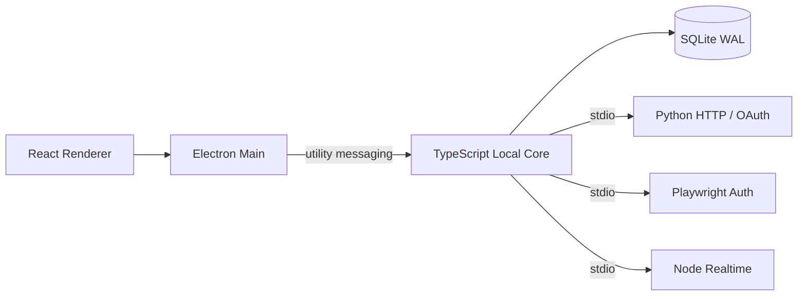

# BiliMonitor Desktop

2026-10-06 按用户要求保存本地提交快照，业务迁移保持暂停：最新完成[粉丝立即刷新](docs/implementation/2026-10-05-follower-manual-refresh-audit.md)的原业务对齐及定向回归，此前[间隔保存](docs/implementation/2026-10-05-follower-interval-audit.md)、[添加成功链](docs/implementation/2026-10-05-follower-add-flow-audit.md)、[Long64精确链路](docs/implementation/2026-10-05-follower-long64-audit.md)与[UID输入](docs/implementation/2026-10-05-follower-uid-input-audit.md)保留。提交前完整检查仍有1项旧趋势测试超时；类型检查、Python1003项及生产构建单独通过，不冒称全量绿色。当前状态、提交范围及恢复顺序见[提交快照](docs/implementation/2026-10-06-commit-snapshot.md)和[全量台账](docs/implementation/2026-09-13-full-migration-tracker.md)。本次不推送GitHub、不更新已安装客户端，不代表粉丝模块或全部业务迁移完成。

BiliMonitor Desktop 是把原 BiliMonitor B/S 项目的真实业务改造成完全本地桌面应用的独立仓库。它不依赖远程业务后端，也不要求本机维护数据库服务、消息队列、容器或 WSL。

当前导航只显示已接到本地 Contract、Core、SQLite、Worker、IPC 与真实 UI 的原业务：B站用户工作台、粉丝监控、扫码登录、直播间 REST、实时弹幕、观众/大航海榜、直播场次、数据中心、场次洞察与导出，以及抖音本人 Web/OAuth 登录态。源码中的 SQLite schema 为 v14；敏感凭据由 Electron `safeStorage` 封装的本机密钥进行 AES-256-GCM 加密。B站真人扫码和抖音真人扫码/开放平台授权仍是发布前手工验收项，不把未执行的人机操作写成已通过。

原项目更新至 `fa2faa6` 后正在重新逐项迁移、验收，已有入口不代表全部业务等价。最新范围及未完成项见 [全量迁移台账](docs/implementation/2026-09-13-full-migration-tracker.md)。当前场次面板读取最近 20 场，数据中心/分析可选择最近 200 场；查询数量非正数回退 20、超过 200 截断为 200。

直播导出建议名称为 `主播名-2026-09-13-第1次导出-弹幕.csv`，昵称为空回退 UID，按原规则清理文件名并截取最多 80 个 Unicode 码点。每位主播按北京时间日期累计编号，不同场次与 CSV/XLSX/ZIP 共享；已经生成但未保存、或文件写入失败，已分配编号不复用。v12 仅新增本地每日计数表，不删除历史场次；重新启动客户端后自动升级，构建通过不等于已更新安装包。

直播间的展开详情与用户工作台共用弹幕/观众/大航海组件：每 2 秒读取最近 60 条弹幕并展示 UID，支持未开播监听、协议选择、阅读时暂停自动滚动。榜单按类型保留排序与选择，只刷新当前选中榜单（最多 4 页），显示陪伴天数/大航海等级；读取失败保留组件内上次数据，重新打开时读取最新本地快照。此项不代表独立弹幕页、全部榜单采集规则及全量业务已验收。

直播间列表、汇总、全部房间趋势及用户资源绑定不再隐含截断为 100/500 间；显式列表 limit 仍保留兼容。历史未传或非正数取最近 500 点，正数最大 2000 点，按时间升序返回；起止包含边界，支持时区偏移和微秒。事件缺省取最近 20 条，请求数限制在 1..200。详见[直播查询迁移审计](docs/implementation/2026-09-13-live-query-audit.md)。

[直播采集与快照应用](docs/implementation/2026-09-13-live-collection-audit.md)现按原规则只回填资料/关注，不把旧热度和开播时间当作新事实；重新添加与普通采集区分处理，旧结果重新添加只激活设置，事件按实际落库时间记录。原重试类别/次数/退避、失败来源、场次与快照事务顺序均有真实SQLite回归；数据库/场次内部错误不冒充平台失败。

[直播Python与Worker链路](docs/implementation/2026-09-13-live-worker-audit.md)已补0分区/short ID、昵称与字段回退、时间解析、旧接口空结果及原错误分类；共享契约校验输入/输出，真实Python子进程→NDJSON→Core→SQLite验证中文、错误metadata与原始响应证据。测试仅替换外部HTTP，不能代替真人平台/原生安装包验收。原宽松数值范围、边缘解析与配置仍在M08待办中，不代表全量迁移完成。

v13 按原业务保留接口返回的有符号热度/关注计数，不用负值错误拒绝整批采集；契约、房间/快照存储和用户工作台投影同步兼容。升级仅移除两张直播表的非负计数约束，保留记录、rowid、索引和关联，并在事务提交前检查外键。新代码启动时才执行升级；直播计数超过 JavaScript 安全整数范围仍待完整迁移。

v14 仅移除粉丝监控/快照四个计数的额外非负约束，保留监控/绑定正 UID、记录身份、rowid、索引、触发器、视图及外键；失败原子回滚，重开幂等。粉丝计数在内核/SQLite 使用 bigint，在 v2 通信使用精确十进制字符串，覆盖原 signed64 数值与回绕差分；旧 v1 无法准确表示的值明确失败，不静默舍入。粉丝及工作台的文本、合计、排序、趋势轴和提示也走精确路径。没有打开用户实际数据库、制作安装包或更新已安装客户端，原生及真人验收仍未完成。

粉丝页[添加UID输入](docs/implementation/2026-10-05-follower-uid-input-audit.md)按用户确认保留精度，兼容前导零、空白、正号及结果为整数的科学/进制写法；真实小数、非正数和Long越界在本地拒绝，不发采集请求。未恢复原网页的Number舍入缺陷；失败保留草稿。[添加成功链](docs/implementation/2026-10-05-follower-add-flow-audit.md)已恢复提交清UID/保留间隔、共享读完成后清理与最多4人自动选择、raw-ID趋势请求及独立成功确认；旧请求不影响新抽屉。重读失败保留旧数据且不回滚或重试成功添加，不代表M06已完整验收。

[直播调度与退出恢复](docs/implementation/2026-09-13-live-lifecycle-audit.md)已恢复原默认每秒到期扫描，按每批完成后的固定延迟执行，保留1500ms接口限流。关闭Core立即停止直播采集，取消限流/重试等待，迟到成功或失败不再写库；重启按本地保存的启用、间隔、到期和退避状态恢复。实际Python子进程退出已自动验证，原生安装应用验收仍单列。

[直播自动采集配置](docs/implementation/2026-09-13-live-collection-configuration-audit.md)从实际D盘数据目录的 `config/bilibili-live-collection.json` 读取，重启生效；[示例文件](config/bilibili-live-collection.example.json)包含已实现的 `enabled`、`schedulerDelayMs`、`dueBatchSize`、`statusBatchSize`，缺省分别true/1000/20/30，支持原同名环境变量覆盖。关闭自动REST不禁用手工操作或粉丝/弹幕调度；30只是默认批量，不再是Worker硬上限。配置错误在建库前拒绝，并经bootstrap返回不含堆栈/启动诊断的明确提示。后续已接入[间隔、限流、重试与失败退避策略](docs/implementation/2026-09-13-live-collection-policy-audit.md)，并接入[四个REST端点的HTTP配置与请求存活](docs/implementation/2026-09-13-live-http-lifetime-audit.md)，示例现包含17项配置。配置默认值不改已有房间排程，手工输入/数据库仍限1..2592000秒；[榜单及其WBI HTTP配置、长请求/退出处理](docs/implementation/2026-09-13-rank-http-audit.md)随后已接入，并补真实Python管道失联验证；[Node弹幕三端点HTTP配置、请求存活与在途取消](docs/implementation/2026-09-25-danmaku-http-audit.md)已接入；随后接入[storageEnabled及工作台开关](docs/implementation/2026-09-25-live-storage-audit.md)：直播存储关闭时不创建相关服务/调度，原工作台必须显式一并关闭（`config/subject-monitor.json` 的 `enabled=false`），冲突在建库前报错；关闭不删除历史。完整弹幕业务及原生应用验收仍未完成。

[粉丝监控启动配置](docs/implementation/2026-09-26-follower-configuration-audit.md)独立支持16项原设置及环境覆盖：区分停止自动扫描与关闭全部粉丝存储业务，工作台依赖同时校验，关闭再启用保留历史/绑定。默认启动即扫描、每批完成后等待1秒；间隔、批量、重试/退避和HTTP设置贯通到Python。直播遮罩昵称使用独立无落盘查询，不要求开启粉丝存储，也不产生无引用原始响应文件；长请求保活、父管道失联取消和迟到写库保护已有自动回归。完整Spring绑定、解析域及共享限流仍在后续清单。

[直播监控操作区](docs/implementation/2026-09-13-live-monitor-panel-audit.md)现按原页面显示横向房间列表、默认首房详情、八项事实字段与完整性提示；卡片每秒显示采集节奏，优先显示暂停/异常，倒计时不发起采集。间隔草稿跨收起、切房及页签保留，成功保存后清理，失败不丢失；按原规则夹取1..2592000秒并使用相对步长，滚轮不会误改值。添加成功展开实际返回房间，包含复用已有房间；浅粉白/深色与窄窗口已做浏览器回归。详情场次区仍保留在M11，不等于全量迁移完成。

[直播趋势](docs/implementation/2026-09-13-live-trend-audit.md)在房间页同页展示，也保留独立页签；最多4房按选择顺序采用单图/双列/主次/2×2布局。最近500点使用真实时间、原轴留白和精确万/亿格式，鼠标/键盘可看具体值；缺失热度沿用原页面以0绘图，但空心点与提示明确原始值缺失，不写假快照。历史不足依次回退近期快照和当前值参考。选房180ms合并、成功重读刷新、清空后成功重读恢复live-first；旧在途结果和15秒缓存不再挡住新数据。浅粉白/深色、窄屏及错误重试已做隔离浏览器回归。

[直播整体刷新与状态事件](docs/implementation/2026-09-13-live-overview-audit.md)现按原loadAll规则，房间、汇总和最近20条事件全部读取成功后一起更新；任一路失败保留完整旧投影，首次失败不冒充空数据。汇总恢复“最近状态变化”，事件同页展示当前主播名、六类原事件名称和每秒更新的相对时间。命令成功后立即标记间隔已保存或关闭被删除房间的详情，后续读取失败不回滚成功事实；删除后重新添加相同房间号使用新监控ID，不复用旧趋势。全部沿用本地桥接，15秒轮询只读本地投影，不新增业务服务。

粉丝查询默认返回全部监控用户，不再默默截断为 100/500 人；界面仍最多选 4 人对比。历史查询未传/非正数取最近 500 点，最大 2000 点，按时间升序返回；`from/to` 包含边界并支持时区和微秒精度。页面沿用原项目的最近 500 点查询，不是固定小时范围。采集仅重试网络、HTTP 限流与服务端错误；卡片成功但无头像时清掉旧值，relation/stat 回退保留原资料。

粉丝页现按原业务展示总粉丝、最近净增、最早排程及间隔汇总；横向用户块显示每秒更新的采集节奏，点击或键盘展开一位用户的详情。切换/收起保留各用户未保存的间隔草稿，后台重读不覆盖草稿，删除仍需确认。界面倒计时不发起采集；手动立即刷新按原页面不设置自动“采集中”标记或重复点击锁，失败不重读，成功等待共享列表读取但不等待历史，列表读取失败仍确认已完成刷新。

勾选用户后在同页显示趋势：1人单图、2人双列、3人主次、4人网格；拖动或键盘按钮交换位置。图表按真实时间间距、原数值/时间轴留白显示最近500点，支持万/亿刻度和鼠标/键盘数值提示；无完整历史时依次使用最近快照、已知当前值单点（标为“当前值参考”，不落库伪造快照）。本地历史读取按180ms合并、单请求在途、120ms补读，刷新提示至少700ms、结果提示900ms；失败保留已有图，迟到数据和旧错误不串到新用户，清空选择/离开页面停止后续读取。

粉丝监控已补齐[逐操作代码与自动闭环审计](docs/implementation/2026-09-13-follower-workflow-audit.md)：通过实际 Preload 校验、Core、SQLite 验证增删改、失败退避、历史和重开保留。Core 停止时取消粉丝限流/重试等待，迟到结果不再写库，也不把退出当作平台失败。测试替换了 Electron 传输和外部平台响应；真人采集、原生客户端/安装包验收及 M07 登录等后续业务仍见全量台账，不代表全部迁移完成。

B站登录交互已补未登录刷新状态、扫码期间刷新二维码、成功账号展示、凭据分字段/完整复制和操作反馈；关闭弹窗后的迟到结果不再回填，新旧二维码轮询保持单请求在途。界面已独立审查，窄屏单列覆盖问题已修复。合成数据浏览器回归不使用真实凭据或系统剪贴板。

登录采集与本地生命周期已补[逐操作审计](docs/implementation/2026-09-13-bilibili-auth-core-audit.md)：HTTP会话Cookie和登录展示Cookie分离，保留原响应优先级、删除/到期与作用域；二维码计时、清理和重复激活有回归。撤销、换账号或退出后的旧响应不能恢复凭据，未知内部错误不再误判过期。真实Preload校验/Core/隔离SQLite验证六类操作与重开恢复。

[登录与弹幕联动](docs/implementation/2026-09-13-auth-danmaku-link-audit.md)现只在凭据首次激活后升级匿名连接，保留原协议和自动/手动归属；单房失败不阻断后续房间，重复扫码成功回读不再触发断线。按原业务，撤销仅停用凭据，不强制关闭已有LOGIN连接，后续建连不再携带旧凭据。应用退出会取消在途建连并终止专属Worker，迟到事件不写关闭的数据库。真人扫码、原生客户端及M09全部弹幕规则仍待验收。

## 当前技术栈

| 领域 | 选择 |
| --- | --- |
| 桌面与 UI | Electron 43、React 19、TypeScript 7、electron-vite |
| 本地核心 | TypeScript Local Core，运行在 Electron `utilityProcess` |
| 控制数据 | Node `node:sqlite`、SQLite WAL、schema migration |
| 进程契约 | JSON Schema + Zod + Pydantic；utility messaging / NDJSON stdio |
| HTTP / OAuth Worker | Python httpx |
| 浏览器登录 Worker | Node Playwright |
| 实时采集 | Node WebSocket Worker |
| 当前业务分析 | TypeScript Core + SQLite 查询投影 |

项目源码只使用 TypeScript、Python、PowerShell、SQL 和声明式配置，不包含 C、C++、Rust 源码或对应编译工具链。第三方依赖只安装官方/上游预编译产物。

## 运行结构



应用不开放业务 HTTP/TCP 端口。Renderer 只能访问窄化 Preload API；Local Core 独占控制数据库；当前未实现的 AI、Agent、Tool 能力不对外声明。

## 目录

```text
apps/desktop/          Electron Main、Preload 与 React Renderer
packages/contracts/    JSON Schema、Zod DTO 和 Runtime Envelope
packages/core-runtime/ TypeScript Local Core
packages/storage/      SQLite WAL 与迁移
packages/task-engine/  Durable Task 状态机
workers/python/        B站 HTTP 与抖音 OAuth Worker
workers/node-browser/  Playwright 登录 Worker
workers/node-realtime/ WebSocket Worker
scripts/               D 盘 bootstrap、dev、check、build
docs/                   架构、ADR、UI 与路线图
```

## 本地开发

所有项目工具、缓存、临时文件、浏览器、构建物和运行数据都会固定到 D 盘；Python 基础解释器来自 E 盘，项目 venv 位于 D 盘。运行目录和导出保存位置会拒绝 C、E 与 UNC 路径，只接受 `D:\`。

```bat
bootstrap.cmd
dev.cmd
check.cmd
build.cmd
```

首次 `bootstrap.cmd` 会准备 Node 24 LTS、pnpm 11、Python 依赖、Crawlee/Playwright Chromium 和锁文件依赖。不要绕过脚本调用 C 盘全局 `pnpm` 或 `python`。

## Windows 安装包与运行数据

```bat
build.cmd -Package
```

安装目录固定为 `D:\BiliMonitor Desktop`，不可改到系统盘；可变数据固定为 `D:\BiliMonitor Desktop Data`，升级和卸载不会删除其中的 SQLite、CAS、凭据、Chromium Profile 与导出文件。安装包内自带 Python Worker、Node Worker 和 Playwright Chromium，不依赖开发仓库的 Python 环境。

## 抖音 OAuth 正式配置

首次启动会生成：

```text
D:\BiliMonitor Desktop Data\config\douyin-oauth.env.example
```

复制为同目录的 `douyin-oauth.env`，填写抖音开放平台的 `client key`、`client secret`，并把回调地址配置为 `bilimonitor://douyin-oauth`，然后重启应用。应用会立即使用 Electron `safeStorage` 将完整配置加密为 `douyin-oauth.secure`，并删除明文 `douyin-oauth.env`。浏览器 Worker、爬虫 Worker 和 Renderer 都拿不到 client secret。

## 当前边界

当前业务事实源为原仓库 `fa2faa6`，按全量迁移台账逐项核对真实功能。Mock/占位页面不在桌面导航中冒充已实现业务；Platform adapter、CollectTask run-once 等已有接口继续按 M16/M17 核实可执行行为，不能仅因相邻页面使用 Mock 就整体排除。新的 AI、Agent 扩展暂不开发，不缩减原项目真实功能的迁移范围。

历史控制器、Service、状态机和本地映射见 [原 B/S 业务复刻基线](docs/implementation/original-bs-business-parity.md)；当前状态以[全量迁移台账](docs/implementation/2026-09-13-full-migration-tracker.md)为准。

## 文档

- [当前运行时蓝图](docs/architecture/typescript-python-local-runtime.md)
- [ADR-0006](docs/adr/0006-typescript-python-local-runtime.md)
- [本地开发环境](docs/development.md)
- [实施路线图](docs/roadmap.md)
- [初版桌面 UI 设计](docs/ui/initial-ui-design.md)
