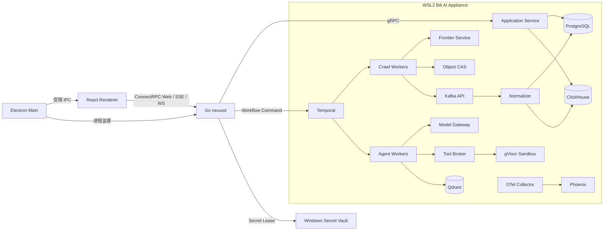
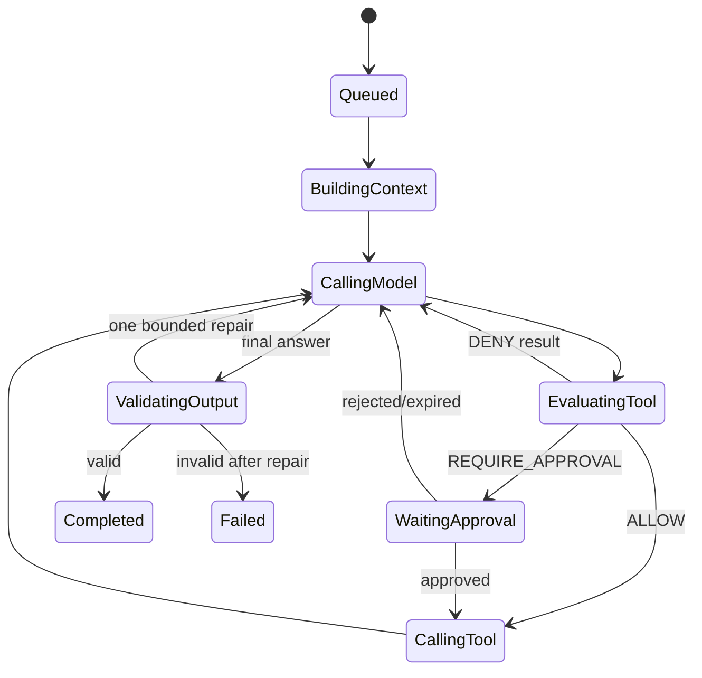

# BiliMonitor Desktop 详细技术与业务实现规格

> 状态：Superseded by [本地原生业务与技术实现规格](local-native-business-implementation.md)。本文保留本地服务集群方案，不再作为实现依据。
>
> 适用范围：当前 UI 定义的 19 个工作区，以及其背后的采集、直播、数据、AI、Agent、扩展和治理能力。

## 目录

- [1. 目标、范围和硬约束](#1-目标范围和硬约束)
- [2. 架构方案比较与最终选择](#2-架构方案比较与最终选择)
- [3. 运行拓扑与进程边界](#3-运行拓扑与进程边界)
- [4. 详细技术栈](#4-详细技术栈)
- [5. 代码组织与模块依赖](#5-代码组织与模块依赖)
- [6. 契约、通信和一致性](#6-契约通信和一致性)
- [7. 数据平面](#7-数据平面)
- [8. 爬虫执行体系](#8-爬虫执行体系)
- [9. AI、Agent 和知识体系](#9-aiagent-和知识体系)
- [10. 19 个工作区的逐功能实现](#10-19-个工作区的逐功能实现)
- [11. 端到端业务流程](#11-端到端业务流程)
- [12. 安全、故障与恢复](#12-安全故障与恢复)
- [13. 测试、验收与质量门禁](#13-测试验收与质量门禁)
- [14. 实施切片与交付顺序](#14-实施切片与交付顺序)

## 1. 目标、范围和硬约束

### 1.1 产品目标

BiliMonitor Desktop 是完全本地运行的社交平台数据与 Agent 工作台。桌面应用负责交互，本地 Appliance 负责长期运行的采集、实时连接、数据处理、模型推理和 Agent 工作流。远程平台请求和用户明确启用的 AI API 是唯一默认出站流量。

设计优先级从高到低为：

1. 能力上限、数据可追溯性和长期可演进性。
2. 爬虫、实时流、AI 和 Agent 的运行时隔离与可恢复性。
3. 本地安全、凭据保护和高影响动作的人类控制权。
4. UI 的一致性、实时性和复杂工作台体验。
5. 安装体积、实现成本和重复开发成本。

### 1.2 硬约束

- Windows 11 首发；Linux/macOS 只要求契约和核心代码不被 Windows 路径绑死。
- 默认单用户、单工作空间，但所有权威记录保留 `workspace_id`。
- Renderer 不持有 Secret、不连接数据库、不运行平台网页、不直接控制 WSL2。
- 所有长任务必须持久化、可取消、可恢复、可观察，不以 UI 进程存活为前提。
- 原始证据必须先于解析结果落盘；解析失败不能导致原始数据丢失。
- Agent 不拥有任意 SQL、Shell、浏览器、网络和文件系统权限。
- 验证码、风控和账号异常进入人工检查，不实现绕过。
- 每类状态只有一个权威所有者；投影、索引和缓存均可重建。
- 大对象只通过 `ObjectRef` 传递，不能进入 Temporal History、Kafka 消息或普通 RPC Body。

### 1.3 本文与现有文档的关系

- ADR 决定技术方向，本文不改变已接受的关键边界。
- `initial-ui-design.md` 定义用户可见的信息架构和交互。
- `product-model.ts` 是当前 19 个工作区和业务能力清单。
- 本文把页面、命令、工作流、事件、表、Worker 和验收条件逐项对应起来。

## 2. 架构方案比较与最终选择

| 方案 | 结构 | 优点 | 上限问题 | 结论 |
| --- | --- | --- | --- | --- |
| A. Electron + Python 单 Core | 单进程 API、SQLite、内嵌调度 | 简单、启动快 | 实时流、浏览器、Agent、GPU 和恢复状态互相拖累 | 仅保留为 Spike，不作为目标架构 |
| B. Electron + 本地 Kubernetes 全微服务 | 所有模块独立部署 | 调度和横向扩展能力强 | 本地生命周期、升级和诊断复杂度过高，业务边界容易被基础设施反向塑造 | 远程 Worker 阶段使用，不作为首发本地形态 |
| C. 本地能力平台 | Windows 控制面 + WSL2 Appliance + OCI 多运行时 | 兼顾桌面体验、运行时隔离、持久化工作流和未来远程扩展 | 服务和多语言供应链较复杂 | **采用** |

最终选择 C。Appliance 首发用 `systemd + OCI Compose` 管理稳定服务；远程 Worker 或多机阶段复用相同 Proto、Temporal Task Queue 和 Kafka Topic，通过 Helm 部署。这样本地与未来分布式形态不需要重写业务协议。

## 3. 运行拓扑与进程边界



### 3.1 Electron Main

只负责桌面系统能力：窗口、托盘、通知、协议链接、文件选择、自动更新、`nexusd` 生命周期和崩溃恢复。它不包含业务查询、爬虫规则或 Agent 逻辑。

安全配置固定为：`contextIsolation=true`、`sandbox=true`、`nodeIntegration=false`。Preload 只暴露 `selectExportPath`、`openExternal`、`getDesktopStatus` 等具体方法，不提供通用 channel。

### 3.2 React Renderer

只持有展示状态、编辑草稿和可丢弃缓存。所有业务状态通过 Query 获取，所有写操作通过 Command 提交。Renderer 退出不能改变 Campaign、直播连接、导出或 Agent Run 的结果。

### 3.3 `nexusd`

Go 控制面负责：

- 启停和升级 WSL2 Appliance，维护服务健康状态机。
- 为 Renderer 提供单一 loopback Gateway，校验 Origin、Host 和启动会话令牌。
- 将 ConnectRPC-Web 转为内部 gRPC，聚合 SSE/AG-UI/WebSocket。
- 调用 Windows Credential Manager/DPAPI，签发短期 Secret Lease。
- 执行 OPA Policy、审批检查、出站分类和桌面文件能力授权。
- 生成 `correlation_id`、传播 `traceparent`，并维护 UI 需要的健康投影。

`nexusd` 不保存平台 Cookie、Agent Prompt、Parser 或业务实体。

### 3.4 Application Service

Python 实现模块化应用服务，使用 Pydantic 作为领域边界、SQLAlchemy 2 + asyncpg 访问 PostgreSQL，gRPC 作为内部入口。它负责聚合不变量、Command Handler、Query Handler、Outbox 和 UI Projection，不直接执行长时间抓取或模型推理。

### 3.5 Appliance

- 数据和容器层位于 WSL2 ext4 VHD，禁止把 PostgreSQL、ClickHouse 或对象库放在 `/mnt/c`。
- 服务使用内部网络和 mTLS 身份；除 `nexusd` 管理通道外不向 Windows LAN 暴露。
- GPU Worker 通过 WSL2 GPU passthrough 使用 NVIDIA runtime；无 GPU 时自动降级到远程模型或 llama.cpp。
- OCI runtime 使用 containerd；内置受信服务使用 runc，第三方工具和扩展使用 runsc/gVisor；开发和单机编排使用 nerdctl compose。
- 内置服务由 systemd 保活；业务 Worker 由 Temporal Task Queue 和 OCI runtime 管理。
- Appliance 内部服务使用 SPIFFE/SPIRE 工作负载身份和短期 mTLS SVID，远程 Worker 沿用同一身份模型。

## 4. 详细技术栈

### 4.1 桌面与前端

| 层 | 选择 | 具体用途 |
| --- | --- | --- |
| Desktop | Electron + electron-vite | 桌面窗口、安全沙箱、打包和更新 |
| UI | React 19 + TypeScript strict | 高复杂度工作台和 Agent 客户端生态 |
| 路由 | TanStack Router | 类型安全深链接、URL 过滤条件、详情抽屉 |
| Server State | TanStack Query | Query 缓存、失效、离线快照、重连 |
| Client State | Zustand | 侧栏、主题、布局草稿、命令面板 |
| 表单 | React Hook Form + Zod | 向导、Schema 表单和前端即时校验 |
| 表格 | TanStack Table + Virtual | 百万级数据的服务端分页和可视区渲染 |
| 图表 | Apache ECharts | 时序、热力、漏斗、分布和大屏降采样 |
| 图编辑 | React Flow | Agent、Workflow、Identity 和数据血缘图 |
| 编辑器 | Monaco Editor | Prompt、JSON Schema、策略和高级查询模板 |
| API | ConnectRPC generated client | Proto 生成的强类型 Query/Command |
| 流式 | AG-UI/SSE + WebSocket | Agent 事件、投影变化和高频现场流 |
| 测试 | Vitest + Testing Library + Playwright | 组件、契约、键盘和 Electron E2E |

前端功能目录按业务域拆分，不按页面大文件拆分。每个 Feature 包含 `routes/`、`api/`、`model/`、`components/`、`screens/` 和 `tests/`。

### 4.2 控制面与业务服务

| 组件 | 技术 | 边界 |
| --- | --- | --- |
| `nexusd` | Go、connect-go、gRPC、OPA、OTel | Gateway、Policy、Secret、Appliance 生命周期 |
| Application Service | Python、Pydantic、SQLAlchemy、asyncpg | 聚合、Command/Query、Outbox、Projection |
| Temporal | Temporal Server + 多语言 SDK | 长任务、重试、Signal、版本和恢复 |
| Event Bus | Apache Kafka KRaft | 高频事实、异步投影和可重放数据管道；本地单节点、远程可扩集群 |
| Schema | Protobuf + Buf | 跨 TS/Go/Python/Rust 契约和 Breaking Check |

### 4.3 采集与处理

| Worker | 技术 | 适用场景 |
| --- | --- | --- |
| HTTP Worker | Scrapy + selectolax/lxml + httpx 辅助客户端 | 高吞吐 HTTP、分页、批量资料和内容 |
| Browser Worker | Node.js + Crawlee + Playwright | 登录、动态页面、复杂交互和 HAR/截图 |
| Realtime Worker | Rust Tokio + tokio-tungstenite | 弹幕 WebSocket、心跳、重连和二进制协议 |
| Media Worker | FFmpeg/ffprobe + 受控下载器 | 音视频元数据、分段和可选媒体留档 |
| Normalizer | Python 批处理 Worker | Parser、实体归一化、Outbox 和批量写入 |
| Frontier | Go + Pebble | URL 去重、优先队列、租约、延迟重试和快照 |

### 4.4 AI 与 Agent

| 层 | 选择 | 说明 |
| --- | --- | --- |
| 默认 Agent Runtime | PydanticAI + Temporal | 类型化输出、工具调用和可恢复业务流程 |
| 图式 Runtime | LangGraph Adapter | 仅用于显式图状态、分支和时间旅行 |
| 统一模型入口 | LiteLLM + Native Adapter | 通用协议和厂商高级能力并存 |
| 本地 LLM | vLLM 默认，SGLang 基准候选，llama.cpp 兜底 | GPU 服务、复杂推理和 GGUF/CPU |
| Embedding/Rerank | TEI 或独立原生服务 | 批量向量和重排，不与生成模型进程争用 |
| 检索 | Qdrant Dense/Sparse + RRF | 混合检索、过滤、多向量和 Alias 切换 |
| Agent 观测 | OpenTelemetry + Phoenix | Trace、Dataset、Experiment 和 Evaluation |
| 工具互操作 | Tool Broker + MCP | 发现、版本、授权、调用和审计 |
| 策略 | OPA + 短期 PASETO Capability Token | 资源、网络、文件、凭据和影响级别 |

## 5. 代码组织与模块依赖

目标仓库结构：

```text
apps/
  desktop/                 Electron Main / Preload / React Renderer
services/
  nexusd/                  Go 本地控制面
  application/             Python Command、Query、Projection
  frontier/                Go Frontier Service
  normalizer/              Python 规范化管道
  model-gateway/           Python 模型目录、路由和 Provider Adapter
  tool-broker/             Go 工具授权与执行代理
workers/
  crawler-http/            Scrapy Worker
  crawler-browser/         Crawlee + Playwright Worker
  crawler-realtime/        Rust Tokio Worker
  crawler-media/           FFmpeg Worker
  agent-pydantic/          默认 Agent Worker
  agent-langgraph/         可选图式 Agent Worker
  knowledge-indexer/       提取、切片、Embedding、索引
packages/
  proto/                   Proto 源文件与 Buf 配置
  contracts-ts/            生成的 TypeScript 契约
  ui/                      设计 Token 和无业务通用组件
  connector-sdk-python/    Connector/Parser SDK
  tool-sdk-python/         Tool SDK
  testing/                 Fixture、Fake Provider、Contract Harness
plugins/
  builtin/bilibili/        内置 B站能力
  builtin/douyin/          内置抖音认证能力
deploy/
  appliance/               OCI Compose、systemd、迁移和健康脚本
  helm/                    远程 Worker 扩展
docs/
```

依赖规则：

1. `domain` 不依赖数据库、Temporal、Kafka、Playwright 或模型 SDK。
2. Application Handler 只依赖 Port；基础设施通过 Adapter 注入。
3. Connector 不能直接写数据库，只返回版本化 Envelope 和 ObjectRef。
4. Worker 不能直接读取 Secret 表，只能使用短期 Lease。
5. UI 只依赖生成契约和 ViewModel，不依赖数据库字段。
6. 插件只能调用 SDK 中声明的 Host API，不能 import 宿主内部包。

## 6. 契约、通信和一致性

### 6.1 Proto 服务划分

```text
bili/v1/common.proto
bili/v1/overview.proto
bili/v1/subjects.proto
bili/v1/campaigns.proto
bili/v1/live.proto
bili/v1/assets.proto
bili/v1/agents.proto
bili/v1/knowledge.proto
bili/v1/models.proto
bili/v1/evaluations.proto
bili/v1/accounts.proto
bili/v1/connectors.proto
bili/v1/identity.proto
bili/v1/tools.proto
bili/v1/operations.proto
bili/v1/extensions.proto
bili/v1/governance.proto
bili/v1/settings.proto
```

Buf CI 必须执行 lint、breaking 和 TS/Go/Python/Rust 代码生成。字段只追加不复用；未知枚举在 UI 显示 `UNKNOWN(value)`；破坏性变化发布 `v2`。

### 6.2 Command 与 Query

- Query 无副作用，使用不透明 `page_token`，支持安全重试和 ETag。
- Command 必须携带 `idempotency_key` 和期望 `etag/version`。
- 立即操作返回新资源；长任务返回 `operation_id` 或 Workflow Projection。
- 高影响 Command 返回 `approval_required`，同时提供 `approval_id`、原因和缩减范围建议。
- 批量 Command 每一项单独返回状态，不使用全有或全无掩盖局部失败。

### 6.3 事件信封

每个事实事件包含：

```text
event_id, event_type, schema_version, occurred_at, observed_at,
producer, workspace_id, correlation_id, causation_id, traceparent,
partition_key, idempotency_key, payload, object_refs
```

业务事务和 Outbox 在同一 PostgreSQL 事务提交。Outbox Relay 发布 Kafka 后记录 broker offset；消费者以 `event_id` 建幂等收件箱。系统保证 at-least-once 传递和业务幂等，不声称端到端 exactly-once。

### 6.4 实时通道

- SSE：低频 Projection、Operation、Activity Rail 和系统状态。
- AG-UI over SSE：Agent Token、Step、Tool、Approval、Artifact。
- WebSocket：所选直播房间的聚合指标和有限字段弹幕。
- 断线恢复：先 Query 权威 Projection，再以 `last_event_id` 请求可补偿增量；事件窗口外则全量刷新。
- Renderer 背压：现场流按房间和事件类型订阅，服务端聚合/采样；原始高频流不进入 DOM。

## 7. 数据平面

### 7.1 状态所有权

| 数据 | 权威所有者 | 重建来源 |
| --- | --- | --- |
| Workspace、Subject、Campaign、账号引用、Agent 定义 | PostgreSQL | 备份 + 审计事件 |
| Workflow 内部历史 | Temporal | Temporal 持久层 |
| Frontier 状态 | Frontier/Pebble | Snapshot + Campaign 事件 |
| 高频事实 | Kafka 保留窗口 | Object CAS 原始证据或上游重放 |
| 当前业务投影 | PostgreSQL | Kafka + 权威实体 |
| 分析明细 | ClickHouse | Kafka/Object CAS 重放 |
| 向量与稀疏索引 | Qdrant | KnowledgeSource + Object CAS |
| 原始响应和 Artifact | Object CAS | 不可变主对象 |
| 凭据明文 | Windows Secret Vault | 加密备份与密钥恢复流程 |

### 7.2 PostgreSQL

按 Schema 拆分：`core`、`crawl`、`live`、`agent`、`knowledge`、`model`、`tool`、`identity`、`governance`、`operations`。主要表统一包含 `workspace_id`、`created_at`、`updated_at`、`version`；追加写表只含 `recorded_at`。

关键约束：

- `platform_account(platform, external_id)` 唯一。
- `subject_account_binding(subject_id, platform_account_id, valid_to)` 只允许一个有效关系。
- `campaign(idempotency_key)`、`agent_run(idempotency_key)` 唯一。
- `live_session(room_id, natural_session_key)` 唯一并允许后续修正边界。
- `agent_version(agent_id, version_number)`、`tool_version(tool_id, semver)` 不可变。
- `approval_request` 的终态决策用 compare-and-swap，避免重复批准。

### 7.3 ClickHouse

保存 `crawl_fetch_event`、`api_call_event`、`metric_snapshot`、`live_status_event`、`live_danmaku_event`、`live_interaction_event`、`live_rank_entry_event`、`agent_run_event`、`model_usage_event`、`tool_invocation_event` 和 `otel_span`。

- 原始写入表使用 MergeTree，物化视图生成分钟/小时聚合。
- 直播排序键为 `(workspace_id, platform, room_id, occurred_at, event_id)`。
- 查询必须带 workspace 和时间范围；UI 默认最大扫描窗口受 Query Template 限制。
- 修正数据使用版本列和 ReplacingMergeTree，不用 UPDATE 大范围修改事实表。

### 7.4 Qdrant

- Collection 按安全域和向量配置拆分，不按 Agent 拆分。
- Payload 包含来源、ObjectRef、chunk_version、时间、访问标签和 tombstone。
- 重建写入 shadow collection，通过 Alias 原子切换。
- 删除先在 PostgreSQL 写 Tombstone；检索必须同步过滤，后台再删除 Point。

### 7.5 Object CAS

对象 ID 使用 BLAKE3 内容 Hash；兼容外部校验时同时记录 SHA-256。对象不可覆盖，修订产生新对象。

```text
ObjectRef = object_id + content_hash + media_type + size_bytes + created_at
ObjectMetadata = source + connector_version + parser_version + encryption + retention + references
```

对象写入流程：临时文件流式写入 → 计算 Hash → fsync → 原子 rename → 元数据事务 → 完成事件。WARC/HAR/截图/响应体、Prompt Context、导出和报告都使用这一流程。

## 8. 爬虫执行体系

### 8.1 Capability，而不是平台大接口

Connector 以细粒度能力注册：

```text
auth.web_qr
auth.oauth
session.validate
account.profile
follower.snapshot
content.list
live.status
live.danmaku
live.rank
media.metadata
```

每个能力独立声明输入/输出 Schema、认证类型、引擎、域名白名单、限频键、风险等级、证据策略、Parser 和兼容版本。单个协议变化只降级对应能力。

### 8.2 Fetch Engine Router

路由顺序：

1. Connector 指定强制引擎时直接选择。
2. 稳定 API/HTML 使用 Scrapy HTTP Worker。
3. 需要 DOM、扫码、JS Challenge 或用户可见交互时使用 Browser Worker。
4. 长连接和二进制帧使用 Rust Realtime Worker。
5. 媒体转码和探测使用 Media Worker。

禁止 Worker 在失败后自行无限升级到浏览器。引擎升级必须由 Connector 策略允许，并计入成本、风险和并发预算。

### 8.3 Frontier

Frontier Key：`BLAKE3(canonical_target + capability + account_scope + request_fingerprint)`。

状态机：

```text
DISCOVERED → READY → LEASED → FETCHED → PARSED → DONE
                    ↘ RETRY_WAIT → READY
                    ↘ MANUAL_REVIEW / DEAD
```

Pebble 保存精确去重、优先级队列、`next_attempt_at`、深度、租约和检查点。Bloom Filter 只用于快速否定，不能作为唯一去重依据。Frontier 定期生成一致性 Snapshot 到 Object CAS；UI 只读取聚合投影和分页详情。

### 8.4 限频、重试和熔断

四级 Rate Key：平台 → 账号 → Capability/Endpoint → 出站网络身份。令牌桶控制平均速率，滑动窗口控制突发；服务端 `Retry-After` 优先于本地策略。

错误分类：

- `TRANSIENT_NETWORK`：指数退避 + full jitter。
- `RATE_LIMITED`：保存服务端窗口并暂停对应 rate key。
- `CREDENTIAL_EXPIRED`：暂停依赖账号的新任务，触发续期。
- `SCHEMA_CHANGED`：保存证据，降级 Capability，创建契约检查。
- `RISK_CHALLENGE`：进入 `MANUAL_REVIEW`。
- `PERMANENT_NOT_FOUND`：终止当前请求，不扩大重试。

### 8.5 原始证据与解析

固定执行顺序：领取任务 → 获取短期 Session Lease → Fetch → 原始对象落 CAS → 校验 Hash → 发布 `crawl.fetch.completed` → Parser 解析 → 发布规范化事实。

Parser 是独立版本。升级时先对录制 Fixture 和影子样本重放，比较字段级 Diff、空值率、唯一键和业务指标，再切换 active parser。旧解析结果保留版本，不能无痕覆盖。

### 8.6 Bilibili 首批能力

- 扫码登录：独立 Browser Context 展示二维码，只把加密 Storage State 交给 Session Vault。
- 粉丝快照：按 Subject 调度，写当前投影和 ClickHouse 历史；同一时间桶幂等。
- 直播状态：HTTP 快照识别开播/结束候选边界。
- 弹幕：Rust Worker 负责握手、心跳、重连、解压和原始事件发布。
- 榜单：分页快照保存页码、抓取时间和覆盖状态。
- 场次：Projector 综合状态快照和实时连接形成可修订场次，不用单个事件直接断言结束。

## 9. AI、Agent 和知识体系

### 9.1 Agent 定义

`AgentDefinition` 是可编辑身份；`AgentVersion` 是不可变发布物：

```text
instructions_ref, runtime, model_policy_id, toolset_versions,
input_schema_ref, output_schema_ref, context_policy,
memory_policy_id, budget_policy_id, evaluation_gate_id
```

发布时解析并锁定所有依赖版本。生产 Run 不能引用 `latest`，只能引用明确版本。

### 9.2 Agent Run 工作流



Model Call、Retriever、Tool Call 和大型上下文构建均为 Temporal Activity。Token Delta 只走 AG-UI，不逐 Token 写 Temporal History。每个 durable step 写 PostgreSQL 投影和 ObjectRef，支持 UI 回放。

### 9.3 模型路由

模型选择先做硬过滤，再做评分：

1. 硬过滤：数据级别、出站许可、模态、上下文、Tool、JSON Schema、地区和可用性。
2. 评分：质量 40%、任务基准 25%、延迟 15%、成本 10%、当前负载 10%；权重由 Route Policy 版本化。
3. 降级链：仅在未产生业务副作用前自动切换；发生 Tool Call 后由 Agent Workflow 决定恢复点。

数据级别：`L0_PUBLIC` 可按策略出站；`L1_INTERNAL` 需 Provider allowlist；`L2_SENSITIVE` 默认本地，出站需审批和字段预览；`L3_SECRET` 不进入模型上下文。

### 9.4 结构化输出与可靠性

- 优先使用 Provider 原生 JSON Schema/Tool Calling。
- 输出经过 Pydantic/JSON Schema 验证，失败只允许一次受控修复。
- 引用型回答必须返回 `EvidenceRef[]`；没有证据时显式标记 `insufficient_evidence`。
- 模型超时、限额和内容拒绝分别记录，不能统一显示为“AI 失败”。
- 用量记录 prompt/completion/cached token、模型、路由原因、延迟和估算费用。

### 9.5 Tool Broker

工具调用必须包含短期 Capability Token：

```text
workspace_id, agent_run_id, tool_id, tool_version,
resource_scope, network_scope, filesystem_scope,
credential_scope, max_impact, expires_at, nonce
```

Policy 结果为 `ALLOW`、`DENY`、`REQUIRE_APPROVAL` 或 `ALLOW_WITH_REDUCED_SCOPE`。调用前持久化 Invocation，执行后保存结果摘要和 ObjectRef。非幂等工具不自动重试；文件写入、外部网络、凭据修改和身份关系写入默认要求审批。

### 9.6 MCP

MCP 是工具互操作层，不是内部服务总线。支持 stdio、Streamable HTTP；每个 Server 独立进程/容器，限制环境变量、网络、文件和资源。工具发现结果经过 Schema 校验和版本快照，Agent Run 锁定实际工具版本。

### 9.7 知识与记忆

知识索引流程：Resolve Source → Extract → Chunk → Metadata Normalize → Dense/Sparse Embed → Shadow Upsert → Smoke Evaluation → Alias Switch。

检索流程：权限/时间/来源 Filter → Dense/Sparse Prefetch → RRF → 可选 Rerank → 去重和覆盖控制 → Evidence Pack。Evidence Pack 中每条内容必须带来源时间、ObjectRef、内容 Hash 和访问标签。

Agent 记忆分三层：Run 内消息、Agent 级结构化 Memory、知识库可检索事实。自动写长期记忆必须通过 Schema 和去重策略；不把完整对话无选择地向量化。

### 9.8 评估与发布门禁

- Dataset Version 冻结样本、ObjectRef 和期望值。
- Experiment 固定 Agent、Prompt、Toolset、Retriever、Parser、Model Route 版本。
- Evaluator 分为确定性、Schema、引用、工具路径、回归指标和 LLM Judge。
- Production 发布要求所有硬门槛通过；LLM Judge 只作为一个信号，不能覆盖确定性失败。
- 在线运行保留采样评估和漂移监测，但不自动替换生产版本。

## 10. 19 个工作区的逐功能实现

每个页面都遵循同一加载协议：Router 解析 URL → 并行 Query 首屏 ViewModel → 建立页面级 SSE/WS 订阅 → 事件只使对应 Query Key 失效或更新有限投影。页面不能直接消费 Kafka，也不能用前端计时器伪造后端状态。

### 10.1 信号总览

**业务目标**：在一个首屏回答“系统是否健康、哪些业务正在运行、哪里需要人工处理”。指标必须来自同一 `snapshot_at`，避免四张卡显示不同时间切片。

**服务与数据**：`OverviewService`、`ActivityProjectionService`；读取 PostgreSQL 当前投影和 ClickHouse 聚合，不直接查询 Temporal/Kafka 内部表。

| 功能 | Query/Command | 后端实现 | UI 实现与验收 |
| --- | --- | --- | --- |
| 运行态势 | `GetOverview(time_range)` | 并行读取 Campaign、Live、Agent、Approval 摘要，以统一水位返回 `freshness[]` | Metric Strip 展示更新时间和陈旧标记；任一服务不可用时局部降级，不清空全页 |
| 信号趋势 | `QuerySignalSeries(metric, bucket)` | ClickHouse 预聚合分钟/小时序列；服务端 LTTB 降采样 | ECharts 支持 5m/1h/24h；Tooltip 显示采集水位和缺口 |
| 执行平面 | `GetExecutionTopology` | 合并健康探针、Worker Projection、存储状态 | 节点可点击进入系统观测；健康不只用颜色表达 |
| 正在关注 | `ListFocusedRecords`、`PinRecord` | 用户固定项 + 风险/运行优先级生成混合 Feed | 记录类型图标、深链接和最近活动可见；排序稳定 |
| Signal Tape | `SubscribeActivity` | 按 workspace 聚合关键事实，去重并限速；弹幕只显示聚合事件 | 支持暂停视觉流但不暂停后端；点击跳到因果对象 |
| 风险与审批 | `ListActionableRisks` | 只返回需要操作者动作的问题，普通 warning 不重复 | 每项必须有建议动作、影响范围和证据链接 |

### 10.2 监控对象

**业务目标**：以 `Subject` 聚合跨平台账号、直播间、趋势和工作台布局，但不修改平台原始身份。

**聚合与表**：`subject`、`subject_tag`、`subject_account_binding`、`subject_monitor_policy`、`subject_widget_layout`、`subject_health_projection`。

| 功能 | Query/Command | Workflow/Event | 存储与规则 |
| --- | --- | --- | --- |
| 对象列表 | `ListSubjects(filter, sort, page_token)` | `subject.health.changed` 更新投影 | PG 当前状态；平台、标签、健康、直播和最近成功均可服务端筛选 |
| 新建/编辑 | `CreateSubject`、`UpdateSubject(etag)` | `subject.created/updated` | 名称非唯一；ID 使用 UUIDv7；并发编辑使用 ETag |
| 绑定账号 | `BindPlatformAccount`、`UnbindPlatformAccount` | `SubjectRefreshWorkflow` | 解绑只关闭有效期，不删除历史；同一账号可按策略关联逻辑身份，但有效 Subject 归属必须明确 |
| 监控策略 | `UpdateBindingMonitorPolicy` | 创建/更新 Temporal Schedule | 调度、能力、凭据引用、证据保留和限频继承规则版本化 |
| 指标矩阵 | `QuerySubjectMetrics` | metric snapshot 进入 CH | 平台原始值和跨平台归一值分栏；单位不可比时禁止求和 |
| Widget 布局 | `Get/SaveWidgetLayout` | 无长工作流 | JSON Schema 校验组件类型和参数；草稿存在 IndexedDB，发布版在 PG |
| 手动刷新 | `RefreshSubject(idempotency_key)` | `SubjectRefreshWorkflow` | 返回 Operation；防止重复点击创建多个并发刷新 |

详情路由为 `/subjects/:subjectId`。首批 Widget：粉丝趋势、直播状态、弹幕速率、健康事件、最近采集、AI 摘要。每个 Widget 独立 Query 和错误边界，单个失败不影响其他 Widget。

### 10.3 采集活动

**业务目标**：把采集目标、证据策略、调度和失败恢复封装成可重复执行的 Campaign。

**聚合与表**：`campaign`、`campaign_revision`、`campaign_schedule`、`campaign_run_projection`、`campaign_checkpoint`、`manual_review_case`；URL 级状态由 Frontier 所有。

| 功能 | Query/Command | Workflow/Worker | 关键规则 |
| --- | --- | --- | --- |
| 创建向导 | `ValidateCampaignDraft`、`CreateCampaign` | `CrawlCampaignWorkflow` | 步骤为目标/种子、Capability、账号、引擎、调度、限频、证据、保留期和风险摘要 |
| 种子导入 | `CreateSeedImport` | `SeedImportWorkflow` | CSV/JSONL 先落 CAS；逐行校验，返回错误行 Artifact |
| Frontier | `GetFrontierSummary`、`ListFrontierItems` | Frontier Lease API | 默认只显示聚合；详情服务端分页，支持状态/域名/深度筛选 |
| 生命周期 | `PauseCampaign`、`ResumeCampaign`、`CancelCampaign` | Temporal Signal | 暂停不领取新任务；取消保存 Checkpoint 后终止；取消不删除数据 |
| 调度 | `SetCampaignSchedule` | Temporal Schedule | 时区显式保存；错过窗口策略为 skip/catch-up-one，不无限补跑 |
| 失败队列 | `RetryFailedItem`、`ResolveManualReview` | 对应 Fetch Activity | 风险挑战不能批量无审查重试；Schema 变化需绑定 Parser/Connector 修复版本 |
| 重放 | `ReplayCampaignObjects` | `ReplayParserWorkflow` | 只从 ObjectRef 解析，不重新访问平台；新旧 Parser 输出可差异比较 |

Campaign 状态为 `DRAFT → CREATED → SEEDING → RUNNING → DRAINING → COMPLETED`，旁路终态/暂停态为 `PAUSED`、`MANUAL_REVIEW`、`FAILED`、`CANCELLED`。UI 的四层进度分别来自 Campaign、Frontier、Fetch 和 Normalize 投影。

### 10.4 直播雷达

**业务目标**：从开播检测、实时事件、榜单快照到场次复盘维持同一可修订时间线。

**核心表**：`live_room_monitor`、`live_room_projection`、`live_connection_projection`、`live_session`、`live_session_revision`、`live_session_coverage`；明细在 ClickHouse。

| 功能 | Query/Command | Workflow/事件 | 实现与验收 |
| --- | --- | --- | --- |
| 房间监控 | `AddLiveRoomMonitor`、`SetLiveMonitorPolicy` | `LiveMonitorWorkflow`、`live.status.*` | 房间状态、标题、分区、热度、下一次快照和连接健康齐全 |
| 现场弹幕 | `SubscribeLiveRoom` | Rust 发布 `live.danmaku.v1` | WS 只发送订阅字段；客户端环形缓冲，离屏消息不渲染；原始事件在 CH/CAS |
| 互动指标 | `QueryLiveSeries` | Materialized View | 弹幕、点赞、礼物、SC、上舰分别定义口径，不把估算值伪装成结算收入 |
| 观众/大航海榜 | `GetRankSnapshot`、`ListRankEntries` | `LiveRankSnapshotActivity` | 保存 snapshot_id、页码、抓取时间和覆盖率，可比较两个快照 |
| 场次边界 | `GetLiveSession`、`CorrectSessionBoundary` | `LiveSessionProjector` | 覆盖状态支持 START_MISSING、END_PENDING、DISCONNECTED_GAP 等；人工修正产生 revision |
| 场次洞察 | `GetSessionInsight` | CH 查询模板 + PG 摘要 | 返回人数、消息、付费互动、峰值和覆盖缺口；所有结论带数据口径 |
| 导出 | `CreateLiveSessionExport` | `LiveSessionExportWorkflow` | 生成 CSV/XLSX/Parquet ObjectRef；复制到用户目录前请求 `filesystem.write` |

实时 Worker 的连接状态机为 `CONNECTING → ACTIVE → DEGRADED → RECONNECTING → CLOSED`。每次断线记录 gap；重连使用指数退避和平台建议，不在短周期同时重连所有房间。

### 10.5 数据资产

**业务目标**：让所有实体、事件、原始证据、解析版本、血缘和导出任务可检索、可验证、可重放。

| 功能 | Query/Command | 后端实现 | 安全与验收 |
| --- | --- | --- | --- |
| 实体浏览 | `QueryEntities(template_id, params)` | PG 保存查询模板和当前实体 | 不接受 UI 拼接 SQL；结果带 schema_version 和 freshness |
| 事件浏览 | `QueryEvents` | CH 参数化模板、时间范围和扫描预算 | 超预算返回可缩小范围建议，不让大查询拖垮采集 |
| 原始证据 | `GetObjectMetadata`、`OpenObjectPreview` | CAS Range Read、格式安全预览 | HTML 作为文本/隔离预览，不在 Renderer 同源执行脚本 |
| 数据血缘 | `GetLineage(resource_id)` | 从 normalized field → parser → fetch → object 建图 | 每条边显示版本、时间和 trace；缺失边显示 incomplete |
| Parser 重放 | `CreateReplayJob`、`CompareReplay` | Shadow 表/对象保存新输出 | 通过字段 Diff 和质量门槛后再激活 Parser，不覆盖旧版 |
| 保存查询 | `CreateQueryTemplate` | 受控 AST/模板 + 参数 Schema | 权限和最大扫描量随版本保存；Agent 只能调用已发布模板 |
| 数据集 | `CreateDatasetVersion` | 冻结 Query、时间水位和 Object Manifest | Dataset Version 不可原地变更，支持可复现导出 |
| 导出任务 | `CreateExportJob`、`CancelExportJob` | Durable Export Workflow | 分块写入、断点恢复、Hash 校验、产物 ObjectRef 和用户路径复制分离 |

### 10.6 Agent 工作台

**业务目标**：把分析方法变成有版本、权限、Schema、评估门槛和回滚目标的 Agent，而不是保存一段 Prompt。

**核心表**：`agent_definition`、`agent_draft`、`agent_version`、`agent_dependency_lock`、`agent_release_channel`。

| 功能 | Query/Command | 实现 | 验收规则 |
| --- | --- | --- | --- |
| Agent 定义 | `CreateAgent`、`UpdateAgentDraft(etag)` | 草稿可变，发布版本不可变 | 名称、说明、输入/输出、运行时和所有依赖均可检查 |
| Prompt 编辑 | `ValidatePromptTemplate` | Monaco + 变量 Schema；Prompt 正文保存 CAS | 未声明变量、超上下文估算和 Secret 占位符阻止发布 |
| 工具选择 | `ResolveEffectiveToolset` | Toolset 版本 + Policy Preview | UI 显示实际资源/网络/文件范围，不只显示工具名 |
| 模型策略 | `SimulateModelRoute` | 使用真实 Model Catalog 但不发送业务数据 | 展示硬过滤、评分、降级链和数据出站等级 |
| 输出 Schema | `ValidateOutputSchema` | JSON Schema/Pydantic 双校验 | 破坏性 Schema 变化必须新 major version |
| 沙箱试跑 | `CreateSandboxRun` | 隔离数据范围和预算的 AgentRunWorkflow | 实时显示 Context、Token、Tool、Approval 和验证错误 |
| 发布 | `PublishAgentVersion` | `AgentEvaluationWorkflow` + Approval Gate | 锁定依赖、评估通过、人工签署后才可进入 Production |
| 回滚 | `SetReleaseChannelVersion` | 原子切换 release channel | 只影响新 Run；运行中的 Run 保持原版本 |

### 10.7 Agent 运行记录

**业务目标**：完整回放一次 Agent 决策，并允许在安全恢复点取消、重试或继续。

| 功能 | Query/Command | 数据/事件 | 关键语义 |
| --- | --- | --- | --- |
| 启动 Run | `CreateAgentRun` | PG Run + Temporal Workflow | 输入按 Agent Schema 校验；idempotency key 防重复启动 |
| 运行列表 | `ListAgentRuns` | PG Projection | 状态含 queued/running/waiting_approval/retrying/failed/cancelled/completed |
| 现场流 | `SubscribeAgentRun` | AG-UI | Token 可丢弃；Step、Tool、Approval、Artifact 事件不可丢 |
| 步骤回放 | `GetAgentRunTimeline` | message/step/tool/artifact + trace | 严格按 causation 排序；大型输入输出通过 ObjectRef 按需加载 |
| 取消/恢复 | `CancelAgentRun`、`ResumeAgentRun` | Temporal Signal/Cancel | 取消等待安全点；非幂等工具执行中不伪装成立即取消 |
| 重试步骤 | `RetryAgentRunFromCheckpoint` | 新 Run 引用 parent/checkpoint | 不改写旧 Run；展示继承的上下文与变更的依赖 |
| Run 对比 | `CompareAgentRuns` | 服务端 Diff ViewModel | 对比模型、Prompt、Retriever、工具路径、结果、用量和评估 |
| 产物 | `ListRunArtifacts` | Object CAS | 报告、图表、代码和数据集均带 Hash、来源和 MIME |

### 10.8 知识库

**业务目标**：构建可引用、可重建、有访问控制和删除传播的混合检索系统。

**核心表**：`knowledge_source`、`knowledge_source_version`、`knowledge_collection`、`chunk_manifest`、`index_job`、`knowledge_tombstone`。

| 功能 | Query/Command | Workflow | 关键实现 |
| --- | --- | --- | --- |
| 添加来源 | `CreateKnowledgeSource` | `KnowledgeIndexWorkflow` | 来源可为 Dataset、Object、文档、字幕、Agent Artifact；保存解析策略 |
| 切片预览 | `PreviewChunking` | 短任务或 Activity | 展示边界、token、metadata、parent/child；预览不写生产索引 |
| 集合管理 | `CreateCollection`、`RebuildCollection` | Shadow build + Alias switch | 向量配置和安全域不可热改；重建不阻塞在线查询 |
| 检索调试 | `DebugRetrieval` | Filter/Dense/Sparse/RRF/Rerank 分阶段输出 | 每阶段候选、分数、耗时和淘汰原因可见 |
| 引用包 | `BuildEvidencePack` | Retriever Activity | 去重、覆盖度、token budget 和 ObjectRef 完整 |
| 增量索引 | `SyncKnowledgeSource` | 版本 Diff | 内容 Hash 不变则不重嵌入；Embedding 模型变化触发新索引版本 |
| 删除传播 | `DeleteKnowledgeSource` | Tombstone Workflow | 查询立即过滤；后台删除 Qdrant Point 和派生缓存，不删除有保留要求的原始证据 |

### 10.9 模型路由

**业务目标**：统一远程和本地模型，同时保留 Provider 原生能力、数据治理和可解释路由。

| 功能 | Query/Command | 实现 | 验收规则 |
| --- | --- | --- | --- |
| Provider | `CreateProvider`、`RotateProviderSecret`、`TestProvider` | 配置在 PG，Secret 只存 Vault | API Key 永不回显；测试日志脱敏；失败区分认证/网络/限额 |
| 模型目录 | `SyncModelCatalog`、`UpsertLocalModel` | 标准能力 + Provider extension | 记录 context、modality、tool、schema、streaming、pricing 和 region |
| 路由策略 | `CreateModelRoutePolicy` | 版本化硬条件、权重和 fallback | 规则冲突在保存前检测；生产 Agent 锁定 policy version |
| 路由模拟 | `SimulateModelRoute` | 只运行 filter/score | 显示每个候选接受/拒绝原因和预计出站数据等级 |
| 本地推理 | `Start/StopModelInstance` | Model Instance Workflow | 展示 GPU、显存、并发、KV Cache、队列和健康；OOM 自动熔断实例 |
| 用量限额 | `SetBudgetPolicy` | CH usage + PG reservation | Run 启动预留预算，调用后结算；超限返回明确策略结果 |
| 降级链 | 随模型调用执行 | Workflow-aware fallback | 已发生副作用后不自动重跑整段；相同请求关联同一 correlation ID |

### 10.10 评估中心

**业务目标**：用冻结数据集和可复现实验阻止 Agent、模型、检索或 Parser 的无证据升级。

| 功能 | Query/Command | Workflow/存储 | 验收规则 |
| --- | --- | --- | --- |
| 数据集 | `CreateEvaluationDatasetVersion` | 样本、期望和 Object Manifest 在 PG/CAS | 冻结后不可编辑；敏感样本继承数据级别 |
| 实验 | `CreateExperimentRun` | `ExperimentWorkflow` 并行执行 Case | 固定全部依赖版本、随机种子和环境指纹 |
| 评估器 | `CreateEvaluatorVersion` | Deterministic/Schema/Citation/Path/Judge | LLM Judge 保存模型、Prompt、采样参数和原始判定 |
| 结果分析 | `GetExperimentSummary`、`ListCaseResults` | PG 摘要、CH 明细、Phoenix Trace | 支持总体/分片指标、置信区间和失败样本钻取 |
| 版本对比 | `CompareExperiments` | paired case diff | 只比较共同样本；新增/缺失样本单列 |
| 发布门禁 | `EvaluateReleaseGate` | Gate Policy | 硬指标失败不能由人工备注覆盖；例外必须新建有期限的审批策略 |
| 回归趋势 | `QueryEvaluationTrend` | CH 聚合 | 按 Agent/模型/数据集版本分组，禁止混用不同 Dataset 口径 |

### 10.11 平台与账号

**业务目标**：统一管理平台账号、认证会话、加密凭据和 Browser Profile，但每个平台保持独立认证状态机。

**数据边界**：PG 只保存 `platform_account`、`credential_ref`、`credential_version_metadata`、`browser_profile_ref` 和依赖关系；明文只存在 Vault 或短期 Worker 内存。

| 功能 | Query/Command | Workflow | 安全与验收 |
| --- | --- | --- | --- |
| B站扫码 | `StartBilibiliQrAuth`、`PollAuthSession` | `AuthSessionWorkflow` + Browser Worker | 状态 WAITING/SCANNED/SUCCESS/EXPIRED/FAILED；二维码不进入日志 |
| 抖音 OAuth | `StartDouyinOAuth`、`HandleOAuthCallback` | OAuth state/PKCE Workflow | 校验 state、PKCE 和 redirect；refresh token 只进 Vault |
| 抖音 Web 扫码 | `StartDouyinWebAuth` | 异步 Playwright Auth Worker | 状态含 STARTING，避免浏览器尚未启动却显示等待扫码 |
| 凭据校验 | `ValidateCredential` | 平台专用 validate capability | 不用一次业务采集的失败直接判定全局失效；保存错误分类 |
| 凭据续期 | `RenewCredential` | `CredentialRotationWorkflow` | 新版本验证成功后原子激活，旧版本随后撤销；失败保留旧版本 |
| Browser Profile | `ListProfileLeases`、`RevokeProfile` | Profile Lease Manager | 按平台和账号隔离；UI 不下载 Cookie；撤销前列出依赖任务 |
| Secret 轮换 | `RotateVaultKey` | `VaultKeyRotationWorkflow` | 旧 Key 解密、新 Key 重加密、校验后切换；解密失败禁止生成新值覆盖 |
| 撤销账号 | `RevokeCredential` | Impact Analysis + Approval | 展示 Campaign、Realtime、Tool 影响；默认需要确认/审批 |

### 10.12 连接器

**业务目标**：把平台差异压缩到独立、可降级、可测试、可回放的 Capability。

| 功能 | Query/Command | 实现 | 验收规则 |
| --- | --- | --- | --- |
| 能力矩阵 | `ListConnectors`、`GetCapability` | Registry 读取签名 Manifest 和运行探针 | 展示 Schema、引擎、认证、域名、限频、风险和 active version |
| 配置 | `ValidateConnectorConfig`、`UpdateConnectorConfig` | JSON Schema + SecretRef | Secret 字段不写普通配置；更新产生 revision |
| Parser | `RegisterParserVersion`、`ActivateParserVersion` | Fixture/Shadow Replay | 激活前必须通过契约测试和数据质量阈值 |
| 测试夹具 | `CreateFixtureFromObject` | 原始 ObjectRef + 脱敏规则 | 夹具不可包含未声明 Secret；内容 Hash 固定 |
| 契约测试 | `RunConnectorContractSuite` | `ConnectorContractWorkflow` | 覆盖成功、分页、限频、凭据失效、Schema 变化、幂等和证据完整性 |
| 能力降级 | `DisableCapability`、`SetCapabilityRisk` | Registry Projection | 只影响单 Capability；依赖 Campaign 进入暂停/替代方案分析 |
| 版本兼容 | `CheckConnectorCompatibility` | API version + schema diff | 明确兼容的旧 Worker 可排空，破坏性升级阻止热切换 |

Connector 运行结果统一为 `FetchEnvelope`：结构化候选数据、ObjectRef、cursor/checkpoint、请求元数据、rate limit、retryability、risk 和 error classification。业务服务不得依赖某个平台 SDK 的原始异常类型。

### 10.13 身份图谱

**业务目标**：分离逻辑身份、平台账号、监控对象、算法候选和人工决定，避免“相似度高”被当作事实。

**核心表**：`identity_node`、`identity_relation_version`、`identity_candidate`、`identity_evidence`、`identity_decision`、`identity_conflict`。

| 功能 | Query/Command | Workflow | 不变量 |
| --- | --- | --- | --- |
| 身份节点 | `CreateIdentity`、`UpdateIdentity` | `identity.*` | 身份节点不覆盖平台昵称/头像，只保存逻辑主体信息 |
| 候选匹配 | `GenerateIdentityCandidates` | `IdentityCandidateWorkflow` | 昵称、头像、简介、外链和行为模型分别给分，保存算法版本 |
| 证据链 | `GetIdentityEvidence` | 查询 ObjectRef/Metric | 每个分数可追到实际证据、时间和 Hash |
| 人工决定 | `Confirm/RejectIdentityCandidate` | Decision Command | Candidate 不能自行变为 Relation；决定追加写并带理由 |
| 撤销/拆分 | `RevokeRelation`、`SplitIdentity` | Impact Projection rebuild | 不删除旧关系；新版本生效，依赖 Subject 投影重建 |
| 冲突 | `List/ResolveIdentityConflicts` | Conflict Workflow | 一账号多主体等冲突不能被后台最后写入者覆盖 |
| Agent 建议 | 通过 `identity.suggest` Tool | Tool Broker + Approval Policy | Agent 默认只能新增 Candidate，写 Decision 需要高影响授权 |

### 10.14 工具与 MCP

**业务目标**：Agent 只能调用被版本化描述、最小授权、隔离执行和完整审计的工具。

| 功能 | Query/Command | 实现 | 验收规则 |
| --- | --- | --- | --- |
| 工具目录 | `RegisterToolVersion`、`ListTools` | 稳定 name + immutable version + Schema | 展示超时、幂等、影响级别、数据范围和运行时 |
| 本地工具 | `CreateLocalToolPackage` | 签名包 + Tool SDK + OCI runtime | 第三方工具默认无网无文件；Host API 显式授权 |
| MCP Server | `ConnectMcpServer`、`DisconnectMcpServer` | 独立 Supervisor，stdio/Streamable HTTP | 保存发现快照、健康、日志和实际 transport；SecretRef 注入 |
| 策略 | `PreviewCapabilityPolicy`、`UpdateToolPolicy` | OPA Policy Bundle | 输入 Agent、Tool、Resource 后展示最终 token scope 和判定解释 |
| 调用记录 | `ListToolInvocations`、`GetToolInvocation` | PG 索引 + CH 审计 + CAS I/O | 能跳转 Run、Approval、Trace、Credential 和 Artifact |
| 沙箱 | 随 Invocation 执行 | OCI + gVisor + cgroup/timeout | 限 CPU/内存/进程/网络/挂载；超限明确记录而非普通工具错误 |
| 工具下线 | `DeprecateToolVersion` | 依赖分析 | 已锁定 Agent Version 仍可运行到声明截止；新发布不能引用 |

内置首批工具：`data.query`、`asset.get_metadata`、`live.get_session`、`knowledge.retrieve`、`artifact.create`、`artifact.export`、`identity.suggest`。不提供通用 `sql.execute`、`shell.exec` 或无限制 `browser.control`。

### 10.15 工作流与 Worker

**业务目标**：让操作者观察和控制业务工作流与 Worker Fleet，而不是直接操作 Temporal/Kafka 内部数据。

| 功能 | Query/Command | 数据来源 | 验收规则 |
| --- | --- | --- | --- |
| 工作流列表 | `ListWorkflowProjections` | Application PG Projection | 显示业务名、状态、进度、等待原因、重试和深链接 |
| Workflow 控制 | `Pause/Resume/CancelOperation` | 业务 Command → Temporal | 只暴露业务允许的控制，不暴露任意 terminate |
| Task Queue | `ListTaskQueueProjections` | Temporal Poller/Metric 投影 | backlog、poller、schedule-to-start 和版本兼容可见 |
| Worker Fleet | `ListWorkers`、`DrainWorker` | Worker heartbeat + Build ID | runtime、版本、并发、资源和当前任务；Drain 停止接新任务 |
| Kafka 积压 | `ListEventPipelineStatus` | Consumer Lag Projection | Topic、group、lag、吞吐、失败和预计追赶时间 |
| 失败事件 | `ListDeadLetters`、`ReplayDeadLetter` | DLQ + ObjectRef | 重放必须指定修复版本和幂等键，不允许盲目全量回灌 |
| 版本升级 | `CreateWorkerRollout` | `WorkerRolloutWorkflow` | 兼容 Build ID 共存、旧 Worker 排空、健康门槛和回滚 |

### 10.16 扩展中心

**业务目标**：允许 Connector、Toolset、Provider、Exporter 和 UI Panel 扩展，同时保持来源、权限和故障边界可见。

| 功能 | Query/Command | Workflow | 安全与验收 |
| --- | --- | --- | --- |
| 安装本地扩展 | `InspectExtensionPackage`、`InstallExtension` | `ExtensionInstallWorkflow` | 先解包到隔离区，校验签名、Hash、Manifest、SBOM 和 API 版本 |
| 权限预览 | `GetExtensionPermissionDiff` | Manifest + Policy | 新增网络/文件/凭据/UI 权限必须显式复核 |
| 兼容检查 | `CheckExtensionCompatibility` | Contract Harness | Host API、Proto、配置迁移、探针和依赖版本均通过 |
| 启停 | `Enable/DisableExtension` | Supervisor | 禁用先分析活跃 Workflow；强制停用需说明影响 |
| 更新 | `UpdateExtension` | Shadow Install → Probe → Switch | 失败恢复旧 bundle 和配置；不可回滚迁移必须提前阻止 |
| UI Panel | Host 注册 Slot | 签名本地 bundle + 限制 Host API | 不加载远程页面、不获 Node；数据访问走权限化 Query |
| 开发模式 | `TrustDevExtensionForSession` | 临时信任 | 永久醒目标记；信任默认不跨会话，不能伪装成已签名 |

### 10.17 审批与审计

**业务目标**：高影响动作保留“谁请求、等待了什么、谁决定、实际发生了什么”的完整因果链。

**核心表**：`approval_request`、`approval_decision`、`policy_bundle_version`、`audit_event_index`；高频安全事实同时进入 ClickHouse。

| 功能 | Query/Command | 实现 | 不变量 |
| --- | --- | --- | --- |
| 待审批 | `ListApprovalRequests` | PG 当前状态 + SSE | 卡片展示请求者、Agent、Tool、目标、数据级别、影响、过期时间 |
| 决策 | `ApproveOnce`、`ApproveReducedScope`、`RejectApproval` | CAS 状态更新 + Temporal Signal | 同一请求只能有一个终态决定；首版无永久允许高风险动作 |
| 范围缩减 | `PreviewReducedScope` | Policy 重新求值 | 决定记录原范围和批准范围；工具只能获得缩减后的 token |
| 策略管理 | `Validate/PublishPolicyBundle` | OPA bundle version | 保存前运行回归样本，发布可原子回滚 |
| 审计搜索 | `SearchAuditEvents` | PG 索引 + CH 时间线 | 支持 correlation/run/credential/object/tool/user action 查询 |
| 因果链 | `GetAuditCausalGraph` | causation/correlation + Trace | 请求、决定、Invocation、结果和 Artifact 全链可跳转 |
| 风险报告 | `GetRiskSummary` | CH 聚合/规则检测 | 异常出站、反复拒绝、权限漂移和 Secret 错误分类 |
| 审计导出 | `CreateAuditExport` | Export Workflow + Approval | 自动脱敏，导出本身进入审计 |

### 10.18 系统观测

**业务目标**：从 UI Command 一直追踪到 Workflow、Worker、Kafka、数据库、模型、Tool 和原始请求。

| 功能 | Query/Command | 实现 | 验收规则 |
| --- | --- | --- | --- |
| 服务拓扑 | `GetServiceGraph` | OTel Service Graph + Health Probe | 状态、版本、延迟、错误和依赖边可见；陈旧探针单独标记 |
| Trace | `GetTrace`、`SearchTraces` | OTel Collector + Phoenix/CH | 传播 traceparent；敏感 Attribute 在采集端脱敏 |
| 日志 | `SearchLogs` | 结构化日志管道 | 按 service/level/correlation 过滤；默认不收 Cookie、Key、完整敏感 Prompt |
| 指标 | `QueryOperationalMetrics` | Prometheus compatible endpoint | CPU/GPU/磁盘/队列/请求/模型/浏览器上下文指标 |
| Agent 观测 | 跳转 Phoenix ViewModel | Phoenix API Adapter | 输入输出默认摘要；查看敏感全文需权限和审计 |
| 告警 | `List/AcknowledgeAlerts` | Alert Rule Engine | warning/critical、证据、建议动作和抑制窗口明确 |
| 诊断包 | `CreateDiagnosticBundle` | Diagnostic Workflow | 收集前列清单，生成后执行 Secret 扫描；Hash 和脱敏报告齐全 |

### 10.19 系统设置

**业务目标**：以版本化 Workspace Settings 管理本地平台，不让服务各自维护冲突配置。

| 功能 | Query/Command | Workflow | 验收规则 |
| --- | --- | --- | --- |
| 常规 | `Get/UpdateWorkspaceSettings(etag)` | 配置变更事件 | 语言、时区、启动和通知；并发编辑有冲突提示 |
| 存储 | `GetStoragePlan`、`UpdateRetentionPolicy` | Capacity Projection/Compaction | 展示 VHD、CAS、PG、CH、Qdrant 容量和增长预测 |
| Appliance | `Start/Stop/RepairAppliance` | Appliance State Machine | 预检 WSL2/GPU/磁盘；失败给出可执行诊断，不无限重启 |
| 安全 | `RotateVaultKey`、`UpdateSecretPolicy` | Key Rotation Workflow | Secret 不进入 Settings DTO；密钥轮换可验证、可恢复 |
| 网络 | `UpdateEgressPolicy`、`TestProxy` | Policy Bundle | 域名、Redirect、DNS、WebSocket 和代理统一治理 |
| 备份 | `Create/Verify/RestoreBackup` | Backup/Restore Workflow | PG、CH、Qdrant、CAS Manifest、配置和密钥材料一致水位 |
| 更新 | `Check/CreateUpgrade` | Upgrade Workflow | 容量、备份、Schema、Worker 和 Proto 兼容预检；健康后切换 |
| 开发者 | `SetDeveloperMode` | 会话/配置策略 | 显示风险标记；调试端口仅 loopback；生产 Secret 仍不可读 |

设置更新采用“验证草稿 → 展示影响 → ETag Command → 发布变更事件”。服务不得直接观察散落的 `.env` 并热改业务行为；`.env.local` 只用于开发启动参数。

## 11. 端到端业务流程

### 11.1 应用启动与关闭

```text
Electron Main 启动
→ 生成高熵会话令牌和随机 loopback 端口
→ 启动 nexusd
→ nexusd 检查 WSL2、VHD、版本和上次关机标记
→ 启动/连接 Appliance
→ 执行只读 Schema/服务兼容检查
→ Application Service ready
→ Renderer 获取 DesktopBootstrap ViewModel
→ 建立 SSE 并恢复上次路由
```

若 Appliance 不可用，UI 进入可诊断的 Degraded Shell，可查看日志、修复 WSL2 或恢复备份，但不能展示伪造业务数据。

退出时 Renderer 先断开订阅；Electron 通知 `nexusd`。默认“关闭窗口不停止 Appliance”，托盘继续显示运行状态。用户选择完整停止时，系统停止领取新 Activity、排空有宽限期任务、保存 Frontier Snapshot 和服务水位，再关闭服务。实时连接的覆盖缺口必须落库。

### 11.2 添加监控对象并启动粉丝监控

```text
CreateSubject
→ BindPlatformAccount(Bilibili UID)
→ Connector account.profile 验证并创建/关联 PlatformAccount
→ UpdateBindingMonitorPolicy(follower.snapshot, schedule)
→ 创建 Temporal Schedule
→ SubjectRefreshWorkflow
→ Scrapy Fetch
→ Raw Object CAS
→ Parser/Normalizer
→ PG 当前投影 + CH 历史快照
→ subject.metrics.updated
→ UI Query 失效并刷新趋势
```

失败语义：UID 不存在则绑定不生效；网络失败保留待验证绑定草稿；凭据过期只暂停需要该凭据的能力；同一时间桶的重复快照通过唯一键幂等。

### 11.3 创建并运行采集活动

1. UI 用 `ValidateCampaignDraft` 连续校验 Connector、账号、域名、预算和证据策略。
2. `CreateCampaign` 在一个事务内写 Campaign、Revision 和 Outbox。
3. Temporal Workflow 将种子交给 Frontier，而不是把全部 URL 放进 History。
4. Worker 领取有限期 Lease；拿到与任务绑定的 Session Lease。
5. Fetch 成功后原始对象先落 CAS，随后发布完成事件。
6. Normalizer 幂等解析并写 PG/CH，更新 Campaign Projection。
7. 暂停只停止新 Lease；正在写 CAS 的任务完成原子提交后停在安全点。
8. 完成条件为 Frontier 无 READY/LEASED 项、Normalizer 水位追平、证据完整性检查通过。

### 11.4 直播监控与场次复盘

```text
AddLiveRoomMonitor
→ LiveMonitorWorkflow 周期快照
→ 检测开播候选
→ 启动 Realtime Connection Activity
→ 弹幕/互动事实进入 Kafka
→ CH 明细 + PG 房间/场次投影
→ 检测结束候选并等待迟到窗口
→ 固化 coverage 和 session revision
→ 用户启动 Live Review Agent
→ data.query / knowledge.retrieve
→ 生成 Evidence-backed Report Artifact
→ 如需复制到用户目录，进入审批
```

状态快照、实时连接和平台时间可能乱序。Projector 以 `occurred_at`、`observed_at` 和迟到窗口修订场次，任何修订都保留旧 revision。断线期间不估造弹幕，只记录 gap。

### 11.5 登录态续期

```text
CredentialHealthProjection 发现将过期/失效
→ 阻止依赖能力领取新任务
→ 现有无凭据任务继续运行
→ 用户启动平台专用 AuthSession
→ 新 Secret 写入待激活 Credential Version
→ Connector validate
→ 原子激活新版本并撤销旧 Lease
→ 恢复依赖 Campaign/Realtime
→ 写入 credential.rotated 和完整审计链
```

解密出现认证标签错误时，系统必须报告 Key 不匹配并保留原密文；禁止猜测或覆盖密钥。

### 11.6 Agent 运行、工具和审批

1. `CreateAgentRun` 锁定 AgentVersion、ModelPolicy、Toolset 和输入 ObjectRef。
2. Context Builder 按数据级别构建上下文；网页/爬取内容标记为 `untrusted_content`。
3. Model Gateway 记录路由候选和选择原因。
4. Tool Call 先由 Tool Broker 解析实际资源范围，再由 OPA 判定。
5. `ALLOW` 生成短期 Capability Token；`REQUIRE_APPROVAL` 挂起 Workflow。
6. 审批通过后只执行批准范围；拒绝/过期作为结构化 Tool Result 返回 Agent。
7. 最终输出通过 Schema 和引用验证，Artifact 落 CAS。
8. 异步评估更新 Run 质量投影，不改写原始输出。

桌面退出不会取消等待审批的 Run。审批过期时间由 Workflow Timer 管理，不能依赖浏览器计时器。

### 11.7 知识源更新和索引切换

来源变更先生成版本 Diff。新增/改变内容进入 Extract/Chunk/Embed；未变 Hash 复用已有向量；删除写 Tombstone。全部新 Point 写 Shadow Collection，运行检索冒烟和评估集后切换 Alias。切换失败时在线 Collection 不变。

### 11.8 扩展安装和升级

```text
选择本地包
→ Host 复制到隔离 staging
→ Hash/签名/SBOM/Manifest 检查
→ 权限 Diff
→ 用户确认新增权限
→ OCI 沙箱运行 Contract + Health Probe
→ 配置迁移 Dry Run
→ 原子切换 active version
→ 观察窗口
→ 成功固化；失败恢复旧版本
```

扩展包不能在检查阶段执行安装脚本。所有迁移由声明式入口在沙箱运行，且只能访问扩展自己的配置/数据命名空间。

### 11.9 备份和恢复

备份 Workflow 先获取一致性水位：暂停短暂的 Schema 变化和 Object GC，不停止正常只读查询。依次生成 PG 逻辑/物理兼容备份、ClickHouse Snapshot、Qdrant Snapshot、Temporal 关键配置、CAS 增量 Manifest、扩展与策略清单以及加密 Secret Material。最后生成签名 Backup Manifest 和校验报告。

恢复必须在隔离的临时 Appliance 验证 Schema、对象 Hash、关键 Query 和 Secret 可解密性；验证通过后才切换当前 VHD/数据目录。不能把“备份文件存在”当作可恢复证明。

## 12. 安全、故障与恢复

### 12.1 信任区

| 区域 | 信任级别 | 强制限制 |
| --- | --- | --- |
| React Renderer | 低 | 无 Node、Secret、数据库、任意 IPC 和第三方网页 |
| Electron Main | 高 | 只处理系统能力；每个 IPC 方法独立校验 |
| `nexusd` | 高 | Gateway、Vault、Policy、生命周期；审计所有敏感操作 |
| 内置 Worker | 中 | 任务租约、短期 Secret、受限网络和明确对象范围 |
| 第三方扩展 | 低 | gVisor、默认无网无文件、资源上限、签名和权限清单 |
| 平台网页/爬取文本/工具输出 | 不可信数据 | 不能成为系统指令或改变权限 |

### 12.2 Secret 设计

- 使用随机 Data Encryption Key 对 Secret 进行 AES-256-GCM 信封加密；Master Key 由 Windows DPAPI/Credential Manager 封装。
- 每个密文记录 `key_id`、算法、nonce、AAD、创建时间和用途；AAD 绑定 workspace/platform/account/type。
- Worker 通过 mTLS 身份、任务、Capability 和 TTL 换取 Lease；Lease 只在内存，禁止写日志和 Core Dump。
- 日志过滤 Authorization、Cookie、query token、API key、手机号和完整敏感 Prompt。

### 12.3 出站和 Prompt Injection

- HTTP、Redirect、DNS、WebSocket 和浏览器子资源均通过 Connector/Tool 的域名策略。
- 远程模型调用展示 Provider、数据级别、实际字段类别和脱敏规则。
- 系统目标、用户输入、工具结果和网页文本进入不同结构化通道。
- 任何网页中的“忽略规则、调用工具、读取 Secret”等文字都只是不可信内容。
- 高影响判定在模型之外由 OPA 执行，Prompt 不能放宽 Capability Token。

### 12.4 故障矩阵

| 故障 | 系统行为 | 用户可见动作 |
| --- | --- | --- |
| `nexusd` 启动失败 | Electron 保持诊断壳，不循环无限拉起 | 查看日志、重试、修复/恢复 Appliance |
| WSL2/VHD 不可用 | 禁止写入，保留 Windows 侧设置和诊断 | 磁盘/WSL 修复向导 |
| Worker 崩溃 | Temporal Activity 重试或 Lease 到期回收 | 显示 attempt、下一次重试和最后心跳 |
| Kafka 积压 | 继续保存事实，降低非关键投影优先级 | 显示 lag、ETA，允许扩 Worker |
| PostgreSQL 不可写 | 停止新 Command，采集 Worker 在安全边界暂停 | 只读 UI + 恢复建议 |
| ClickHouse 不可用 | 原始事实仍进 Kafka/CAS，分析查询降级 | 显示数据水位和追赶状态 |
| Qdrant 不可用 | Agent 禁用知识检索或按策略失败，不伪造引用 | 显示 Retriever unavailable |
| Object CAS 校验失败 | 对象隔离，相关解析/Artifact 标记 corrupt | 重新抓取或从备份恢复 |
| 平台限频 | rate key 熔断并按窗口延迟 | 展示服务端窗口和影响任务 |
| 凭据失效 | 暂停依赖该凭据的新任务 | 进入续期页面 |
| 模型 Provider 失败 | 在副作用边界前按策略降级 | 显示实际模型、错误分类和重试 |
| Agent 等待审批 | Workflow 持久等待 Timer/Signal | 审批卡、过期时间和缩减范围 |
| 升级迁移失败 | 不切 active version，恢复兼容服务 | 展示失败阶段和备份验证结果 |

## 13. 测试、验收与质量门禁

### 13.1 测试层级

| 层 | 测试内容 | 工具/证据 |
| --- | --- | --- |
| Domain | 聚合不变量、状态机、错误分类、策略纯函数 | Python/Go/Rust 单元测试，无网络 |
| Proto | lint、breaking、多语言编解码、未知枚举 | Buf CI + golden message |
| Persistence | Migration、唯一约束、Outbox、幂等、并发 ETag | Testcontainers/PostgreSQL/ClickHouse |
| Connector | 录制 Fixture、Parser、分页、限频、凭据失效、Schema 漂移 | Contract Harness，不访问生产账号 |
| Frontier | 精确去重、优先级、Lease、崩溃恢复、Snapshot | Property-based + crash test |
| Workflow | 时间跳跃、Signal、Retry、Cancel、版本兼容 | Temporal Test Server |
| Agent | 假模型、工具策略、审批、Schema、引用、预算、注入 | Deterministic Fake Provider |
| UI | ViewModel、加载/空/错/陈旧态、键盘、虚拟列表 | Vitest/RTL/Storybook |
| Desktop E2E | 启动、深链接、更新、文件选择、安全配置 | Playwright Electron |
| 发布 | 干净 Windows 用户、WSL2 安装、GPU/无 GPU、备份恢复 | 自动化安装矩阵 + 签名产物 |

### 13.2 必测不变量

- 重复 Command 不创建重复 Campaign、Run、导出或审批。
- 任意 Worker 在 CAS 写入中崩溃不会产生“已完成但无对象”的事件。
- Parser 重放不访问平台且不覆盖旧版本结果。
- Agent 不能通过 Prompt 或 Tool 参数扩大 Capability Token。
- 非幂等 Tool 在超时后不会被框架无条件重试。
- Renderer 无法访问 Node API、Secret、任意本地端口或平台 Cookie。
- 数据删除会立即从检索中过滤，即使物理 Qdrant 删除仍在后台。
- 备份只有在隔离恢复测试通过后才能标记 `VERIFIED`。
- 直播断线必须产生覆盖缺口，不能显示 100% 完整。
- 未通过发布门禁的 AgentVersion 不能进入 Production channel。

### 13.3 页面验收模板

每个工作区交付必须同时满足：

1. Loading、Empty、Partial、Error、Stale、Permission Denied 六类状态。
2. 主列表服务端分页/排序/筛选，并可由 URL 恢复。
3. 主 Command 有幂等、双击保护、进度、取消语义和错误分类。
4. 关键记录具备深链接、correlation ID、证据/Trace 入口。
5. 实时页面断线恢复后以权威 Query 校正，不只续接前端缓存。
6. 字体、键盘、焦点、对比度、缩放和 1024px 最小窗口通过 UI 回归。

### 13.4 性能基线

以下是首个生产基线，不是通过牺牲正确性获取的峰值目标：

- 桌面冷启动到可诊断 Shell 小于 3 秒；Appliance 未就绪时显示真实进度。
- 普通 Query P95 小于 200ms；复杂 CH 查询在 UI 显示扫描预算和进度。
- SSE 状态从投影提交到 UI P95 小于 1 秒。
- 现场弹幕 UI 在持续高频输入下保持 60fps，DOM 节点数有固定上限。
- 10 万 Frontier Item 列表滚动不加载全量记录；服务端分页稳定。
- Agent Token 流不进入 Temporal History；10 万 Token Run 仍可快速打开聚合时间线。
- CAS 对象写入必须流式，不能把大型 WARC/视频整体读入内存。

实际吞吐目标在录制的 Bilibili 负载基准上确定，并固化到发布基准套件。

## 14. 实施切片与交付顺序

### Slice 0：契约、控制面和真实 UI 数据通路

交付：Proto/Buf、`nexusd` 启停、Application Service、PG、ConnectRPC、TanStack Router/Query、SSE、统一 Error Model、OTel、开发 Appliance。

验收：信号总览使用真实健康投影；Renderer 不再直接依赖演示 `product-model` 数据；安全测试和深链接通过。

### Slice 1：账号、监控对象和粉丝快照

交付：Session Vault、B站扫码、Platform Account、Subject、绑定策略、Scrapy HTTP Worker、Object CAS、Parser/Normalizer、粉丝历史。

验收：从扫码到 Subject 趋势完整跑通；Secret 不落日志/数据库；原始响应可回放。

### Slice 2：Campaign、Frontier 和数据资产

交付：Temporal Campaign、Frontier Service、限频/重试/Manual Review、Parser 重放、实体/事件/证据浏览、导出。

验收：Worker 强杀可恢复；重复种子精确去重；导出可取消并校验 Hash。

### Slice 3：直播完整链路

交付：房间快照、Rust Realtime、Kafka、ClickHouse、场次 Projector、榜单、覆盖状态、CSV/XLSX/Parquet。

验收：断网/重连/乱序/迟到事件测试通过；场次缺口诚实可见；现场 UI 无内存持续增长。

### Slice 4：模型、Agent、工具和审批

交付：Model Gateway、本地/远程 Provider、AgentVersion、PydanticAI + Temporal、AG-UI、Tool Broker、OPA、MCP、Approval Signal、Run 回放。

验收：直播复盘 Agent 只用只读数据工具生成带 ObjectRef 引用的报告；文件导出必须审批；桌面重启后继续等待/运行。

### Slice 5：知识库和评估

交付：Knowledge Source、混合检索、Shadow/Alias、Evidence Pack、Dataset/Experiment/Evaluator、发布门禁、Phoenix。

验收：索引可全量重建且在线查询不停；Agent 发布被确定性回归门槛约束。

### Slice 6：身份、扩展和平台治理

交付：Identity Candidate/Decision、Connector 管理、扩展安装/签名/沙箱、Worker Rollout、完整审计、诊断包、备份恢复和升级。

验收：第三方扩展无法越权；人工身份决策可撤销；备份在隔离环境恢复通过；失败升级可回到原版本。

### 14.1 每个切片的 Definition of Done

- 领域不变量、Proto、Migration、Workflow 和 UI 状态均有自动化测试。
- 业务数据、ObjectRef、事件和 Trace 可形成完整因果链。
- 失败、取消、重试、恢复和权限拒绝均有明确 UI。
- 新 Secret 字段通过日志扫描和数据库扫描验证不泄漏。
- 文档、ADR、操作手册、备份/恢复步骤与实现同步。
- Windows 干净环境安装、启动、升级、退出后无孤儿进程。

本文把整个产品拆成七个可独立验收的垂直切片。实现时按切片贯通 UI、契约、业务、Workflow、Worker、存储和观测，不先批量搭建空页面或没有业务闭环的微服务。
