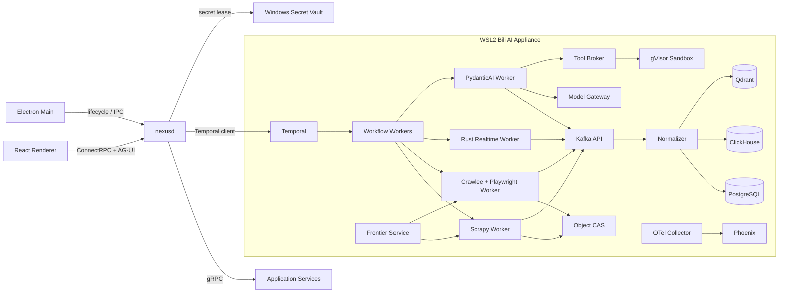

# 初版全功能技术实现设计

> 状态：Superseded by [本地原生业务与技术实现规格](local-native-business-implementation.md)。本文保留曾讨论的本地服务集群方案，不再作为实现依据。

## 目录

- [文档地位](#文档地位)
- [总体约束](#总体约束)
- [运行拓扑](#运行拓扑)
- [前端实现](#前端实现)
- [契约与通信](#契约与通信)
- [状态所有权](#状态所有权)
- [页面到后端的实现映射](#页面到后端的实现映射)
- [核心业务流程](#核心业务流程)
- [数据模型](#数据模型)
- [事件设计](#事件设计)
- [权限和安全](#权限和安全)
- [可观测性](#可观测性)
- [测试与验收](#测试与验收)
- [实施顺序](#实施顺序)
- [BiliMonitor 迁移映射](#bilimonitor-迁移映射)

## 文档地位

本文曾是 UI 初版对应的本地服务集群技术基线，现已由无业务服务端的 [本地原生业务与技术实现规格](local-native-business-implementation.md) 取代。UI 产品范围仍由 [初版桌面 UI 设计](../ui/initial-ui-design.md) 和 `apps/desktop/src/renderer/src/product-model.ts` 定义。

旧文档 `initial-design.md` 中的 Vue、FastAPI 单 Core、SQLite 和 DuckDB 方案属于架构探索阶段，由本文和 ADR-0004 取代。旧 Python Core 实验代码已经移除，不再进入目标运行架构或依赖集合。

本文描述的是目标系统，不表示所有组件已在当前仓库实现。当前可执行范围以根目录 README 的 Slice 状态为准。

## 总体约束

- Windows 11 是首个完整交付平台。
- 业务控制面、执行面、数据库、对象和 Agent 状态默认完全位于本机。
- 只有平台采集请求和用户明确启用的远程 AI Provider 可以出站。
- WSL2 是本地数据与执行 Appliance；Electron Renderer 不直连 WSL2 服务。
- 系统初期是单用户，但所有核心记录保留 `workspace_id`。
- 不进行验证码绕过、风控绕过或未授权数据访问。
- 每类状态只有一个权威所有者；其他存储都是事件流、投影、索引或缓存。
- 大 Payload 不进入 Temporal History、Kafka 消息或 gRPC Frame，统一保存为 `ObjectRef`。

## 运行拓扑



### Windows Host

#### Electron Main

- 窗口、托盘、文件选择、通知、协议链接和自动更新。
- 启动并监督 `nexusd.exe`。
- `contextIsolation=true`、`sandbox=true`、`nodeIntegration=false`。
- Preload 只暴露具体的窗口与系统能力，不提供任意 IPC channel。

#### `nexusd`

- Go 实现的本地控制面和 API Gateway。
- 监听随机 loopback 端口，使用每次启动生成的会话令牌。
- 管理 WSL2 Appliance 启动、健康、迁移、升级和关停。
- 对接 Windows Credential Manager/DPAPI，签发短期 Secret Lease。
- 执行 Policy Check、Approval Command 和出站分类。
- 不包含爬虫规则、Parser、Agent Prompt 或模型推理逻辑。

### WSL2 Appliance

- 数据目录位于 WSL2 ext4 VHD，不位于 `/mnt/c`。
- 服务通过内部 OCI 网络互通，不向局域网暴露端口。
- 本地发行使用 OCI Compose + systemd；远程扩展提供 Kubernetes/Helm。
- PostgreSQL 为应用和 Temporal 使用不同数据库/账号。
- UI 不查询 Temporal、Kafka 或 ClickHouse 的内部管理表，只调用应用投影 API。

## 前端实现

### 技术栈

| 类别 | 选择 | 用途 |
| --- | --- | --- |
| UI | React 19 + TypeScript strict | 桌面工作台 |
| 构建 | electron-vite + Vite | Main/Preload/Renderer 构建 |
| 路由 | TanStack Router | 类型化深链接和详情路由 |
| Server State | TanStack Query | 查询缓存、失效、重试和离线展示 |
| Client State | Zustand | 侧栏、布局、命令面板、短生命周期编辑状态 |
| 表格 | TanStack Table + Virtual | 大列表、列布局和虚拟滚动 |
| 表单 | React Hook Form + Zod | 表单和 Proto DTO 边界校验 |
| API | ConnectRPC Web Client | Protobuf 类型化 Query/Command |
| Agent Stream | AG-UI over SSE | Token、Step、Tool、Approval 和 Artifact 事件 |
| 高频直播 | WebSocket | 聚合后的直播指标和现场消息 |
| 图表 | Apache ECharts | 时间序列、关系、热力和直播分析 |
| 可视化编辑 | React Flow | Agent/Workflow/Identity 图式视图 |
| 图标 | Lucide React | 统一线性图标 |

当前原型暂时只依赖 React 和 Lucide，路由和数据栈在接入真实后端时加入。

### 前端目录

```text
apps/desktop/src/renderer/src/
  app/
    App.tsx
    router.tsx
    providers.tsx
  shell/
    DesktopShell.tsx
    Sidebar.tsx
    SignalTape.tsx
    ActivityRail.tsx
    CommandPalette.tsx
  components/
    data/
    feedback/
    forms/
    charts/
    agent/
  features/
    overview/
    subjects/
    campaigns/
    live/
    data-assets/
    agents/
    knowledge/
    models/
    evaluations/
    accounts/
    connectors/
    identity/
    tools/
    workflows/
    extensions/
    approvals/
    observability/
    settings/
  api/generated/
  state/
  styles/
```

### 前端状态规则

- URL：页面、Tab、选中 ID、时间范围、可分享过滤条件。
- TanStack Query：服务端记录和分页结果。
- Zustand：侧栏、命令面板、列宽、未保存布局草稿。
- React Hook Form：当前表单输入。
- IndexedDB：可丢弃的查询缓存和本地草稿；不得保存 Cookie、API Key 或权威任务状态。
- Renderer 不自行实现业务重试或 Workflow 状态机。

### ViewModel

每个页面由 Query Hook 组合 ViewModel：

```ts
interface LiveRadarViewModel {
  summary: LiveSummary
  rooms: LiveRoomRow[]
  selectedRoom?: LiveRoomDetail
  realtime: LiveRealtimeProjection
  permissions: PagePermissionSet
  freshness: DataFreshness
}
```

Proto Message 不能直接散落到所有组件。Feature Container 将 Proto 转换为带显示语义的 ViewModel，通用组件不依赖后端字段命名。

## 契约与通信

### Protobuf 仓库

```text
proto/bili/v1/common.proto
proto/bili/v1/subjects.proto
proto/bili/v1/campaigns.proto
proto/bili/v1/live.proto
proto/bili/v1/assets.proto
proto/bili/v1/agents.proto
proto/bili/v1/knowledge.proto
proto/bili/v1/models.proto
proto/bili/v1/accounts.proto
proto/bili/v1/connectors.proto
proto/bili/v1/identity.proto
proto/bili/v1/tools.proto
proto/bili/v1/operations.proto
proto/bili/v1/governance.proto
```

Buf 执行 `lint`、`breaking` 和多语言生成。公共字段删除必须走新版本，枚举值不复用，未知枚举在 UI 中显示为 `UNKNOWN(value)`。

### 通用标识

- 外部 ID：ULID 或 UUIDv7。
- 时间：`google.protobuf.Timestamp`，统一 UTC。
- 页游标：不透明 `page_token`。
- 幂等写入：`idempotency_key`。
- 并发修改：`etag` 或 `version`。
- 因果链：`correlation_id`、`causation_id`、`traceparent`。

### ObjectRef

```protobuf
message ObjectRef {
  string object_id = 1;
  string content_hash = 2;
  string media_type = 3;
  int64 size_bytes = 4;
  string storage_uri = 5;
  google.protobuf.Timestamp created_at = 6;
}
```

WARC、HAR、JSON、截图、模型上下文、导出和 Agent Artifact 只通过 `ObjectRef` 传递。

### Query/Command 分离

- Query：无副作用，允许短期缓存和安全重试。
- Command：要求 idempotency key，返回 accepted resource 或 operation ID。
- 长任务不保持 HTTP 请求；Command 返回 Workflow Projection，UI 订阅状态。
- 高风险 Command 可能返回 `approval_required`，UI 打开审批上下文。

### 实时通道

- 普通状态更新：SSE，服务端发送聚合 Projection Event。
- Agent UI：AG-UI SSE。
- 弹幕现场：WebSocket，只发送 UI 订阅房间和所选字段。
- 网络恢复后先 Query 当前 Projection，再从 `last_event_id` 补增量。

## 状态所有权

| 状态 | 权威所有者 | 其他系统角色 |
| --- | --- | --- |
| Workspace、配置、账号引用 | PostgreSQL | Kafka 发布变更事实 |
| Campaign 和应用任务视图 | PostgreSQL Projection | Temporal 执行，Kafka 传播 |
| Workflow 内部历史 | Temporal | 应用只读投影，不查询内部库 |
| URL Frontier | Frontier Service Store | Temporal 只记录 Campaign 级语义 |
| 高频采集事实 | Kafka | ClickHouse 消费分析 |
| 规范化业务实体 | PostgreSQL | ClickHouse 保存历史事实 |
| 弹幕/调用/指标事实 | ClickHouse | PostgreSQL 保存摘要和索引 |
| 原始证据和 Artifact | Object CAS | PostgreSQL 保存 Object Metadata |
| 向量/稀疏索引 | Qdrant | 可由权威来源重建 |
| Agent Run 业务记录 | PostgreSQL | Temporal 执行，Phoenix 观测 |
| Secret | Windows Vault / 加密 Vault | PostgreSQL 仅保存 credential_ref |
| UI 查询缓存 | Renderer | 可随时丢弃 |

应用数据库到 Kafka 使用 Transactional Outbox + CDC。消费语义是至少一次，Consumer 必须按 `event_id` 或业务幂等键去重。

## 页面到后端的实现映射

| 页面 | Query/Command Service | Workflow / Event | 主要存储 | 权限 |
| --- | --- | --- | --- | --- |
| 信号总览 | `OverviewService` | 所有域的 Projection Event | PG 摘要、CH 指标 | `overview.read` |
| 监控对象 | `SubjectService` | `SubjectRefreshWorkflow`、`subject.*` | PG、CH | `subject.read/write` |
| 采集活动 | `CampaignService`、`FrontierService` | `CrawlCampaignWorkflow`、`crawl.*` | PG、Kafka、Object CAS | `campaign.*` |
| 直播雷达 | `LiveService` | `LiveMonitorWorkflow`、`live.*` | PG、CH、Kafka | `live.read/control/export` |
| 数据资产 | `AssetService`、`QueryService` | `ReplayParserWorkflow`、`ExportWorkflow` | Object CAS、PG、CH | `data.read/export/replay` |
| Agent 工作台 | `AgentDefinitionService` | `AgentEvaluationWorkflow` | PG、Object CAS | `agent.design/publish` |
| 运行记录 | `AgentRunService` | `AgentRunWorkflow`、`agent.run.*` | PG、Temporal、Object CAS | `agent.run/read/cancel` |
| 知识库 | `KnowledgeService` | `KnowledgeIndexWorkflow` | PG、Qdrant、Object CAS | `knowledge.*` |
| 模型路由 | `ModelCatalogService` | `model.usage.*` | PG、CH、Vault | `model.configure/use` |
| 评估中心 | `EvaluationService` | `ExperimentWorkflow` | PG、Object CAS、Phoenix | `evaluation.*` |
| 平台与账号 | `AccountService` | `AuthSessionWorkflow`、`credential.*` | PG Ref、Vault、Profile Store | `account.*`、`credential.*` |
| 连接器 | `ConnectorRegistryService` | `ConnectorContractWorkflow` | PG、Object CAS | `connector.*` |
| 身份图谱 | `IdentityService` | `IdentityCandidateWorkflow` | PG、Object CAS | `identity.read/suggest/decide` |
| 工具与 MCP | `ToolRegistryService` | `tool.invoked.*` | PG、Vault、Object CAS | `tool.configure/invoke` |
| 工作流与 Worker | `OperationService` | Temporal/Kafka 投影 | PG、CH | `operation.read/control` |
| 扩展中心 | `ExtensionService` | `ExtensionInstallWorkflow` | PG、Object CAS、filesystem | `extension.*` |
| 审批与审计 | `ApprovalService`、`AuditService` | Temporal Signal、`audit.*` | PG、CH | `approval.decide`、`audit.read` |
| 系统观测 | `ObservabilityService` | OTel Span/Event | Phoenix、CH | `observability.read` |
| 系统设置 | `SettingsService` | `BackupWorkflow`、`UpgradeWorkflow` | PG、Vault、Object CAS | `system.configure/backup/update` |

### 信号总览

`OverviewService.GetOverview` 返回单次一致的首屏快照：

```text
SystemHealthSummary
CampaignSummary
LiveSummary
AgentRunSummary
ApprovalSummary
DataFreshness[]
FocusedRecord[]
```

Signal Tape 来自 `ActivityProjectionService.SubscribeActivity`，服务端按 Workspace 做速率限制、聚合和优先级排序。原始弹幕不直接进入全局 Signal Tape。

### 监控对象

核心聚合：`Subject`、`SubjectAccountBinding`、`SubjectWidgetLayout`。

Command：

```text
CreateSubject
UpdateSubject
BindPlatformAccount
UpdateBindingMonitorPolicy
UnbindPlatformAccount
SaveWidgetLayout
RefreshSubject
```

B站粉丝采集保留 MID、昵称、头像、粉丝、关注、来源端点、采集时间和错误语义。趋势查询从 ClickHouse 读取，当前值从 PostgreSQL Projection 读取。

### 采集活动

`CrawlCampaignWorkflow` 只记录阶段级状态：

```text
CREATED → SEEDING → RUNNING → DRAINING → COMPLETED
                       ↘ PAUSED / MANUAL_REVIEW / FAILED / CANCELLED
```

单 URL 工作由 Frontier 管理。`FetchRequest`：

```protobuf
message FetchRequest {
  string request_id = 1;
  string campaign_id = 2;
  string capability = 3;
  string target = 4;
  string account_ref = 5;
  FetchMode mode = 6;
  int32 priority = 7;
  RetryPolicy retry_policy = 8;
  string rate_key = 9;
  EvidencePolicy evidence_policy = 10;
  string checkpoint = 11;
  string idempotency_key = 12;
}
```

Worker 顺序固定为：取得 Session Lease → Fetch → 原始对象落盘并校验 → 发布完成事实 → 解析。Parser 失败不删除原始对象。

### 直播雷达

拆为四个内部能力：

- `live.room.snapshot`：HTTP 采集直播状态。
- `live.danmaku.stream`：Rust WebSocket 长连接。
- `live.rank.snapshot`：观众和大航海榜单。
- `live.session.project`：按开始、结束和连接边界形成场次。

实时 Worker 不直接写业务表，发布 `live.raw.*` 事实；Normalizer 写 ClickHouse 明细并更新 PostgreSQL 场次摘要。

场次覆盖状态不能被简化成 bool：

```text
COMPLETE
START_MISSING
END_PENDING
DISCONNECTED_GAP
IDENTITY_PARTIAL
UNKNOWN
```

导出通过 `LiveSessionExportWorkflow` 生成 ObjectRef，再由 Electron 文件选择能力复制到用户目标目录。写文件需要 `filesystem.write` 审批。

### 数据资产

`AssetService` 统一管理 `RawObject`、`Artifact` 和 `DatasetObject`。对象采用 BLAKE3/SHA-256 内容 Hash，元数据记录：

```text
media_type, size, source, fetched_at, connector_version,
parser_version, retention_policy, encryption, references
```

查询服务只允许版本化 Query Template 或受控语义查询。首版不向 Agent 暴露任意 SQL。

### Agent 工作台和运行记录

`AgentDefinition` 与 `AgentVersion` 分离。发布版本包含：

```text
instructions_ref
runtime = pydantic_temporal | langgraph
model_policy_id
toolset_ids[]
input_schema_ref
output_schema_ref
memory_policy_id
evaluation_gate_id
```

默认 Runtime 为 PydanticAI + Temporal。LangGraph 只用于明确需要图状态和时间旅行的 Agent；一次 Run 只有一个主状态机。

Agent Run 流程：

```text
CreateAgentRun
→ Temporal AgentRunWorkflow
→ Build Context
→ Model Activity
→ Tool Policy Check
→ ALLOW / DENY / REQUIRE_APPROVAL
→ Tool Activity 或等待 Signal
→ Validate Structured Output
→ Persist Message / Artifact
→ Schedule Evaluation
```

模型和 Tool I/O 是 Activity。稳定 Agent name、Toolset ID 和 Activity name 不随文案修改。Token Delta 走 AG-UI，不逐 Token 写 Temporal History。

### 知识库

索引源以 `KnowledgeSource` 指向权威对象。索引流程：

```text
Resolve source
→ extract
→ chunk
→ metadata normalize
→ dense embed
→ sparse index
→ Qdrant upsert to shadow collection
→ smoke evaluation
→ alias switch
```

检索服务：Filter → Dense/Sparse Prefetch → RRF → 可选 Rerank → Evidence Pack。删除先写 Tombstone，再异步传播 Qdrant；查询必须过滤 Tombstone。

### 模型路由

模型调用统一经过 `ModelGateway`：

- LiteLLM 处理通用 OpenAI-compatible 路径。
- Native Adapter 保留厂商原生工具、实时音频、缓存或 Responses 能力。
- vLLM 是本地 GPU 默认服务，SGLang 作为基准测试候选，llama.cpp 负责 GGUF/CPU。
- 数据分级、任务能力、上下文、模态、结构化输出、延迟和质量共同决定路由。
- 精确 Cache 只用于可证明安全的确定性请求和 Embedding；Agent 推理默认不做 Semantic Cache。

### 评估中心

`EvaluationDataset` 版本冻结后不可修改，只能产生新版本。`ExperimentRun` 固定所有依赖版本。评估结果同时保存结构化分数和 Evidence；LLM Judge 记录 Judge 模型和 Prompt 版本。

### 平台与账号

`SessionVault` 是凭据唯一入口。关系：

```text
PlatformAccount
  → CredentialRef → encrypted secret
  → BrowserProfileRef → encrypted profile
  → SessionLease → worker memory
```

Worker 不访问凭据数据库。`nexusd`/Secret Broker 根据 Worker Identity、Campaign、Capability 和 TTL 签发租约。租约内容只在内存存在。

B站和抖音的登录状态机分别实现，不共享 Cookie 解析：

- B站：`WAITING → SCANNED → SUCCESS | EXPIRED | FAILED`。
- 抖音 Web：`STARTING → WAITING → SCANNED → CONFIRMED → SUCCESS`，保留异步浏览器启动状态。
- 抖音 OAuth：`AUTHORIZING → CALLBACK_RECEIVED → ACTIVE → REFRESH_REQUIRED | REVOKED`。

Credential 记录 `key_id`。密钥轮换先用旧 Key 解密、用新 Key 重加密并校验，再激活新版本；解密失败不得生成新 Key 覆盖。

### 连接器和扩展

Connector Manifest：

```text
id, version, api_version, publisher, signature,
capabilities[], config_schema_ref, runtime,
network_policy, secret_requirements, entrypoints
```

Capability 比继承平台大接口更细：`account.profile`、`follower.snapshot`、`live.status`、`live.danmaku`、`live.rank`、`auth.web_qr`。

第三方扩展运行在独立进程或 gVisor 容器中。`ui.panel` 不允许直接加载任意远程网页，只能加载签名的本地 bundle，并通过受限 Host API 访问数据。

### 身份图谱

PostgreSQL 保存版本化关系：`IdentityNode`、`PlatformAccountNode`、`IdentityCandidate`、`IdentityEvidence`、`IdentityDecision`。算法只能新增 Candidate；只有人工或明确授权 Tool 才能写 Decision。

### 工具与 MCP

Tool Broker 为每次调用生成 Capability Token：

```text
workspace_id
agent_run_id
tool_id + version
resource_scope
network_scope
filesystem_scope
credential_scope
max_impact
expires_at
nonce
```

Tool Invocation 在执行前持久化，执行后写 Result/ObjectRef。幂等工具携带 idempotency key；非幂等工具重试必须经过工具自身确认或人工审批。

### 审批与审计

Policy 结果：`ALLOW`、`DENY`、`REQUIRE_APPROVAL`、`ALLOW_WITH_REDUCED_SCOPE`。

Approval 通过 Temporal Signal 唤醒原 Workflow。审批记录保存请求快照、范围、风险、决策者、理由、过期时间和后续结果。审计事件采用追加写，业务记录只保存索引。

### 系统设置、备份和升级

设置 Command 使用 ETag 防止并发覆盖。Secret 值不进入普通 Settings DTO。

备份内容：

- PostgreSQL 逻辑备份和 Schema 版本。
- ClickHouse 数据/元数据快照策略。
- Qdrant Collection Snapshot。
- Object CAS Manifest 与增量对象。
- Connector、Agent、Model、Policy 配置，不含可公开的明文秘密。

升级顺序：预检 → 创建可恢复备份 → 下载并校验 → 数据迁移 → 启动兼容 Worker → 健康检查 → 切换版本。失败时回滚二进制；数据库迁移只能按声明的兼容策略恢复，不能盲目降级。

## 核心业务流程

### Transactional Outbox

```text
Command Transaction
  ├─ 更新业务表
  └─ 写 outbox_event
          ↓ CDC
        Kafka
          ↓
  ClickHouse / Projection / Notification
```

### 原始证据优先

```text
Fetch response
→ stream to temporary object
→ compute hash
→ atomically publish CAS object
→ persist RawObject metadata
→ emit crawl.fetch.completed with ObjectRef
→ parse and normalize
```

任何解析失败都保留 ObjectRef 和 Fetch Metadata。

### 高风险 Agent 工具

```text
Agent proposes tool call
→ Tool Broker validates schema
→ Policy Engine evaluates capability
→ REQUIRE_APPROVAL
→ PostgreSQL approval_request
→ Temporal waits for Signal
→ AG-UI shows approval card
→ user approves/reduces/rejects
→ Tool executes with scoped token
→ audit links request, decision and result
```

## 数据模型

### PostgreSQL

| Domain | 表 |
| --- | --- |
| Workspace | `workspace`, `workspace_setting`, `schema_migration_state` |
| Platform | `platform`, `platform_account`, `credential_ref`, `browser_profile_ref` |
| Connector | `connector`, `connector_version`, `connector_capability`, `connector_test_run` |
| Subject | `subject`, `subject_account_binding`, `subject_widget_layout`, `subject_health_event` |
| Campaign | `crawl_campaign`, `crawl_checkpoint`, `campaign_projection`, `frontier_ref` |
| Object | `raw_object`, `object_reference`, `retention_policy`, `export_job` |
| Live | `live_room_monitor`, `live_room_projection`, `live_session`, `live_session_coverage` |
| Agent | `agent_definition`, `agent_version`, `agent_run`, `agent_message`, `agent_step`, `artifact` |
| Model | `model_provider`, `model_catalog_entry`, `model_route`, `model_usage_summary` |
| Knowledge | `knowledge_source`, `knowledge_collection`, `index_job`, `knowledge_tombstone` |
| Evaluation | `evaluation_dataset`, `evaluation_dataset_version`, `experiment_run`, `evaluation_result` |
| Tool | `tool_definition`, `tool_version`, `mcp_server`, `tool_invocation`, `capability_policy` |
| Identity | `identity_node`, `identity_candidate`, `identity_evidence`, `identity_decision` |
| Governance | `approval_request`, `approval_decision`, `audit_event_index`, `outbox_event` |
| Operations | `workflow_projection`, `worker_projection`, `service_health`, `alert_projection` |

所有主要表包含 `workspace_id`、版本、UTC 时间和审计字段。幂等 Command 在业务唯一约束中体现，不只靠应用代码判断。

### ClickHouse

```text
crawl_fetch_event
api_call_event
live_status_event
live_danmaku_event
live_interaction_event
live_rank_entry_event
agent_run_event
model_usage_event
tool_invocation_event
audit_security_event
otel_span
```

直播事件典型排序键：`(workspace_id, platform, room_id, occurred_at, event_id)`。分区按月或日依据实际量级决定，先用录制负载测试再固定。

### Qdrant

- Collection 按数据安全边界与向量配置拆分，不按每个 Agent 建 Collection。
- Payload 包含 `workspace_id`、`source_type`、`source_id`、`object_id`、`chunk_version`、`occurred_at`、访问标签和 Tombstone。
- Collection Alias 用于无停机重建。

### Object CAS

本地默认使用 ext4 上的内容寻址存储，路径不是公共契约。Storage Adapter 支持未来迁移 S3/Ceph。对象本身不可原地修改；修订产生新 Hash。

## 事件设计

```json
{
  "event_id": "01J...",
  "event_type": "crawl.fetch.completed",
  "schema_version": 1,
  "occurred_at": "2026-08-22T12:36:18Z",
  "producer": "crawler-browser",
  "workspace_id": "...",
  "correlation_id": "...",
  "causation_id": "...",
  "traceparent": "...",
  "partition_key": "campaign_482",
  "idempotency_key": "...",
  "payload": {},
  "object_refs": []
}
```

初始 Topic：

```text
crawl.fetch.completed.v1
crawl.fetch.failed.v1
crawl.normalized.v1
live.bilibili.status.v1
live.bilibili.danmaku.v1
live.bilibili.interaction.v1
agent.run.events.v1
model.usage.v1
tool.invocation.v1
audit.security.v1
```

Kafka Topic 只承载事实，不用作任意 RPC Command Queue。需要命令和状态机的操作走 Temporal/Service Command。

## 权限和安全

### 信任区

| 区域 | 信任级别 | 限制 |
| --- | --- | --- |
| React Renderer | 低 | 无 Node、无 Secret、无数据库连接 |
| Electron Main | 高 | 只处理系统能力，不处理业务数据查询 |
| `nexusd` | 高 | Gateway、Vault、Policy、Appliance 生命周期 |
| 内置 Worker | 中 | 只拿短期租约和指定任务 |
| 第三方扩展 | 低 | 独立进程/OCI/gVisor、默认无网无文件 |
| 网页内容和工具输出 | 不可信数据 | 永远不能提升为系统指令或权限 |

### 出站治理

- 所有远程模型请求经过 Model Gateway Egress Policy。
- 所有浏览器和 HTTP Worker 使用 Connector 声明的域名白名单。
- Tool 网络请求由 Tool Broker Egress Proxy 控制。
- DNS、HTTP Redirect、WebSocket 和子资源请求都必须在白名单策略内。
- UI 展示数据级别和实际发送字段，不只展示 Provider 名称。

### Prompt Injection

- 爬取内容进入 Agent Context 时标记 `untrusted_content`。
- 系统指令、用户目标、工具结果、网页文本使用不同结构化通道。
- 网页中的“调用工具”“泄露 Secret”等文本不具备操作权限。
- 高影响 Tool 在模型之外由 Policy Engine 判定。

## 可观测性

- 所有 ConnectRPC Request 生成或继承 `traceparent`。
- Temporal Workflow/Activity 通过 Interceptor 传播 Trace Context。
- Kafka Producer/Consumer 写入 Trace Header 和 correlation ID。
- Tool Broker、Model Gateway 和 Object CAS 都产生 Span。
- OpenTelemetry Collector 负责处理、采样和导出。
- Phoenix 保存 Agent Trace、Dataset、Experiment 和 Evaluation。
- 系统服务指标进入 Prometheus 兼容端点，Grafana 作为高级调试界面；桌面 UI 只展示任务相关投影。

日志必须自动过滤 Authorization、Cookie、query token、API key、手机号和完整 Prompt 敏感片段。诊断包运行脱敏扫描后才能生成。

## 测试与验收

### 前端

- Product Model 测试确保 19 个工作区无遗漏、无重复。
- BiliMonitor Capability Mapping 测试确保原有登录、关注者、直播、弹幕、排行、场次、任务、原始响应、AI 和 Identity 有入口。
- Component 测试覆盖命令搜索、导航、Tab、审批和错误状态。
- Playwright/Electron E2E 覆盖深链接、窗口恢复、Keyboard、断网和服务重启。
- 1600×960 与 1024×768 截图回归。

### 爬虫

- WARC/HAR 固定夹具解析契约。
- URL 去重、优先级、限频、退避和 Checkpoint 测试。
- Worker 在写对象前、写对象后、发事件前、发事件后分别崩溃的恢复测试。
- 同一事件重放不产生重复实体。
- Cookie/Secret 不出现在日志、Kafka、Temporal Payload 和普通 API 响应。

### Agent

- Model Stub 验证结构化输出和路由。
- Tool Policy 覆盖 Allow、Deny、Approval、Reduced Scope。
- Workflow 中断、Activity 重试、Signal 恢复和取消测试。
- 黄金数据集验证工具路径、引用完整性和 Prompt Injection。
- 禁用 AI 后所有爬虫、直播、查询和导出仍可工作。

### 发布验收

1. 干净 Windows 用户目录完成安装。
2. 检测或安装 WSL2 Appliance。
3. 创建并迁移所有数据存储。
4. Electron 只能访问 loopback Gateway。
5. Worker 崩溃后 Campaign 和 Agent Run 恢复。
6. 备份在新 Appliance 中完成恢复演练。
7. 退出、升级和卸载不留下未管理进程；用户数据按明确选择保留或删除。

## 实施顺序

### Phase 0：契约和控制面

- 新建 ADR-0004 并冻结目标架构。
- 建立 `proto/`、Buf 和生成代码。
- 实现 Go `nexusd`、loopback auth 和 Appliance lifecycle。
- React UI 接入 ConnectRPC health/overview，替换演示数据。

### Phase 1：BiliMonitor 业务垂直切片

- PostgreSQL、Temporal、Object CAS。
- B站扫码登录和 Session Vault。
- B站关注者监控、监控对象和采集活动。
- 原始对象优先、Checkpoint 和错误恢复。

### Phase 2：直播完整链路

- Live Room HTTP Connector。
- Rust Danmaku Worker。
- Kafka、ClickHouse、直播场次投影。
- 榜单、洞察和持久化导出。

### Phase 3：Agent 基础平台

- Model Gateway、PydanticAI Temporal Runtime。
- Tool Broker、Approval、AG-UI。
- 直播复盘 Agent 和异常解释 Agent。
- Phoenix Trace 和黄金数据集。

### Phase 4：知识、扩展和高级治理

- Qdrant Hybrid Retrieval。
- Identity Graph。
- MCP、扩展签名与 gVisor。
- 完整备份、升级和远程 Worker 扩展。

每个 Phase 都完成真实 UI 状态、API、Workflow、数据迁移、测试和恢复演练，不把后端实现与页面设计拆成两个长期不同步的项目。

## BiliMonitor 迁移映射

| BiliMonitor 现有内容 | 新系统目标 | 迁移方式 |
| --- | --- | --- |
| `BilibiliFollowerMonitorController/Service` | Subject + Follower Connector | 迁移业务语义和行为测试 |
| `BilibiliAuthService` | Session Vault + Bilibili Auth Connector | 保留状态机与凭据 Key 稳定规则 |
| `DouyinOAuthService` | Douyin OAuth Connector | 保留 OAuth/Web 双登录态隔离 |
| `douyin-worker` | Auth Browser Worker | 保留前端不直连、Worker 不访问 DB |
| `BilibiliLiveMonitorService` | Live Room Connector + Workflow | 拆分 Fetch、Projection 和 Workflow |
| `BilibiliLiveDanmakuService` | Rust Realtime Worker | 重做传输层，保留事件语义 |
| `BilibiliLiveRankService` | Rank Connector | 保留榜单类别、分页和快照语义 |
| `BilibiliLiveSession*` | Live Session Projection | 保留覆盖缺口、用户/事件/洞察/导出语义 |
| `SubjectWorkbenchService` | Subject Aggregate | 保留跨指标工作台和 Widget Layout |
| `CollectTask*` | Temporal Campaign Workflow | 迁移幂等、Checkpoint、重试和原始响应经验 |
| `RawPayloadService` | Object CAS | 改成内容寻址和 ObjectRef |
| `AiAnalysisPort` | Agent Runtime | 从单次 Mock Summary 升级为版本化 Agent Run |
| `IdentityLinkService` | Identity Graph | 增加候选、证据、决策和版本 |
| Vue 页面和 Element Plus | React Signal Desk | 重新实现，不直接复制组件代码 |
| Spring/JDBC/PostgreSQL schema | 新服务和迁移 | 不直接建立运行时耦合 |

如直接移植原项目代码，必须保留 ISC 许可声明，并以等价行为测试证明迁移后的业务语义。
