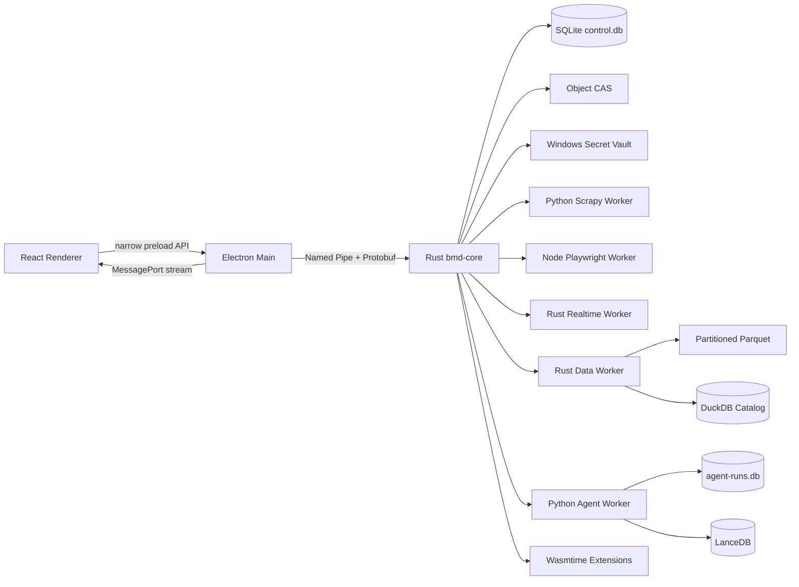

# BiliMonitor Desktop 本地原生业务与技术实现规格（历史探索稿）

> 非当前实现：本文包含尚未开发的 AI、Agent、19 个工作区以及已废弃的 Rust 方案，仅保留作历史探索，不能据此判断功能是否完成。当前开发只以 [原 B/S 业务复刻基线](../implementation/original-bs-business-parity.md) 和 [TypeScript/Python 当前运行时](typescript-python-local-runtime.md) 为准。

> 状态：Historical / Not Implemented
>
> 本文是当前 UI、业务和功能的权威技术实现基线。系统是无业务服务端的 Windows 本地客户端；允许由客户端直接管理多个本地 Worker，但不部署本地服务集群。

## 目录

- [1. 目标与边界](#1-目标与边界)
- [2. 最终架构选择](#2-最终架构选择)
- [3. 运行拓扑与进程职责](#3-运行拓扑与进程职责)
- [4. 技术栈](#4-技术栈)
- [5. IPC、契约与流式事件](#5-ipc契约与流式事件)
- [6. 本地数据体系](#6-本地数据体系)
- [7. Durable Task Engine](#7-durable-task-engine)
- [8. 爬虫与实时采集体系](#8-爬虫与实时采集体系)
- [9. AI、Agent、知识和工具体系](#9-aiagent知识和工具体系)
- [10. 前端工程与 UI 状态](#10-前端工程与-ui-状态)
- [11. 19 个业务工作区逐项实现](#11-19-个业务工作区逐项实现)
- [12. 端到端业务流程](#12-端到端业务流程)
- [13. 安全、扩展与隐私](#13-安全扩展与隐私)
- [14. 故障、恢复、备份与升级](#14-故障恢复备份与升级)
- [15. 测试与性能门槛](#15-测试与性能门槛)
- [16. 代码结构与实施顺序](#16-代码结构与实施顺序)
- [17. 技术选型依据](#17-技术选型依据)

## 1. 目标与边界

### 1.1 产品目标

BiliMonitor Desktop 面向单个本机用户，完成社交平台登录态管理、长期采集、直播实时数据、原始证据、分析查询、AI 分析和 Agent 工作流。它不是 BiliMonitor Web 系统的桌面壳，也不是在本机部署的微服务平台。

优先级：

1. 爬虫、实时流、AI 和 Agent 的能力上限。
2. 本地数据可追溯、可重放、可恢复。
3. 桌面客户端的安装、启动、退出和升级体验。
4. Secret、Agent 工具和第三方扩展的最小授权。
5. 开发成本、语言数量和重复实现成本。

### 1.2 “无服务端”的硬约束

- 不安装 PostgreSQL、Kafka、Temporal、ClickHouse、Qdrant、Redis 或容器集群。
- 不要求 WSL2、Docker、Kubernetes 或 Windows Service。
- 应用不监听浏览器或局域网可访问的业务 HTTP 端口。
- Electron 启动本地 Core；Core 按需启动 Worker；全部进程属于当前应用生命周期。
- 关闭到托盘可继续工作；完全退出时停止 Worker、保存 Checkpoint，下次启动恢复。
- 应用退出期间不执行调度；重启后按 `SKIP`、`RUN_ONCE` 或 `RUN_LATEST` 处理错过窗口。
- 远程模型 API、平台请求和用户显式配置的远程 MCP 是允许的出站能力，不构成业务后端。

### 1.3 必须保留的能力边界

- 平台网页只能在独立 Playwright Worker 中打开，不能进入 Electron Renderer。
- Scrapy、Playwright、实时协议和 Agent 使用独立 Worker，避免依赖污染与级联崩溃。
- 原始响应先落 Object CAS，Parser 失败不丢证据。
- Agent 只能通过 Core 暴露的 Tool 调用数据、网络、文件和 Secret。
- 所有长任务具备状态、步骤、重试、Checkpoint、取消和审计。
- 大 Payload 只通过 `ObjectRef` 传递，不复制进 SQLite、IPC 事件或 Agent 快照。

## 2. 最终架构选择

### 2.1 三种方案

| 方案 | 评价 |
| --- | --- |
| Electron 单进程 | UI、数据、浏览器和 Agent 共用崩溃域；无法稳定承载长期采集 |
| 本机服务集群 | 能力强但不是客户端；安装、资源、迁移和诊断成本失控 |
| Electron + Rust Core + 隔离 Worker | 保留高能力上限，同时没有业务服务端；采用 |

### 2.2 核心原则

- **一个控制核心**：Rust Core 是业务、任务、权限和数据写入的唯一入口。
- **多个能力 Worker**：不同语言只用于其最强生态，不形成服务自治。
- **嵌入式存储分层**：SQLite 管事务，Parquet/DuckDB 管分析，LanceDB 管检索，CAS 管大对象。
- **操作系统 IPC**：Named Pipe 和 MessagePort，不使用 loopback HTTP。
- **稳定契约**：业务契约使用 Protobuf；框架对象、数据库行和 Python 类型不出进程。
- **显式副作用**：网络、文件、Secret、账号和身份写入都经过 Capability Policy。

## 3. 运行拓扑与进程职责



### 3.1 Electron Main

职责：窗口、托盘、通知、自动更新、文件选择、协议链接、Core 生命周期、IPC 桥接和崩溃恢复。

不允许：业务 SQL、平台请求、Prompt、Parser、Cookie 解析或长任务状态机。

生产安全固定为：

```text
contextIsolation = true
sandbox = true
nodeIntegration = false
webSecurity = true
allowRunningInsecureContent = false
```

导航、新窗口、外链和权限请求全部使用 allowlist。Renderer 只加载签名包内的本地资源。

### 3.2 React Renderer

只负责路由、展示、表单和可丢弃草稿。权威状态不保存在 Zustand、IndexedDB 或组件 state。Renderer 刷新、崩溃或重载不能改变采集和 Agent Run 的真实结果。

### 3.3 Rust `bmd-core.exe`

Core 是普通子进程，不是系统服务。职责：

- 打开和迁移 `control.db`，保持 SQLite 单写者。
- 实现业务 Aggregate、Command、Query 和 Projection。
- 调度 Durable Task、Schedule、Retry、Lease 和 Approval。
- 启动、监督、限额和关闭 Worker。
- 管理 Object CAS、SecretRef、PathGrant 和 NetworkGrant。
- 执行 Tool Policy、MCP Broker 和扩展 Host。
- 将高频批次交给 Data Worker，将 Agent 任务交给 Agent Worker。
- 生成本地 Trace、审计和诊断事件。

Core 启动后创建带当前用户 SID ACL 的 Named Pipe。只接受 Electron Main 完成一次握手；没有发现、监听或通用远程调用能力。

### 3.4 Worker

| Worker | 运行时 | 职责 | 是否常驻 |
| --- | --- | --- | --- |
| `crawler-http` | Python | Scrapy/httpx HTTP 采集和 Parser | 有任务时按池启动 |
| `crawler-browser` | Node.js | Crawlee/Playwright、扫码、动态页面、HAR/截图 | 有会话时启动 |
| `crawler-realtime` | Rust | WebSocket、心跳、二进制协议、重连 | 有直播监控时启动 |
| `data-worker` | Rust | Arrow/Parquet 写入、DuckDB 查询、压实和导出 | 有数据业务时常驻 |
| `agent-worker` | Python | PydanticAI、Provider、RAG、Agent Step | 有 Agent 时启动 |
| `model-worker` | Python + llama.cpp native binding | llama.cpp 本地推理 | 用户启用本地模型时启动 |
| `wasm-host` | Core 内 Wasmtime | Parser、Exporter、纯函数 Tool | 按调用实例化 |

Core 使用 Windows Job Object 管理原生 Worker，限制 CPU、内存、进程数量和退出行为。Worker 崩溃只影响自己的 Lease，不导致 Core 或 UI 退出。

### 3.5 生命周期

```text
Electron Main
→ 创建启动 nonce
→ spawn bmd-core.exe --pipe-name --nonce-hash
→ Named Pipe 握手并校验 build/api version
→ Core 打开 SQLite、执行迁移、恢复未完成任务
→ Renderer 获取 BootstrapSnapshot
→ 按当前业务启动 Worker
```

完整退出：拒绝新任务 → 请求 Worker Checkpoint → 等待宽限期 → 回收 Lease → Data Worker flush → SQLite checkpoint → Job Object 关闭。异常退出后，下次启动根据 `lease_expires_at` 恢复。

## 4. 技术栈

版本只在 lockfile 和发行 manifest 固定，设计文档不写容易失效的补丁版本。

### 4.1 桌面 UI

| 领域 | 技术 | 用途 |
| --- | --- | --- |
| 桌面 | Electron、electron-vite、electron-builder | 窗口、打包、签名、更新 |
| UI | React 19、TypeScript strict | 工作台和复杂 Agent UI |
| 路由 | TanStack Router | 深链接、Tab、筛选和详情 |
| 查询状态 | TanStack Query | IPC Query 缓存、失效和重连 |
| 本地 UI 状态 | Zustand | 主题、侧栏、布局草稿 |
| 表单 | React Hook Form + Zod | 向导和 Schema 表单 |
| 大列表 | TanStack Table + Virtual | 服务端/核心分页和虚拟滚动 |
| 图表 | Apache ECharts | 时间序列、分布、热力和指标 |
| 图编辑 | React Flow | Agent、Workflow、Identity、血缘 |
| 编辑器 | Monaco Editor | Prompt、JSON Schema、策略、高级查询 |
| 测试 | Vitest、Testing Library、Playwright Electron | 单元、组件和 E2E |

### 4.2 Core 与数据

| 领域 | 技术 | 用途 |
| --- | --- | --- |
| Core | Rust + Tokio | 并发、IPC、调度、权限、监督 |
| IPC | Windows Named Pipe + Protobuf | 无端口进程通信 |
| 事务 | SQLite WAL + STRICT tables | 聚合、任务、配置、投影和审计索引 |
| 高频批次 | Apache Arrow | Worker 与 Data Worker 的列式批次 |
| 事实存储 | Zstd Parquet | 直播、采集、模型和工具事实 |
| 分析 | DuckDB embedded | 扫描、聚合、导出和压实 |
| 检索 | LanceDB embedded | 向量、标量过滤、全文和混合召回 |
| 大对象 | Filesystem Object CAS + BLAKE3 | 原始证据和 Artifact |
| Secret | Windows Credential Manager + DPAPI | Cookie、Token、API Key |
| 沙箱 | Wasmtime/WASI、AppContainer、Job Object | 纯扩展、第三方进程和子进程资源隔离 |

### 4.3 采集与 Agent

| 领域 | 技术 | 用途 |
| --- | --- | --- |
| HTTP 爬虫 | Scrapy、httpx、selectolax/lxml | 高吞吐请求和解析 |
| 浏览器 | Crawlee + Playwright | 登录、DOM、JS、截图和 HAR |
| 实时 | Tokio + WebSocket + 平台协议 Decoder | 弹幕与直播事件 |
| Agent | PydanticAI + Step Persistence | 类型化 Agent 和本地恢复 |
| 图式 Agent | LangGraph Adapter | 明确需要分支/图状态时启用 |
| 模型 | Provider 原生 SDK + OpenAI-compatible Adapter | 远程和兼容端点 |
| 本地模型 | llama.cpp binding | 无服务进程的本地推理 |
| 工具协议 | MCP stdio/Streamable HTTP | 本地与显式远程工具互操作 |
| 观测 | OpenTelemetry SDK + 本地 Trace Store | Run、Model、Tool 和爬虫因果链 |

## 5. IPC、契约与流式事件

### 5.1 三段通信

1. Renderer ↔ Preload/Main：`ipcRenderer.invoke` 处理有限 Query/Command；`MessagePort` 处理 Stream。
2. Main ↔ Core：用户 SID 限制的 Named Pipe，长度前缀 Protobuf Frame。
3. Core ↔ Worker：每个 Worker 独立 Named Pipe/stdio 控制通道；大型批次通过临时 Arrow IPC File + ObjectRef 交接。

Main 只做认证、路由和流量上限，不修改业务 Payload。

### 5.2 Frame

```protobuf
message IpcFrame {
  uint32 protocol_version = 1;
  string request_id = 2;
  FrameKind kind = 3;
  string method = 4;
  uint64 sequence = 5;
  bool end_of_stream = 6;
  bytes payload = 7;
  ErrorEnvelope error = 8;
}
```

`FrameKind` 包括 `HANDSHAKE`、`REQUEST`、`RESPONSE`、`STREAM_OPEN`、`STREAM_ITEM`、`STREAM_CLOSE`、`CANCEL` 和 `HEARTBEAT`。单帧大小有硬限制；超过限制必须使用 ObjectRef 或 ArrowBatchRef。

### 5.3 契约目录

```text
proto/bmd/v1/common.proto
proto/bmd/v1/desktop.proto
proto/bmd/v1/overview.proto
proto/bmd/v1/subjects.proto
proto/bmd/v1/campaigns.proto
proto/bmd/v1/live.proto
proto/bmd/v1/assets.proto
proto/bmd/v1/agents.proto
proto/bmd/v1/knowledge.proto
proto/bmd/v1/models.proto
proto/bmd/v1/evaluations.proto
proto/bmd/v1/accounts.proto
proto/bmd/v1/connectors.proto
proto/bmd/v1/identity.proto
proto/bmd/v1/tools.proto
proto/bmd/v1/operations.proto
proto/bmd/v1/extensions.proto
proto/bmd/v1/governance.proto
proto/bmd/v1/settings.proto
```

Buf 执行 lint、breaking 和多语言生成。Proto 定义 Message 和稳定 Method ID，不定义网络服务部署。删除字段、复用枚举值或改变语义必须发布新 API version。

### 5.4 Command 与 Query

- Query 无副作用，可缓存和取消；返回 `snapshot_at`、`freshness` 和可选 ETag。
- Command 必须携带 `idempotency_key`；修改聚合时携带期望 `version`。
- 短 Command 返回新 Projection；长 Command 返回 `operation_id`。
- 批量 Command 每项返回独立结果，不能用一个 bool 隐藏局部失败。
- 高风险 Command 返回 `APPROVAL_REQUIRED` 和 `approval_id`。

### 5.5 Stream 和背压

- 普通状态：Core Event Log → Main → 页面 MessagePort。
- Agent：Token、Step、Tool、Approval、Artifact 使用独立 stream。
- 直播：Worker 每 50–200ms 形成 UI Batch；原始单条事件不逐个穿过 Electron IPC。
- Renderer 为每个订阅发送需求：对象、事件类型、字段、采样和最大速率。
- Core 对慢消费者采用 bounded queue；可丢弃 Token/预览事件，不能丢失状态转换和审批事件。
- 重连后先 Query 权威 Projection，再从 `last_sequence` 补低频事件；高频现场流不承诺完整补发，完整数据从 Parquet 查询。

## 6. 本地数据体系

### 6.1 数据目录

```text
<AppData>/BiliMonitorDesktop/
  control/control.db
  control/migrations/
  objects/blake3/ab/cd/<hash>
  events/<event_type>/date=YYYY-MM-DD/hour=HH/*.parquet
  analytics/catalog.duckdb
  vectors/<collection>/
  agent/agent-runs.db
  browser/profiles/
  spool/arrow/
  logs/
  traces/
  backups/
  extensions/
  tmp/
```

开发模式可解析到仓库 `.dev-data/`，便携模式解析到应用旁 `.local-data/`。所有模块通过 `DataDirectory` Port 获取路径，不拼接机器绝对路径。

### 6.2 SQLite `control.db`

启动配置：WAL、foreign_keys、busy_timeout、trusted_schema=OFF、STRICT tables。Rust Core 独占写连接；只读查询使用受控连接池。

Schema 分组：

```text
workspace_*       工作空间、设置、布局
subject_*         监控对象、绑定、策略、健康
account_*         平台账号、SecretRef、认证会话
campaign_*        Campaign、Revision、Projection
task_*            Task、Step、Attempt、Lease、Schedule、Event
object_*          CAS 元数据、引用、保留和 GC
live_*            房间、连接、场次、覆盖和摘要
agent_*           Agent 定义、版本、Run Projection、Artifact
knowledge_*       来源、集合、索引任务和 Tombstone
model_*           Provider、模型目录、路由、用量摘要
tool_*            工具、MCP、Policy、Invocation
identity_*        身份、候选、证据、决定和冲突
approval_*        请求、决定和过期
operation_*       Worker、诊断、告警和 Trace 索引
outbox_*          事务事件和 UI 投影事件
```

主要表统一包含 UUIDv7/ULID ID、`workspace_id`、UTC 时间、`version`。可变配置使用 ETag；历史和审计使用追加写。

### 6.3 高频事实：Arrow + Parquet

Realtime/HTTP/Agent Worker 把事件编码为 Arrow Batch，写到 `spool/arrow/*.tmp`，fsync 后原子改名为 `.ready` 并通知 Core。Data Worker 校验 Schema/Hash 后写入分区 Parquet。

分区原则：

```text
event_type / platform / date / hour
```

不按 Subject、Room 或 Agent 建目录，避免小文件爆炸。目标 Parquet File 128–512MB，Zstd 压缩；按常用过滤键排序，Row Group 尺寸由录制负载基准确定。后台 Compactor 合并小文件，生成新的 Manifest 后原子切换，旧文件延迟 GC。

### 6.4 DuckDB

Data Worker 是唯一读写 `catalog.duckdb` 的进程。其他进程通过 Core Query 调用，不直接打开文件。

DuckDB 用于：

- 查询 Parquet 事件和时间序列；
- 生成分钟/小时聚合；
- 数据集冻结和导出；
- Parser 新旧版本差异分析；
- 小文件压实和统计信息；
- 生成 CSV、JSONL、Parquet 和 XLSX 中间表。

DuckDB 不是事务真相，不保存必须靠它恢复的 Task、账号或审批。

### 6.5 LanceDB

知识索引按安全域和 Embedding 配置建 Table，不按 Agent 建 Table。权威数据仍是 KnowledgeSource、Object CAS 和 SQLite Manifest。

每个 Chunk 保存：`chunk_id`、`source_version_id`、`object_id`、`text_hash`、时间、标签、ACL、安全级别、dense vector 和全文字段。重建写 shadow table，通过 Core 中的 active index pointer 切换。

### 6.6 Object CAS

Object ID 使用 BLAKE3；外部兼容场景同时记录 SHA-256。对象不可原地修改。

写入：临时文件流式写入 → Hash → fsync → 原子 rename → SQLite 元数据事务 → 发布 `object.committed`。只有提交完成的 ObjectRef 才能进入任务结果。

保存对象包括：HTTP 响应、WARC/HAR、截图、媒体片段、录制 Fixture、Prompt Context、Agent Artifact、导出和诊断包。

### 6.7 一致性与 GC

- SQLite 事务同时写业务状态和 Outbox；事件分发失败可重试。
- Parquet Manifest 在文件完全落盘后切换。
- CAS 引用采用显式 `object_reference`；删除先 Tombstone，再在保留窗口后 GC。
- 启动时清理过期 `.tmp`，重新接管 `.ready` Arrow Batch。
- 周期一致性扫描检查 SQLite Ref、CAS 文件、Parquet Manifest 和 LanceDB 来源。

## 7. Durable Task Engine

### 7.1 为什么自带任务引擎

桌面业务需要暂停、恢复、重试、审批和重启恢复，但不需要分布式共识或服务器调度。Rust Core 内置一套以 SQLite 为日志的本地任务引擎，覆盖所有非 Agent 长任务；Agent 内部步骤由 PydanticAI Step Persistence 保存。

### 7.2 数据模型

```text
task_run
  id, task_type, definition_version, state, priority,
  input_ref, output_ref, progress, idempotency_key,
  cancel_requested_at, next_wakeup_at, created_at, updated_at

task_step
  id, task_run_id, step_name, state, attempt,
  max_attempts, retry_policy, timeout_at,
  checkpoint_ref, result_ref, error_code

task_lease
  step_id, worker_id, lease_token_hash,
  acquired_at, heartbeat_at, expires_at

task_event
  seq, task_run_id, step_id, event_type,
  payload_ref, recorded_at

schedule
  id, task_template_id, cron, timezone,
  catch_up_policy, next_run_at, enabled
```

### 7.3 状态机

```text
CREATED → QUEUED → RUNNING → COMPLETED
                    ├→ RETRY_WAIT → QUEUED
                    ├→ WAITING_APPROVAL → RUNNING
                    ├→ PAUSING → PAUSED → QUEUED
                    ├→ CANCELLING → CANCELLED
                    └→ FAILED
```

每次状态转换在一个 SQLite 事务中写当前状态、Task Event 和 Outbox。未知或非法转换直接拒绝，不通过最后写入覆盖。

### 7.4 Lease 与崩溃恢复

- Worker 请求与自己类型匹配的 Step；Core 原子创建带 TTL 的 Lease。
- Worker 心跳只延长当前 Lease，不改变业务进度。
- Checkpoint 必须在外部副作用完成后、报告完成前写入。
- Lease 过期后 Core 根据 Step 的幂等性决定重试或转 `UNKNOWN_EFFECT` 人工检查。
- 读操作、CAS 写入和带 idempotency key 的操作可自动重试。
- 文件复制、账号修改和外部发布等非幂等操作不能盲目重试。

### 7.5 暂停、取消与进度

- 暂停：不发新 Lease；在安全点提交 Checkpoint 后进入 `PAUSED`。
- 取消：设置 cancel flag；Worker 轮询或通过控制帧接收；不能把仍在执行的副作用伪装成已取消。
- 进度：用 `completed_units/total_units`、阶段和数据水位表达；未知总量使用阶段进度，不伪造百分比。
- UI Command 只请求状态变化，实际结果以 Task Projection 为准。

### 7.6 Schedule

Schedule 只在应用运行或托盘驻留时触发。完全退出后的错过策略：

- `SKIP`：不补跑。
- `RUN_ONCE`：启动后补一次。
- `RUN_LATEST`：只执行最近一个窗口并记录跳过数量。

系统不批量补跑所有错过周期，避免启动后冲击平台。

### 7.7 版本兼容

每个 Task 固定 `definition_version`。应用升级时：

- 相同版本 Worker 继续执行；
- 声明兼容的新 Worker 可接管；
- 不兼容 Task 先停在 Checkpoint，由迁移器转换输入或保持旧 Worker；
- 不能理解的旧状态禁止强制重置。

## 8. 爬虫与实时采集体系

### 8.1 Connector Capability

平台插件按能力而不是大而全的接口注册：

```text
auth.web_qr
auth.oauth
session.validate
account.profile
follower.snapshot
content.list
live.status
live.danmaku
live.rank
media.metadata
```

每个 Capability 声明：input/output schema、引擎、认证、域名、限频键、风险、证据策略、Parser、Checkpoint 和错误分类。单个能力故障只降级自己。

### 8.2 Worker 选择

| 条件 | Worker |
| --- | --- |
| 稳定 API、HTML、分页、高吞吐 | Scrapy Worker |
| 短小的签名/验证请求 | httpx Adapter |
| 登录、DOM、动态渲染、截图、HAR | Playwright Worker |
| WebSocket、心跳、压缩二进制帧 | Rust Realtime Worker |
| 音视频探测和转码 | 可选 Media Tool/FFmpeg |

失败后不能由 Worker 自行无限升级引擎。HTTP → Browser 必须由 Connector Policy 明确允许，并重新计算账号、资源和风险预算。

### 8.3 本地 Frontier

Frontier 状态保存在 SQLite，规模较大的 URL/目标集合使用分片表和索引：

```text
frontier_item(
  campaign_id, key_hash, target, capability,
  priority, depth, state, next_attempt_at,
  lease_id, checkpoint_ref, last_error
)
```

Key 为 `BLAKE3(canonical_target + capability + account_scope + request_fingerprint)`。精确唯一约束负责去重；Bloom Filter 只做快速否定。

状态：`DISCOVERED → READY → LEASED → FETCHED → PARSED → DONE`，旁路为 `RETRY_WAIT`、`MANUAL_REVIEW`、`DEAD`。大规模导入分批事务，不能把全部种子读入内存。

### 8.4 限频

四层 Token Bucket：平台、账号、Capability/Endpoint、网络身份。服务端 `Retry-After` 优先于本地估计。状态写入 SQLite，应用重启后不会丢失封禁窗口。

错误分类：

| 类别 | 行为 |
| --- | --- |
| `TRANSIENT_NETWORK` | 指数退避 + full jitter |
| `RATE_LIMITED` | 冻结 rate key 到指定时间 |
| `CREDENTIAL_EXPIRED` | 暂停依赖账号的新任务并触发续期 |
| `SCHEMA_CHANGED` | 保存证据、禁用 Parser/Capability、运行契约检查 |
| `RISK_CHALLENGE` | `MANUAL_REVIEW`，不绕过 |
| `PERMANENT_NOT_FOUND` | 终止当前目标，不扩大重试 |

### 8.5 FetchEnvelope

```text
request_id, campaign_id, capability, target,
observed_at, duration_ms, status_code,
cursor, checkpoint, rate_limit,
retryability, risk, error_class,
object_refs, candidate_records
```

平台 SDK 异常不能跨 Worker 边界；必须映射为稳定错误类型。大正文只在 CAS，Envelope 只包含 ObjectRef。

### 8.6 证据优先与 Parser

固定顺序：取 Lease → 取短期 Secret → Fetch → CAS Commit → 返回 FetchEnvelope → Parser → Arrow Batch → Data Worker → Projection。

Parser 独立版本。升级流程：录制 Fixture → 单元解析 → 影子重放 → 字段 Diff/空值率/唯一键/业务指标 → 激活。旧解析结果保留版本，不能原地覆盖。

### 8.7 Bilibili 具体实现

#### 扫码登录

Playwright Worker 创建独立 BrowserContext，Core 只接收二维码图片 ObjectRef 和状态事件。成功后 Storage State 立即加密写入 Secret Vault，明文临时文件清除。状态：`STARTING → WAITING → SCANNED → SUCCESS | EXPIRED | FAILED`。

#### 粉丝快照

Subject Schedule 生成 `follower.snapshot` Step；HTTP Worker 获取账号资料，原始 JSON 落 CAS，Parser 生成 Snapshot。当前值写 SQLite Projection，历史写 Parquet；唯一键为账号、指标类型和时间桶。

#### 直播状态

周期 HTTP Snapshot 记录开播状态、标题、分区和热度。场次 Projector 用连续证据判断开始/结束，不能用一次失败直接结束场次。

#### 弹幕

Rust Worker 完成握手、心跳、压缩帧解码、协议版本、重连和乱序时间标记。事件先进入 Arrow Batch；UI 只收到批次预览和聚合指标。

#### 榜单

每次快照保存 `snapshot_id`、页码、抓取时间、总页数、覆盖率和 ObjectRef。部分分页失败时快照状态为 `PARTIAL`，不能与完整榜单混用。

#### 场次

场次由状态快照、实时连接和迟到窗口共同形成。覆盖状态：`COMPLETE`、`START_MISSING`、`END_PENDING`、`DISCONNECTED_GAP`、`IDENTITY_PARTIAL`、`UNKNOWN`。人工修正生成新 revision。

## 9. AI、Agent、知识和工具体系

### 9.1 AgentDefinition 与 AgentVersion

Definition 是可编辑身份，Version 是不可变发布物：

```text
instructions_ref
runtime = pydantic | langgraph
model_policy_version
toolset_versions[]
input_schema_ref
output_schema_ref
context_policy_version
memory_policy_version
budget_policy_version
evaluation_gate_version
```

生产 Run 只能引用明确版本，不能引用 `latest`。发布时解析并锁定所有依赖。

### 9.2 Agent Run 双层持久化

Rust Core 的 SQLite 保存稳定业务 Projection：Run 状态、AgentVersion、进度、审批、Artifact、用量和父子关系。

Python Agent Worker 的 `agent-runs.db` 使用 PydanticAI Step Persistence 保存框架级 event、snapshot 和 unresolved tool effect。大媒体和文本通过自定义 MediaStore 写入 Object CAS，数据库只保存 URI。

Core 不解析 PydanticAI 私有快照；Worker 通过稳定的 `AgentStepEvent` 汇报业务步骤。更换 Agent 框架不会改变 UI 契约。

### 9.3 Agent 状态机

```text
QUEUED → BUILDING_CONTEXT → MODEL_CALL → TOOL_POLICY
                                      ├→ TOOL_CALL → MODEL_CALL
                                      ├→ WAITING_APPROVAL → TOOL_CALL/MODEL_CALL
                                      └→ DENIED → MODEL_CALL
MODEL_CALL → VALIDATING_OUTPUT → COMPLETED
                             ├→ REPAIR_ONCE → MODEL_CALL
                             └→ FAILED
```

模型、Retriever 和 Tool Call 都是可观察 Step。Token Delta 只走 Stream；每个 settled tool boundary 保存恢复快照。崩溃后先检查 `UNKNOWN_AFTER_CRASH` Tool Effect，再决定继续、分叉或人工确认。

### 9.4 模型 Provider

不设置 LiteLLM Proxy。Agent Worker 通过 PydanticAI Provider/原生 Adapter 直接调用：

- OpenAI-compatible 端点；
- 需要原生能力的 OpenAI、Anthropic、Google 等 Adapter；
- 用户配置的其他 Provider；
- llama.cpp 本地 Model Worker。

Model Catalog 记录模态、上下文、Tool、JSON Schema、Streaming、地区、价格、数据策略和健康。Secret 通过一次调用租约注入，Provider 配置只保存 SecretRef。

### 9.5 模型路由

先硬过滤：数据级别、出站许可、模态、上下文、Tool、Schema、地区和健康；再按任务基准、质量、延迟、预算和负载评分。

数据级别：

- `L0_PUBLIC`：允许按策略出站。
- `L1_INTERNAL`：只发往 allowlist Provider。
- `L2_SENSITIVE`：默认本地，远程需字段预览和审批。
- `L3_SECRET`：禁止进入模型上下文。

降级只发生在没有外部副作用的恢复点。发生 Tool Call 后不能从头自动重跑整个 Agent。

### 9.6 本地模型

默认本地能力使用 llama.cpp binding 运行在 Model Worker，不开放端口。模型文件由 Model Manager 下载、校验、注册和清理。显示模型量化、上下文、CPU/GPU offload、显存/内存和队列。

vLLM、SGLang 或 WSL2 GPU 作为可选 Compute Adapter，用户主动安装后才出现；Core 通过同一 ModelPort 使用，不成为应用健康前提。

### 9.7 Tool Broker

所有 Tool Call 先回到 Rust Core。Tool 定义包含稳定名称、版本、输入/输出 Schema、超时、幂等性、资源范围和影响级别。

一次调用生成：

```text
agent_run_id, tool_id, tool_version,
resource_scope, network_grant, path_grant,
secret_refs, max_impact, expires_at, nonce
```

Policy 结果：`ALLOW`、`DENY`、`REQUIRE_APPROVAL`、`ALLOW_WITH_REDUCED_SCOPE`。文件系统只接受由系统文件对话框产生的 `PathGrant`，Agent 不能提交任意路径字符串获取权限。

### 9.8 MCP

本地 MCP Server 优先 stdio，由 Core 启动并监督；远程 Streamable HTTP 必须用户显式配置域名和 Secret。Tool Discovery 结果保存版本快照，AgentVersion 锁定实际 Schema。

Agent Worker 不能直接连接 MCP，所有 list/call 经过 Core，确保 Policy、审批、超时、脱敏和审计无法被绕过。

### 9.9 知识索引

流程：Resolve Source → Extract → Chunk → Normalize Metadata → Dense Embed → Full-text Index → Shadow Table → Smoke Evaluation → Active Pointer Switch。

检索：ACL/时间/来源 Filter → Vector/FTS Prefetch → RRF → 可选 Rerank → 去重/覆盖 → Evidence Pack。每条 Evidence 包含 ObjectRef、内容 Hash、来源时间和安全级别。

删除先在 SQLite 写 Tombstone，查询立即过滤；LanceDB 物理删除异步执行。

### 9.10 记忆

分为：Run 消息历史、Agent 结构化 Memory、Knowledge 可检索事实。长期 Memory 必须有 Schema、来源、置信度、生命周期和去重键。默认不把完整聊天无选择地向量化。

### 9.11 评估

Dataset Version 冻结 ObjectRef、输入、期望和数据级别。Experiment 固定 Agent、Prompt、Tool、Retriever、Parser 和 Model Policy 版本。Evaluator 分为确定性、Schema、引用、Tool Path、统计指标和 LLM Judge。确定性硬失败不能被 Judge 或人工备注覆盖。

## 10. 前端工程与 UI 状态

### 10.1 目录

```text
apps/desktop/src/renderer/src/
  app/                 router、provider、bootstrap
  shell/               sidebar、topbar、signal tape、activity rail
  shared/              ui、charts、table、form、feedback
  features/
    overview/
    subjects/
    campaigns/
    live/
    assets/
    agents/
    knowledge/
    models/
    evaluations/
    accounts/
    connectors/
    identity/
    tools/
    operations/
    extensions/
    governance/
    observability/
    settings/
  ipc/generated/       Proto DTO、method client、stream decoder
  state/               仅 UI 状态
```

### 10.2 状态归属

- URL：页面、Tab、选中记录、过滤、排序、时间范围。
- TanStack Query：Core Query 和 Operation Projection。
- Zustand：主题、侧栏、命令面板、列宽、未发布布局。
- React Hook Form：当前编辑表单。
- IndexedDB：可丢弃 Query Cache、草稿和最近访问；不保存 Secret 或权威 Task。

### 10.3 页面加载协议

Router 解析 URL → 并行获取 Page ViewModel → 打开页面 Stream → 用事件失效精确 Query Key → 断线后先重新 Query 再续 Stream。

每个页面必须实现 `Loading`、`Empty`、`Partial`、`Error`、`Stale`、`PermissionDenied`。单个 Widget 有独立 Error Boundary。

### 10.4 列表和高频 UI

- 所有业务列表由 Core 分页、过滤和排序；Renderer 不加载全量后再筛选。
- 记录使用稳定 cursor，不依赖数组索引。
- 现场弹幕使用虚拟列表和固定环形缓冲；完整历史走 Query。
- ECharts 输入服务端/核心降采样序列，不把百万点发送到 Renderer。
- 所有详情、抽屉、Trace 和审批都有可复制深链接。

### 10.5 Command Palette

搜索页面、Subject、Campaign、Live Session、Agent、Tool、Operation 和设置入口。Core 提供统一 SearchIndex Query；结果按权限和最近访问排序。危险动作不能在搜索结果中直接执行，只能进入确认页面。

## 11. 19 个业务工作区逐项实现

以下 Method 名是稳定业务契约，不代表 HTTP Endpoint。所有调用通过生成的 Desktop IPC Client 到 Rust Core。

### 11.1 信号总览

**业务目标**：回答系统是否健康、哪些业务正在运行、数据是否新鲜、哪里需要人工处理。

| 功能 | Core Method | 本地实现 | 数据与验收 |
| --- | --- | --- | --- |
| 运行态势 | `Overview.GetSnapshot` | 并行读取 SQLite Projection、Worker Health 和 DuckDB Aggregates | 返回同一 `snapshot_at`；局部失败显示 Partial，不清空全页 |
| 信号趋势 | `Overview.QuerySignalSeries` | Data Worker 查询分钟/小时 Parquet 聚合并降采样 | 5m/1h/24h 可切换；显示水位和缺口 |
| 执行平面 | `Operations.GetLocalTopology` | Core、Worker、SQLite、Data Worker、Agent/Model 健康图 | 节点可跳转系统观测；不再显示 Temporal/Kafka 等不存在服务 |
| 正在关注 | `Overview.ListFocusedRecords`、`Overview.PinRecord` | 固定项与风险/活跃度混合排序 | Subject、Session、Campaign、Agent Run 类型清晰且有深链接 |
| Signal Tape | `Activity.Subscribe` | SQLite Outbox 的关键低频事件；服务端式聚合在 Core 内完成 | 不传原始弹幕；暂停只暂停显示，不暂停业务 |
| 数据健康 | `Overview.GetDataHealth` | SQLite integrity、CAS missing refs、Parquet watermarks、Lance freshness | 每项给出最后验证时间和可执行修复入口 |
| 风险 Tab | `Governance.ListActionableRisks` | 汇总 Manual Review、凭据失效、审批和存储告警 | 只显示需要用户动作的问题，不重复普通日志 |

### 11.2 监控对象

**核心聚合**：`Subject`、`SubjectAccountBinding`、`SubjectMonitorPolicy`、`SubjectWidgetLayout`。

| 功能 | Core Method | Worker/Task | 存储与规则 |
| --- | --- | --- | --- |
| 对象列表 | `Subjects.List` | 无 | SQLite Projection；平台、标签、健康、直播、最近成功均可分页筛选 |
| 新建/编辑 | `Subjects.Create`、`Subjects.Update` | 无 | `version` 并发控制；名称非唯一，ID 为 UUIDv7 |
| 绑定账号 | `Subjects.BindAccount`、`Subjects.UnbindAccount` | `account.profile` 验证 Task | 解绑只关闭关系有效期，不删除平台历史 |
| 绑定直播间 | `Subjects.BindLiveRoom` | 房间验证 Task | 同平台 room ID 唯一，失败保留可修改草稿 |
| 监控策略 | `Subjects.UpdateMonitorPolicy` | 创建/更新 Schedule | 记录 Capability、周期、账号、证据和保留策略版本 |
| 指标矩阵 | `Subjects.QueryMetrics` | Data Worker | 原始指标和跨平台归一指标分栏；不可比单位禁止相加 |
| Widget 布局 | `Subjects.Get/SaveLayout` | 无 | 草稿在 IndexedDB，发布版 JSON Schema 校验后写 SQLite |
| 手动刷新 | `Subjects.Refresh` | Subject Refresh Task | idempotency key 防双击重复；返回 Operation ID |
| 健康事件 | `Subjects.ListHealthEvents` | Projection | 登录态、限频、Schema 和数据缺口使用稳定错误类型 |

详情 `/subjects/:subjectId` 的 Widget 首批包括粉丝趋势、直播状态、弹幕速率、最近采集、健康事件和 AI 摘要。每个 Widget 独立 Query。

### 11.3 采集活动

**核心聚合**：`Campaign`、`CampaignRevision`、`CampaignProjection`、`FrontierItem`、`ManualReviewCase`。

| 功能 | Core Method | Durable Task/Worker | 关键实现 |
| --- | --- | --- | --- |
| 创建向导 | `Campaigns.ValidateDraft`、`Campaigns.Create` | Campaign Task | 目标、种子、Capability、账号、引擎、调度、限频、证据、保留和风险摘要 |
| 种子导入 | `Campaigns.ImportSeeds` | Seed Import Step | CSV/JSONL 先落 CAS；流式校验，错误行生成 Artifact |
| Frontier | `Campaigns.GetFrontierSummary/ListFrontierItems` | Core Frontier | 默认聚合；详情 cursor 分页，支持状态/域名/深度筛选 |
| 生命周期 | `Pause/Resume/CancelCampaign` | Task 状态机 | 暂停不发新 Lease；取消保存 Checkpoint；都不删除数据 |
| 调度策略 | `Campaigns.SetSchedule` | Local Schedule | 时区显式；完全退出后的 catch-up policy 可配置 |
| Fetch 进度 | `Campaigns.GetRunProjection` | HTTP/Browser Worker | Campaign、Frontier、Fetch、Parse、Persist 五层水位 |
| 失败队列 | `Campaigns.ListFailures/RetryFailure` | 相应 Worker | 风险挑战不能批量重试；Schema 变化必须绑定修复版本 |
| 人工检查 | `Campaigns.ResolveManualReview` | Core Approval/Task | 记录证据、决定和后续结果，不提供绕过动作 |
| Parser 重放 | `Campaigns.ReplayObjects` | Parser/Data Worker | 只读 CAS，不访问平台；新旧版本保存字段 Diff |

状态：`DRAFT → QUEUED → SEEDING → RUNNING → DRAINING → COMPLETED`；旁路为 `PAUSED`、`MANUAL_REVIEW`、`FAILED`、`CANCELLED`。

### 11.4 直播雷达

**核心聚合**：`LiveRoomMonitor`、`LiveConnectionProjection`、`LiveSession`、`LiveSessionRevision`、`Coverage`。

| 功能 | Core Method | Worker/数据 | 关键实现 |
| --- | --- | --- | --- |
| 房间列表 | `Live.ListRooms/GetRoom` | HTTP Snapshot + SQLite | 状态、标题、分区、热度、下一次采集、连接健康和新鲜度 |
| 添加房间 | `Live.AddRoomMonitor` | room validation Task | 去重、平台验证、监控策略和账号影响预览 |
| 现场弹幕 | `Live.SubscribeRoom` | Rust Realtime → Arrow/UI Batch | 虚拟列表、字段订阅、速率限制；完整数据写 Parquet |
| 互动曲线 | `Live.QuerySeries` | DuckDB | 弹幕、点赞、礼物、SC、上舰独立口径；显示覆盖缺口 |
| 榜单 | `Live.GetRankSnapshot/ListRankEntries` | Rank Snapshot Task | snapshot、页码、时间、覆盖率；支持快照对比 |
| 场次 | `Live.ListSessions/GetSession` | Session Projector | 开始/结束、连接、覆盖、用户、事件和付费互动摘要 |
| 修正边界 | `Live.CorrectSessionBoundary` | Core Command | 新 revision，不改写旧历史；需要理由和审计 |
| 场次洞察 | `Live.GetSessionInsight` | DuckDB Query Template | 所有指标带口径、时间范围和 coverage |
| 导出 | `Live.CreateSessionExport` | Data Worker Export Task | CSV/XLSX/Parquet 先生成 CAS Artifact，再凭 PathGrant 复制 |

实时连接状态：`CONNECTING → ACTIVE → DEGRADED → RECONNECTING → CLOSED`。断线产生 Gap，不估造数据。

### 11.5 数据资产

| 功能 | Core Method | 本地实现 | 安全与验收 |
| --- | --- | --- | --- |
| 实体浏览 | `Assets.QueryEntities` | SQLite Query Template | 不接收任意 SQL；返回 schema、freshness 和 cursor |
| 事件浏览 | `Assets.QueryEvents` | Data Worker/DuckDB | 必须带时间范围和扫描预算；超预算给出缩小建议 |
| 原始证据 | `Assets.GetObject/OpenPreview` | CAS Range Read | HTML/JS 作为文本或隔离预览，绝不在同源 Renderer 执行 |
| 数据血缘 | `Assets.GetLineage` | SQLite Ref + Parser Manifest + ObjectRef | 字段 → Parser → Fetch → Object 的版本和时间完整 |
| 保存查询 | `Assets.CreateQueryTemplate` | 受控 AST/参数 Schema | Agent 只能使用发布模板，不能提交任意 SQL |
| 数据集 | `Assets.CreateDatasetVersion` | Query 水位 + Object Manifest | Version 冻结，不可原地变化，可复现 |
| Parser 影子重放 | `Assets.CreateReplay/CompareReplay` | Parser + DuckDB Diff | 影响量、空值、唯一键和指标差异通过后才能激活 |
| 导出任务 | `Assets.Create/CancelExport` | Data Worker | 分块、Checkpoint、Hash、ObjectRef 和 PathGrant 分离 |
| 保留与 GC | `Assets.UpdateRetention/PreviewGc` | Core CAS GC | 先展示影响引用；Tombstone 过保留期后删除 |

### 11.6 Agent 工作台

**核心聚合**：`AgentDefinition`、`AgentDraft`、`AgentVersion`、`DependencyLock`、`ReleaseChannel`。

| 功能 | Core Method | Agent Worker | 验收规则 |
| --- | --- | --- | --- |
| Agent 定义 | `Agents.Create/UpdateDraft` | 无 | 草稿可变；发布版本不可变；使用 ETag |
| Prompt | `Agents.ValidatePrompt` | Token/变量估算 | Prompt 正文落 CAS；未声明变量、Secret 占位和超长阻止发布 |
| 工具 | `Agents.ResolveEffectiveTools` | Tool Broker | 展示实际数据、路径、网络和 Secret Scope |
| 模型策略 | `Models.SimulateRoute` | Model Catalog | 不发送业务数据；展示过滤、评分、降级和出站级别 |
| 输出 Schema | `Agents.ValidateOutputSchema` | Pydantic/JSON Schema | 破坏性变化新 major version；示例输出验证 |
| 上下文策略 | `Agents.PreviewContext` | Context Builder | 显示来源、token、截断、脱敏和不可信内容标记 |
| 沙箱试跑 | `Agents.CreateSandboxRun` | PydanticAI Step Persistence | 数据范围和预算受限；实时显示 Model、Tool、Approval 和 validation |
| 评估 | `Agents.RunReleaseEvaluation` | Evaluation Task | 固定 Dataset/依赖；失败样本可钻取 |
| 发布/回滚 | `Agents.PublishVersion/SetReleaseChannel` | Core Command | 发布锁定依赖；回滚只影响新 Run |

### 11.7 Agent 运行记录

| 功能 | Core Method | 实现 | 关键语义 |
| --- | --- | --- | --- |
| 启动 | `AgentRuns.Create` | Core Run + Agent Worker | 输入 Schema、预算、版本和 idempotency 校验 |
| 列表 | `AgentRuns.List` | SQLite Projection | queued/running/waiting/retrying/failed/cancelled/completed |
| 现场流 | `AgentRuns.Subscribe` | Agent Event → Core → MessagePort | Token 可丢，Step/Tool/Approval/Artifact 不可丢 |
| 步骤回放 | `AgentRuns.GetTimeline` | Core Projection + ObjectRef | 因果排序；大输入输出按需打开 |
| 暂停/取消 | `AgentRuns.Pause/Cancel` | Core 控制 + Worker Checkpoint | 不在非幂等 Tool 中途伪造成功取消 |
| 恢复 | `AgentRuns.Resume` | Step Persistence `continue_run` | 先处理未决 Tool Effect；不盲目重放副作用 |
| 分叉 | `AgentRuns.Fork` | `fork_run` + 新 Core Run | 原 Run 不改写；可更换模型/Prompt/工具策略 |
| 比较 | `AgentRuns.Compare` | Core/DuckDB Diff | 比较模型、上下文、工具路径、结果、用量和评估 |
| Artifact | `AgentRuns.ListArtifacts` | CAS | Hash、MIME、来源、生成步骤和数据级别齐全 |

### 11.8 知识库

**核心聚合**：`KnowledgeSource`、`SourceVersion`、`Collection`、`ChunkManifest`、`IndexRun`、`Tombstone`。

| 功能 | Core Method | Worker/存储 | 关键实现 |
| --- | --- | --- | --- |
| 知识源 | `Knowledge.Create/SyncSource` | Knowledge Task | Dataset、Object、文档、字幕、Artifact；保存提取策略 |
| 切片预览 | `Knowledge.PreviewChunking` | Agent/Knowledge Worker | 显示边界、token、metadata、parent-child；不写生产索引 |
| 集合 | `Knowledge.Create/RebuildCollection` | LanceDB shadow | 向量配置和安全域版本化；切换不阻塞查询 |
| 混合检索 | `Knowledge.Search` | Vector + FTS + RRF | ACL、时间和来源 Filter 先执行 |
| 检索调试 | `Knowledge.DebugSearch` | 分阶段 trace | 展示候选、分数、耗时和淘汰原因 |
| Rerank | 检索策略内 | 本地/远程模型 | L2 数据远程重排需审批；保留 reranker 版本 |
| Evidence Pack | `Knowledge.BuildEvidencePack` | Core/Worker | 每条证据有 ObjectRef、Hash、来源时间和安全级别 |
| 增量索引 | `Knowledge.SyncSource` | 内容 Hash Diff | 未变内容不重嵌入；Embedding 变化建新索引 |
| 删除传播 | `Knowledge.DeleteSource` | Tombstone + 异步 Lance 清理 | 查询立即过滤，原始证据按保留策略处理 |

### 11.9 模型路由

| 功能 | Core Method | 本地实现 | 验收规则 |
| --- | --- | --- | --- |
| Provider | `Models.CreateProvider/Test/RotateSecret` | Config + SecretRef | Key 不回显；错误区分认证、网络、限额和区域 |
| 模型目录 | `Models.SyncCatalog/RegisterLocalModel` | Provider Adapter/Model Worker | 记录能力、上下文、价格、数据策略和健康 |
| 路由策略 | `Models.CreateRoutePolicy` | 版本化 filter/score/fallback | 保存前检测冲突；AgentVersion 锁定版本 |
| 路由模拟 | `Models.SimulateRoute` | 仅本地规则 | 展示每个候选接受/拒绝原因，不发送输入 |
| 本地模型 | `Models.Install/Start/StopLocalModel` | Model Worker | 校验 Hash、资源预估、队列、卸载和磁盘清理 |
| 推理状态 | `Models.GetInstanceHealth` | Worker telemetry | CPU/GPU、内存、上下文、tokens/s 和排队 |
| 用量与预算 | `Models.QueryUsage/SetBudget` | SQLite Summary + Parquet Detail | Run 预留、调用结算、超限明确拒绝 |
| 出站预览 | `Models.PreviewEgress` | Context classification | Provider、字段类别、脱敏和审批原因可见 |

### 11.10 评估中心

| 功能 | Core Method | Task/存储 | 验收规则 |
| --- | --- | --- | --- |
| Dataset | `Evaluations.CreateDatasetVersion` | SQLite + CAS Manifest | 冻结不可编辑；继承数据安全级别 |
| Experiment | `Evaluations.CreateExperiment` | Local Task + Agent Worker | 固定全部依赖、随机种子和环境指纹 |
| Evaluator | `Evaluations.CreateEvaluatorVersion` | Deterministic/Schema/Citation/Path/Judge | Judge 保存模型、Prompt、参数和原始判定 |
| 运行矩阵 | `Evaluations.RunExperiment` | 受并发/预算限制的 Step | 可暂停、恢复、取消；Case 结果幂等 |
| 结果分析 | `Evaluations.GetSummary/ListCases` | DuckDB/SQLite | 总体、分片、置信区间和失败样本 |
| 版本对比 | `Evaluations.CompareExperiments` | paired diff | 只比较共同样本，新增/缺失单列 |
| 发布门禁 | `Evaluations.EvaluateGate` | Core Policy | 硬失败不能被备注覆盖；例外必须有期限审批 |
| 回归趋势 | `Evaluations.QueryTrend` | Parquet/DuckDB | Dataset 版本不同不得混成一条趋势 |

### 11.11 平台与账号

**核心聚合**：`PlatformAccount`、`CredentialRef`、`CredentialVersionMetadata`、`BrowserProfileRef`、`AuthSession`。

| 功能 | Core Method | Worker/Secret | 关键实现 |
| --- | --- | --- | --- |
| B站扫码 | `Accounts.StartBilibiliQrAuth` | Playwright + DPAPI | QR 通过 ObjectRef；WAITING/SCANNED/SUCCESS/EXPIRED/FAILED |
| 抖音 OAuth | `Accounts.StartDouyinOAuth/HandleCallback` | 系统浏览器 + Core callback grant | state、PKCE、一次性 callback；Token 只进 Vault |
| 抖音 Web | `Accounts.StartDouyinWebAuth` | Playwright | STARTING 状态单独显示；Profile 与 B站完全隔离 |
| 状态校验 | `Accounts.ValidateCredential` | 平台 capability | 不用一次请求失败直接判定全局失效；保存错误分类 |
| 续期 | `Accounts.RenewCredential` | Auth Task | 新版本验证后原子激活；失败保留旧版本 |
| Profile 租用 | `Accounts.ListProfileLeases` | Core Lease | UI 不读取 Cookie；显示被哪些 Campaign/Session 使用 |
| 导出登录态 | `Accounts.ExportCredential` | Approval + PathGrant | 默认禁止；启用时强警告、加密产物和审计 |
| 撤销 | `Accounts.RevokeCredential` | Impact Analysis Task | 先列出受影响任务；撤销后停止新 Lease |
| 密钥轮换 | `Accounts.RotateVaultKey` | DPAPI Rotation Task | 旧 Key 解密、新 Key 加密、验证后切换；失败不覆盖密文 |

Browser Storage State 按 Secret 处理。需要完整 Profile 的场景在 ACL 限制的临时目录解密/展开，Worker 退出后清理；持久版本重新加密归档。

### 11.12 连接器

| 功能 | Core Method | 实现 | 验收规则 |
| --- | --- | --- | --- |
| 已安装 | `Connectors.List/Get` | Signed Manifest Registry | 版本、来源、运行时、健康和权限完整 |
| 能力矩阵 | `Connectors.ListCapabilities` | Capability Manifest | Schema、引擎、认证、域名、限频、风险和 Parser |
| 配置 | `Connectors.Validate/UpdateConfig` | JSON Schema + SecretRef | Secret 不写普通 JSON；更新产生 revision |
| Parser | `Connectors.Register/ActivateParser` | WASM/Python Parser | 激活前 Fixture、影子重放和质量门槛通过 |
| 测试夹具 | `Connectors.CreateFixture` | CAS + 脱敏 | 固定 Hash；未声明 Secret 扫描必须为零 |
| 契约测试 | `Connectors.RunContractSuite` | Local Task/Worker | 成功、分页、限频、凭据、Schema、幂等、证据完整性 |
| 能力降级 | `Connectors.DisableCapability` | Registry Projection | 只影响单能力；依赖 Task 进入暂停或替代分析 |
| 兼容检查 | `Connectors.CheckCompatibility` | Manifest/Schema Diff | 破坏性变化阻止热切换，旧任务保持旧 Worker |

### 11.13 身份图谱

**核心聚合**：`IdentityNode`、`IdentityRelationVersion`、`IdentityCandidate`、`IdentityEvidence`、`IdentityDecision`、`IdentityConflict`。

| 功能 | Core Method | Task/数据 | 不变量 |
| --- | --- | --- | --- |
| 身份节点 | `Identity.Create/Update` | SQLite | 逻辑身份不覆盖平台原始昵称、头像和账号 |
| 候选匹配 | `Identity.GenerateCandidates` | Local matching/Agent Task | 昵称、头像、简介、外链、行为分别给分并保存算法版本 |
| 证据 | `Identity.GetEvidence` | ObjectRef/Metric | 每个分数可追到证据、时间和 Hash |
| 确认/拒绝 | `Identity.DecideCandidate` | Core Command | Candidate 不能自行变成 Relation；决定追加写 |
| 撤销/拆分 | `Identity.RevokeRelation/Split` | Projection Rebuild Task | 保留旧版本，重建 Subject 聚合 |
| 冲突 | `Identity.List/ResolveConflicts` | Conflict Projection | 一账号多身份不被最后写入覆盖 |
| Agent 建议 | `identity.suggest` Tool | Tool Broker | Agent 默认只新增 Candidate，不能直接写 Decision |
| 图视图 | `Identity.GetGraph` | Core 分页邻接查询 | 限制节点/深度，避免一次加载全图 |

### 11.14 工具与 MCP

| 功能 | Core Method | 实现 | 验收规则 |
| --- | --- | --- | --- |
| 工具目录 | `Tools.List/RegisterVersion` | SQLite Registry | 稳定名称、不可变版本、Schema、超时、幂等、影响级别 |
| 内置工具 | 随版本发布 | Core Query/Command Adapter | 首批均只读，除 Artifact 创建/导出 |
| WASM 工具 | `Tools.InstallWasmTool` | Wasmtime/WASI | 未授予的目录、网络和环境变量不可见 |
| MCP Server | `Tools.Connect/DisconnectMcp` | stdio/remote Transport | Core 监督、发现快照、健康和 SecretRef 注入 |
| 权限策略 | `Tools.Preview/UpdatePolicy` | Core deterministic rules | 输入 Agent、Tool、资源后展示判定和缩减 Scope |
| 调用记录 | `Tools.List/GetInvocation` | SQLite Index + Parquet Detail | 可跳转 Run、Approval、Trace、Object 和 CredentialRef |
| 沙箱状态 | `Tools.GetSandboxHealth` | Job Object/AppContainer/Wasmtime | 资源限制和终止原因与普通 Tool Error 分开 |
| 下线 | `Tools.DeprecateVersion` | Dependency Analysis | 已锁定 Agent 有截止策略；新版本不能再引用 |

首批内置 Tool：`data.query`、`asset.get_metadata`、`live.get_session`、`knowledge.retrieve`、`artifact.create`、`artifact.export`、`identity.suggest`。不提供通用 `sql.execute`、`shell.exec` 或无限制 `browser.control`。

### 11.15 工作流与 Worker

页面名称沿用“工作流与 Worker”，底层展示本地 Durable Task，不再展示 Temporal/Kafka。

| 功能 | Core Method | 数据来源 | 验收规则 |
| --- | --- | --- | --- |
| Task 列表 | `Operations.ListTasks` | SQLite Task Projection | 业务名称、状态、阶段、进度、等待、重试和深链接 |
| Task 控制 | `Operations.Pause/Resume/CancelTask` | Durable Task Engine | 只允许业务声明的控制，不暴露任意状态改写 |
| Schedule | `Operations.List/UpdateSchedules` | SQLite | 时区、next_run、catch-up 和 missed count 可见 |
| Worker | `Operations.ListWorkers` | Worker heartbeat | runtime、build、PID、资源、Lease 和当前任务 |
| Worker 控制 | `Operations.Drain/RestartWorker` | Supervisor | Drain 停止接新 Lease；强杀前展示影响 |
| 队列 | `Operations.GetQueueStatus` | Task tables | ready、leased、retry、review、oldest age 和 ETA |
| 数据积压 | `Operations.GetDataPipelineStatus` | Arrow spool/Parquet watermarks | ready batch、写入速率、compaction 和失败文件 |
| 失败任务 | `Operations.ListFailedSteps/Retry` | Task Event | 重试必须保留修复版本和幂等语义 |
| 版本恢复 | `Operations.GetCompatibility` | Task definition/worker build | 旧任务不能被不兼容 Worker 强接管 |

### 11.16 扩展中心

扩展类型：`platform.connector`、`parser`、`agent.toolset`、`model.provider`、`exporter`、`ui.panel`。

| 功能 | Core Method | 安装流程 | 安全与验收 |
| --- | --- | --- | --- |
| 包检查 | `Extensions.InspectPackage` | staging 解包但不执行 | Hash、签名、Manifest、SBOM、API、权限 |
| 安装 | `Extensions.Install` | 检查 → 权限确认 → probe → 原子激活 | 失败不污染 active 目录 |
| 权限 Diff | `Extensions.GetPermissionDiff` | Manifest comparison | 新网络、文件、Secret、UI 权限必须复核 |
| 兼容性 | `Extensions.CheckCompatibility` | Contract Harness | Host API、Schema、配置迁移和健康探针 |
| 启停 | `Extensions.Enable/Disable` | Dependency Analysis | 先分析活跃 Task；强制停用记录影响 |
| 更新 | `Extensions.Update` | Shadow install + rollback | 观察窗口失败恢复旧 bundle/config |
| WASM 扩展 | Wasmtime Host | WIT interface | 默认无文件无网络，显式 capability linking |
| 进程扩展 | AppContainer/Restricted Process | Named Pipe Host API | 禁止直接打开 control.db、Vault 和其他插件目录 |
| UI Panel | sandboxed local iframe/WebContents | Host message API | 无 Node、无远程代码、仅访问授权 ViewModel |
| 开发模式 | `Extensions.TrustForSession` | 临时 allowlist | 醒目标记，默认不跨会话，不伪装成签名扩展 |

扩展包不能运行任意安装脚本。迁移入口只能访问自己的版本化配置和数据命名空间。

### 11.17 审批与审计

| 功能 | Core Method | 实现 | 不变量 |
| --- | --- | --- | --- |
| 待审批 | `Governance.ListApprovals` | SQLite + MessagePort | 请求者、Agent、Tool、目标、数据、影响和过期时间 |
| 批准一次 | `Governance.ApproveOnce` | compare-and-swap + Task wakeup | 同一请求只有一个终态决定 |
| 缩小范围 | `Governance.ApproveReducedScope` | Policy re-evaluation | 保存原 Scope 和最终 Scope；工具只获缩减授权 |
| 拒绝 | `Governance.Reject` | Task/Agent structured result | 拒绝原因进入 Agent Tool Result 和审计 |
| 策略 | `Governance.Validate/PublishPolicy` | 版本化规则 + regression cases | 发布原子切换，可回滚；首版无永久允许高风险动作 |
| 审计搜索 | `Governance.SearchAudit` | SQLite index + Parquet | correlation/run/credential/object/tool/user action |
| 因果图 | `Governance.GetCausalGraph` | correlation/causation/trace | 请求、决定、Invocation、结果、Artifact 完整 |
| 风险报告 | `Governance.GetRiskSummary` | DuckDB rules | 异常出站、反复拒绝、权限漂移和 Secret 错误 |
| 审计导出 | `Governance.CreateAuditExport` | Data Worker + Approval | 自动脱敏；导出行为本身也进入审计 |

### 11.18 系统观测

| 功能 | Core Method | 本地实现 | 验收规则 |
| --- | --- | --- | --- |
| 本地拓扑 | `Observability.GetTopology` | Core/Worker/Data/Model 状态 | 只显示真实本地进程和数据组件 |
| Trace | `Observability.Search/GetTrace` | OTel SDK → local Trace Store | UI Command、Core、Task、Worker、Model、Tool 贯通 |
| 日志 | `Observability.SearchLogs` | 结构化滚动文件 + SQLite index | Cookie、Key、Token、手机号和敏感 Prompt 脱敏 |
| 指标 | `Observability.QueryMetrics` | 本地采样 → Parquet | CPU、GPU、内存、磁盘、队列、浏览器 Context、token/s |
| Agent 观测 | `Observability.GetAgentTrace` | Core + Agent Step Event | Model/Tool/Context/评估可回放；敏感全文按权限打开 |
| 告警 | `Observability.List/AcknowledgeAlerts` | Local Rule Engine | 级别、证据、建议、抑制窗口和状态明确 |
| 诊断包 | `Observability.CreateDiagnosticBundle` | Local Task | 收集前列清单，生成后 Secret Scan、Hash 和脱敏报告 |
| 开发导出 | `Observability.ExportOtel` | 可选 OTLP Adapter | 只有用户启用时发往 Phoenix/其他 Collector |

### 11.19 系统设置

| 功能 | Core Method | Task/存储 | 验收规则 |
| --- | --- | --- | --- |
| 常规 | `Settings.Get/UpdateWorkspace` | SQLite + ETag | 语言、时区、启动、托盘、通知和 catch-up 默认策略 |
| 数据目录 | `Settings.Get/MoveDataDirectory` | Move Data Task | 空间预检、复制校验、原子切换、失败保留原目录 |
| 存储 | `Settings.GetStoragePlan/UpdateRetention` | Capacity/GC | SQLite、CAS、Parquet、Lance、模型和备份分别展示 |
| Worker | `Settings.UpdateWorkerLimits` | Supervisor config | CPU、内存、浏览器并发、HTTP 并发和 Agent 并发 |
| 安全 | `Settings.RotateVaultKey/UpdatePolicy` | Secret/Policy Task | Secret 不进入普通 Settings DTO |
| 网络 | `Settings.UpdateNetworkPolicy/TestProxy` | Network Broker | 域名、Redirect、DNS、WebSocket、代理统一规则 |
| 备份 | `Settings.Create/Verify/RestoreBackup` | Backup Task | SQLite、CAS、Parquet、Lance、Agent DB 一致 Manifest |
| 更新 | `Settings.Check/CreateUpgrade` | Upgrade Task | 签名、空间、备份、Migration、Worker/Proto 兼容预检 |
| 本地模型 | `Settings.ConfigureModelStorage` | Model Manager | 模型目录、下载、GPU/CPU 和清理策略 |
| 开发者 | `Settings.SetDeveloperMode` | Session/config | 调试端口仅显式开启且 loopback；Secret 仍不可读 |

设置流程固定为：验证草稿 → 展示影响 → ETag Command → 写事务和 Outbox → 相关组件安全重载。服务式 `.env` 热更新不属于产品配置。

## 12. 端到端业务流程

### 12.1 应用启动、驻留与退出

```text
Electron Main 启动
→ spawn Rust Core
→ Named Pipe 握手
→ SQLite migration/integrity check
→ 清理临时文件并接管过期 Lease
→ 恢复 Task Projection
→ 启动当前页面需要的 Data Worker
→ Renderer 获取 BootstrapSnapshot
→ 打开 Activity/Notification Stream
```

关闭窗口默认按用户设置最小化到托盘，采集继续。选择“完全退出”时执行受控停止；超出宽限期的 Worker 由 Job Object 终止，Task 在下次启动从最后 Checkpoint 恢复。

### 12.2 添加 Subject 并监控粉丝

```text
Subjects.Create
→ Subjects.BindAccount(Bilibili UID)
→ account.profile 验证
→ PlatformAccount/Binding 事务提交
→ 配置 follower.snapshot Schedule
→ Durable Task 领取 HTTP Worker
→ Fetch 原始 JSON 到 CAS
→ Parser 生成 Snapshot Arrow Batch
→ Data Worker 写 Parquet
→ Core 更新当前 Projection
→ UI 精确失效 Subject Query
```

UID 不存在时绑定不生效；临时网络错误保留待验证草稿；凭据错误只暂停依赖凭据的 Capability。同一账号和时间桶由唯一键去重。

### 12.3 创建 Campaign

1. UI 每一步调用 `Campaigns.ValidateDraft`，Core 校验 Capability、账号、限频、证据和存储预算。
2. `Campaigns.Create` 在一个事务写 Campaign Revision、Task 和 Outbox。
3. Seed Import 流式写 Frontier，不把所有 URL 载入内存。
4. Worker 领取 Lease 和短期 Secret，执行 Fetch。
5. CAS Commit 成功后才允许 Step 标记 fetched。
6. Parser 产生 Arrow Batch；Data Worker 落盘；Core 更新水位。
7. 完成条件：Frontier 无 READY/LEASED、Arrow spool 水位追平、对象引用检查通过。

### 12.4 直播完整链路

```text
AddLiveRoomMonitor
→ HTTP Snapshot 判断开播候选
→ Core 启动 Realtime Worker
→ WebSocket 事件批量写 Arrow spool
→ Data Worker 写 Parquet/聚合
→ Core 更新房间和场次 Projection
→ UI 接收采样现场流
→ 结束候选 + 迟到窗口
→ 固化 Session Revision/Coverage
→ 可启动直播复盘 Agent
```

网络断开只产生 Gap，不补造消息。平台时间、接收时间和本机单调时钟分别保存，Projector 能处理乱序和系统时钟调整。

### 12.5 登录态续期

```text
Credential Health 发现失效/将过期
→ 停止依赖账号的新 Lease
→ 打开平台专用 AuthSession
→ 新 Secret 写为 pending version
→ Connector validate
→ 原子激活新版本
→ 撤销旧 Secret Lease
→ 恢复相关 Task
→ 写入审计链
```

如果 DPAPI 解密或认证标签失败，保留原密文并明确报告 Key/用户上下文问题；禁止生成新 Key 覆盖。

### 12.6 Agent、Tool 和审批

1. Core 创建 Run Projection，锁定 Agent/Model/Tool/Context 版本。
2. Agent Worker 建立 Step Persistence run，Context Builder 生成 ObjectRef 清单。
3. Model Adapter 请求前执行数据分级和出站判断。
4. Tool Call 回到 Core；Core 计算资源、网络、路径和 Secret Scope。
5. `ALLOW` 执行；`REQUIRE_APPROVAL` 持久挂起 Run；`DENY` 返回结构化结果。
6. Tool Settled 后保存 PydanticAI Snapshot；外部副作用记录 Tool Effect。
7. 输出经 Schema、引用和数据级别验证后写 Artifact。
8. Evaluation 异步运行，不修改原输出。

应用重启后 Core 读取等待审批/运行中的 Projection，Agent Worker读取 SQLite Snapshot。遇到未知 Tool Effect 时暂停并要求用户判断，不能自动重复副作用。

### 12.7 知识索引切换

Source Version Diff → 未变化 Hash 复用 → 变化内容 Extract/Chunk/Embed → shadow Lance table → 检索冒烟/评估 → Core 原子切 active pointer。失败时在线索引不变。删除先 Tombstone，立即从 Query 过滤。

### 12.8 身份候选与人工决定

匹配 Task 只生成 Candidate 和 Evidence。UI 展示各证据的来源和算法分数；确认/拒绝由 Core Command 追加 Decision。撤销关系产生新 Version，并重建 Subject 聚合，不删除历史。

### 12.9 扩展安装

```text
选择 .bmdx 包
→ 复制到 staging
→ Hash/签名/SBOM/Manifest 检查
→ 权限 Diff
→ 用户确认新增权限
→ Wasmtime 或受限进程 Contract Probe
→ 配置迁移 Dry Run
→ 原子切换 active version
→ 观察窗口
→ 固化或回滚
```

检查阶段不执行扩展脚本。迁移只能访问扩展自己的配置和命名空间。

### 12.10 导出

Data Worker 先在应用数据目录生成临时产物，分块写入并计算 Hash；CAS Commit 后 Task 产生 Artifact。用户通过系统文件对话框生成 PathGrant，Core 再将 Artifact 原子复制到目标。导出取消不会留下伪完整文件。

### 12.11 备份与恢复

备份先暂停 Schema Migration、Compaction 和 GC，不停止安全的只读查询。使用 SQLite Online Backup API，flush Data Worker，冻结 Parquet/CAS/Lance Manifest，备份 Agent DB 和配置，再生成签名 Manifest。

“备份完成”只表示写完；只有在隔离临时目录完成 SQLite 打开、Hash 验证、关键 Query、Lance 索引和 Secret 可解密检查后，状态才是 `VERIFIED`。

## 13. 安全、扩展与隐私

### 13.1 信任区

| 区域 | 信任级别 | 限制 |
| --- | --- | --- |
| React Renderer | 低 | 无 Node、数据库、Secret、任意 IPC 和第三方网页 |
| Electron Main | 高 | 仅桌面系统能力、Core 生命周期和 IPC 桥接 |
| Rust Core | 高 | 唯一业务和权限入口，敏感操作全部审计 |
| 内置签名 Worker | 中 | 任务 Lease、短期 Secret、声明网络范围 |
| WASM 扩展 | 低 | capability-based WASI，无隐式文件/网络 |
| 第三方进程扩展 | 低 | AppContainer/Restricted Token/Job Object/Host API |
| 平台网页、爬取文本、Tool 输出 | 不可信数据 | 永远不能提升权限或覆盖系统指令 |

### 13.2 Renderer 和 Electron

- CSP 仅允许本地 bundle；生产禁用 eval 和远程脚本。
- 所有 preload 方法固定名称和 Zod/Proto 参数校验，不暴露 `send(channel, data)`。
- `shell.openExternal` 只接受解析后的 `https` allowlist URL。
- 平台内容不进入主 Session；Playwright 使用独立 Chromium 进程和 Profile。
- 调试端口和 DevTools 只在开发模式显式开启。

### 13.3 Named Pipe

- Pipe ACL 只允许当前用户 SID。
- Electron 和 Core 用启动 nonce、父进程 PID、build ID 和 protocol version 握手。
- Frame 限长、Method allowlist、并发和速率限制。
- Worker Pipe 绑定 worker_id、可执行文件 Hash 和 Lease，不接受任意本地客户端。

### 13.4 Secret

Secret 使用随机 Data Key 加密，Key 由 DPAPI 当前用户上下文保护；元数据记录 `key_id`、算法、nonce、AAD、用途和版本。AAD 绑定 workspace/platform/account/type。

Worker 只拿与 Task、Capability、账号和 TTL 绑定的 Secret Lease。明文只在内存，禁止写日志、Task Payload、Agent Snapshot 和 Crash Dump。

### 13.5 网络

- 内置 HTTP Worker 使用 Connector 声明的域名和 Redirect allowlist。
- Playwright 通过 Route/Request 过滤子资源和跳转，生产不允许任意导航。
- WASM 默认无网络；需要请求时调用 Core Network Broker。
- 第三方进程扩展运行在 AppContainer 中并默认无出站，网络请求统一通过 Core Broker。无法在 AppContainer 中运行的扩展只能进入醒目的开发信任模式，不能作为普通生产扩展安装。
- 远程模型/MCP 显示实际域名、数据级别、字段类别和 SecretRef。

### 13.6 Prompt Injection

系统指令、用户目标、检索证据、网页文本和 Tool 结果使用不同结构化通道。网页中的操作性文字始终标记 `untrusted_content`。模型不能创建 PathGrant、NetworkGrant 或 Secret Lease；这些只由 Core Policy 和用户交互产生。

### 13.7 数据隐私

- 默认不上传遥测。
- 远程模型调用保存数据分类和实际发送字段摘要。
- 诊断包默认不包含 Cookie、Token、完整 Profile、完整敏感 Prompt 或原始私信。
- 用户删除操作区分“解除关联”“删除派生索引”“按保留策略删除原始证据”。

## 14. 故障、恢复、备份与升级

### 14.1 故障矩阵

| 故障 | 系统行为 | UI 行为 |
| --- | --- | --- |
| Core 启动失败 | Electron 保持诊断壳，不无限重启 | 日志、修复、恢复备份 |
| SQLite migration 失败 | 回滚迁移/恢复启动前备份，保持只读 | 显示失败版本和恢复结果 |
| HTTP Worker 崩溃 | Lease 到期，按错误和幂等性重试 | attempt、下次重试、最后心跳 |
| Browser Worker 崩溃 | 保存已有 CAS/HAR，Profile Lease 回收 | 登录/采集会话中断和重试入口 |
| Realtime Worker 断开 | 写 Gap，退避重连 | Coverage 下降，不显示完整 |
| Data Worker 崩溃 | `.ready` Arrow 保留，重启后接管 | 数据水位陈旧、写入追赶 |
| DuckDB 查询失败 | 不影响采集；Query 返回分类错误 | 缩小范围/重试/修复目录 |
| LanceDB 失败 | 禁用检索或按 Agent Policy 失败 | Retriever unavailable，不伪造引用 |
| CAS Hash 失败 | 隔离对象，阻止下游完成 | 重新抓取/备份恢复 |
| Agent Worker 崩溃 | Snapshot 恢复，检查未决 Tool Effect | 恢复、分叉或人工确认 |
| 本地模型 OOM | 熔断实例，释放模型 | 显示资源不足和可选降级 |
| Provider 失败 | 无副作用恢复点按策略降级 | 实际错误、模型和路由原因 |
| App 完全退出 | Checkpoint 并停止全部 Worker | 下次启动显示错过调度策略 |

### 14.2 Migration

- SQLite migration 单调递增，升级前 Online Backup。
- Parquet Schema 使用 field ID/version；读取旧文件按显式映射，不依赖列顺序。
- Proto 使用 Buf breaking check。
- LanceDB 索引变化通过 shadow rebuild，不做不可恢复原地迁移。
- Agent/Task Definition Version 与应用版本解耦，旧运行可由兼容 Worker 完成。

### 14.3 更新

更新流程：检查签名 → 磁盘/系统/数据兼容预检 → VERIFIED Backup → 排空 Worker → 安装新二进制 → Migration → 健康检查 → 切换版本。

二进制失败可回滚；已提交的数据 Migration 只能按声明策略恢复备份，不能盲目反向 SQL。

### 14.4 数据目录移动

移动时停止写入、flush 所有数据组件、复制到目标临时目录、逐 Manifest/Hash 校验、原子更新 DataDirectory 指针，再删除旧目录。校验失败保留旧目录并恢复运行。

## 15. 测试与性能门槛

### 15.1 测试层级

| 层 | 内容 |
| --- | --- |
| Rust Domain | 聚合不变量、Task 状态机、Policy、路径和错误分类 |
| IPC | Frame fuzz、限长、取消、断线、版本、未知枚举和权限 |
| SQLite | 空库迁移、逐版本升级、WAL 恢复、唯一键、Outbox、ETag |
| Data Worker | Arrow/Parquet Schema、crash recovery、compaction、DuckDB query budget |
| Connector | Fixture、分页、限频、凭据、Schema 漂移、证据和幂等 |
| Browser | Auth 状态机、Profile 隔离、导航 allowlist、二维码过期 |
| Realtime | 二进制帧、压缩、心跳、乱序、重连、Gap 和背压 |
| Agent | Fake Model、Step Persistence、Tool Effect、审批、Schema、引用和预算 |
| WASM/扩展 | Capability deny、AppContainer 隔离、资源上限、签名、更新和回滚 |
| React | ViewModel、六类页面状态、键盘、虚拟列表和可访问性 |
| Electron E2E | 冷启动、Core 崩溃、托盘、完全退出、深链接、更新、文件选择 |
| 发布 | 干净 Windows、GPU/无 GPU、中文路径、便携模式、备份恢复、卸载 |

### 15.2 必测不变量

- Renderer 无法访问 Node、Secret、数据库或任意 Core Method。
- 重复 Command 不创建重复 Campaign、Run、导出或审批。
- CAS 未提交完成时 Task 不能标记 Fetch 完成。
- Worker 崩溃后 Lease 不会永久占用。
- 未决非幂等 Tool Effect 不会自动重放。
- 直播断线必然降低 Coverage。
- Parser 重放不访问平台且不覆盖旧结果。
- Tombstone 写入后检索立即不可见。
- 未通过 Gate 的 AgentVersion 不能成为 Production。
- 扩展不能访问未授权路径、网络、Secret 和其他扩展数据。
- 只有经过隔离恢复测试的备份可标记 VERIFIED。

### 15.3 性能基线

- 冷启动到可诊断 Shell 小于 3 秒；Core 和数据恢复异步显示真实进度。
- 普通 SQLite Query P95 小于 100ms；复杂分析 Query 显示扫描量和取消能力。
- 状态转换到 UI P95 小于 500ms。
- 直播现场持续高频输入保持流畅，Renderer DOM 行数固定上限。
- 10 万 Frontier Item 仍使用 cursor/virtual list，不全量加载。
- Arrow Batch 和 CAS 全程流式，大对象不整体进内存。
- Agent Token 不写 Core Event Log；10 万 Token Run 仍能快速打开聚合时间线。
- 完全退出后无遗留 Worker、Chromium 和调试端口。

真实吞吐目标使用录制的 Bilibili 公开响应和弹幕 Fixture 建立基准，不在文档中凭空承诺机器无关的事件数。

## 16. 代码结构与实施顺序

### 16.1 目标目录

```text
bili-monitor-desktop/
  apps/
    desktop/                  Electron Main、Preload、React Renderer
  core/
    bmd-core/                 Rust 领域、IPC、Task、Policy、Supervisor
    bmd-data-worker/          Arrow、Parquet、DuckDB
    bmd-realtime-worker/      实时协议
    crates/
      contracts/
      domain/
      storage-sqlite/
      object-cas/
      task-engine/
      policy/
      worker-protocol/
  workers/
    crawler-http/             Python Scrapy
    crawler-browser/          Node Crawlee/Playwright
    agent/                    Python PydanticAI
    model-local/              Python + llama.cpp native binding
  packages/
    proto/                    Protobuf + Buf
    contracts-ts/             生成 TypeScript DTO/client
    ui/                       设计 Token 和通用组件
    connector-sdk-python/
    agent-sdk-python/
    extension-sdk-wit/
    testing/
  plugins/
    builtin/bilibili/
    builtin/douyin/
  docs/
```

### 16.2 依赖规则

1. Rust Domain 不依赖 Electron、SQLite、DuckDB、Playwright 或 PydanticAI。
2. Worker 不直接打开 `control.db`、Vault、LanceDB 或其他 Worker 数据。
3. Data Worker 是 DuckDB/Parquet 的唯一写者。
4. Agent Worker 不直接执行 MCP 或文件写入，只调用 Core Tool Broker。
5. Connector 返回稳定 Envelope，不泄漏平台 SDK 异常。
6. UI 只依赖生成契约和 ViewModel，不依赖数据库字段。
7. 扩展只能使用公开 Host API/WIT，不 import 宿主内部包。

### 16.3 Slice 0：桌面 Core 和真实数据通路

交付：Rust Core、Named Pipe/Protobuf、生成 IPC Client、SQLite Migration、Task Engine、Worker Supervisor、Bootstrap/Activity Stream、前端 Router/Query。

验收：信号总览显示真实 Core/SQLite/Worker 状态；Core 强杀后 Electron 进入诊断并可重启；无 HTTP 监听端口。

### 16.4 Slice 1：账号、Subject 和粉丝快照

交付：Secret Vault、B站扫码、PlatformAccount、Subject、Scrapy Worker、CAS、Parser、Arrow/Data Worker、粉丝历史。

验收：扫码 → 绑定 → 调度 → 原始证据 → 当前值/趋势完整跑通；Secret 扫描为零。

### 16.5 Slice 2：Campaign、Frontier 和数据资产

交付：Campaign Task、SQLite Frontier、限频、Manual Review、Parser 重放、证据/事件浏览、导出。

验收：Worker 强杀恢复、种子精确去重、重放不访问平台、导出可取消且 Hash 正确。

### 16.6 Slice 3：直播链路

交付：HTTP Snapshot、Rust Realtime、Arrow/Parquet、DuckDB 聚合、Session/Coverage、榜单、导出。

验收：断网、乱序、迟到、时钟变化和高频 UI 测试通过；无内存持续增长。

### 16.7 Slice 4：模型、Agent、Tool 和审批

交付：Provider、llama.cpp Worker、AgentVersion、PydanticAI Step Persistence、MessagePort 流、Tool Broker、MCP、审批、Run 回放。

验收：直播复盘 Agent 只用只读工具生成带证据报告；文件复制需审批；重启后可恢复。

### 16.8 Slice 5：知识和评估

交付：LanceDB、混合检索、Evidence Pack、Dataset/Experiment/Evaluator、发布门禁。

验收：shadow rebuild 不影响在线检索；删除立即过滤；Agent 发布受硬门槛约束。

### 16.9 Slice 6：身份、扩展和完整治理

交付：Identity Candidate/Decision、WASI/AppContainer Extension、完整审计、诊断包、备份恢复和升级。

验收：扩展越权测试失败、身份决定可撤销、VERIFIED Backup 可恢复、失败更新回滚。

### 16.10 Definition of Done

- UI、Proto、Domain、Migration、Task、Worker 和失败态均有自动化测试。
- 业务记录、ObjectRef、Task Event 和 Trace 可形成完整因果链。
- Loading、Empty、Partial、Error、Stale、PermissionDenied 全覆盖。
- 取消、重试、恢复、权限拒绝和数据缺口都有明确 UI。
- Windows 干净环境安装、启动、托盘、完全退出、升级和卸载通过。
- 文档、操作手册、迁移和备份流程与代码同步。

## 17. 技术选型依据

- Electron 官方支持多进程、MessagePort 流和上下文隔离，适合把 UI 与本地 Core/Worker 解耦：[Process Model](https://www.electronjs.org/docs/latest/tutorial/process-model)、[MessagePorts](https://www.electronjs.org/docs/latest/tutorial/message-ports)、[Security](https://www.electronjs.org/docs/latest/tutorial/security)。
- SQLite WAL 允许读写并行但仍只有单写者，因此 Core 独占写连接：[SQLite WAL](https://www.sqlite.org/wal.html)。
- DuckDB 的嵌入式读写并发以单进程为主，因此设计单一 Data Worker，而不是让所有 Worker 打开同一数据库：[DuckDB Concurrency](https://duckdb.org/docs/current/connect/concurrency)。
- DuckDB 可直接读写 Parquet，并支持过滤和投影下推，适合本地分析事实层：[DuckDB Parquet](https://duckdb.org/docs/lts/data/parquet/overview)。
- LanceDB 是本地嵌入式检索库，适合作为可重建派生索引：[LanceDB](https://github.com/lancedb/lancedb)。
- PydanticAI Step Persistence 提供 SQLite backend、resume/fork 和 Tool Effect 记录，可满足本地 Agent 恢复而无需 Temporal：[Step Persistence](https://pydantic.dev/docs/ai/harness/step-persistence/)。
- Wasmtime 可嵌入 Rust，并以 WASI capability 模型授予文件等资源，适合纯扩展沙箱：[Wasmtime](https://docs.wasmtime.dev/)、[Security](https://docs.wasmtime.dev/security.html)。

本方案把“能力上限”放在 Worker、数据格式和稳定契约上，而不是堆叠常驻服务。单机资源不足时通过可选 Compute Adapter 扩展模型或 Worker，不改变本地客户端的默认形态。
