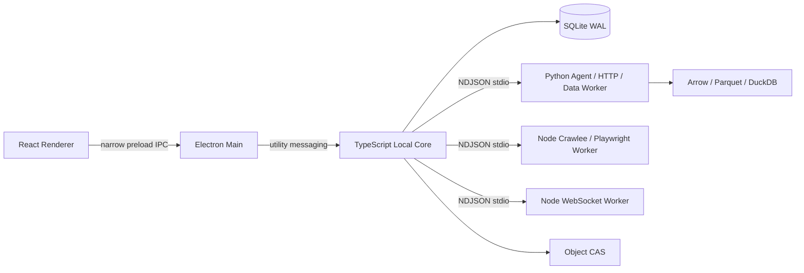

# TypeScript / Python 本地运行时蓝图

## 运行拓扑

应用完全本地运行，不包含用户需要维护的后端、数据库服务、消息队列、容器或业务监听端口。Main、Core、Worker 都由桌面应用启动和退出。

## 责任边界

| 模块 | 当前落点 | 责任 |
| --- | --- | --- |
| Renderer | `apps/desktop/src/renderer` | 页面、交互、ViewModel；无 Node/数据库/Secret 权限 |
| Main | `apps/desktop/src/main/index.ts` | 窗口、安全策略、系统 IPC、Local Core 生命周期 |
| Local Core | `packages/core-runtime` + `core-process.ts` | 状态所有权、任务、审批、Worker 监督和稳定投影 |
| Control DB | `packages/storage` | SQLite WAL、迁移、任务/事件/审批/Outbox |
| Task Engine | `packages/task-engine` | 显式状态机、Attempt、Retry、Approval、恢复 |
| Contracts | `packages/contracts` | JSON Schema、Zod DTO、消息元数据和版本 |
| Python Worker | `workers/python` | PydanticAI/LangGraph、Scrapy、DuckDB/PyArrow、MCP |
| Browser Worker | `workers/node-browser` | Crawlee/Playwright、登录 Profile、证据采集 |
| Realtime Worker | `workers/node-realtime` | WebSocket、心跳、重连、乱序缓冲 |

## 消息协议

每条消息必须包含 `id`、`type`、`version`、`timestamp`、`correlationId`、`traceId` 和 `payload`；派生消息增加 `causationId`。Local Core 对 Electron 使用 structured clone，对 Worker 使用一行一个 JSON Envelope 的 stdio。大对象只传 `ObjectRef`，不穿过 IPC 复制二进制。

协议演进遵循：新增可选字段向后兼容；删除/改义必须提升 schema 版本；UI 只消费稳定 Projection；PydanticAI、LangGraph、Crawlee 内部状态不能成为公共契约。

## 数据分层

- `control.db`：账号引用、Subject、Campaign、Task、Approval、Outbox、UI Projection。
- Object CAS：原始 HTTP、WARC/HAR、截图、导出与 Agent Artifact。
- Arrow/Parquet：直播弹幕、指标快照和其他高频不可变事实。
- DuckDB：查询、压实、导出和派生聚合，不拥有业务事务。
- 向量/全文索引：属于可重建派生数据，后续由 Knowledge Worker 实现。
- Secret：后续接 Windows Credential Manager；数据库仅保存 `SecretRef`。

## Agent 体系

Agent Definition/Version 是产品实体；一次 Run 由 Core 持有稳定状态，Python Worker 保存框架 Checkpoint。PydanticAI 负责默认 Agent、结构化输出和工具调用；LangGraph 只在需要图状态、分叉、长暂停和 time-travel 时使用。所有 Tool/MCP 调用必须经过 Core Policy、预算、出站预览和 Approval，副作用以 Effect ID 去重，崩溃后不自动重复执行。

## 爬虫体系

- 静态/接口优先 Scrapy + httpx；浏览器登录、JS 页面和截图使用 Crawlee/Playwright。
- 直播长连接独立放入 Realtime Worker，不与 UI 或 HTTP Crawler 共用崩溃域。
- Frontier、限频、账号 Lease、重试和证据引用由 Core 持久化；Worker 只执行有界任务。
- 浏览器 Worker 默认只允许公共 HTTPS 目标，Profile、浏览器和缓存都在 D 盘数据目录。
- Parser 对保存的原始证据可离线重放，避免调试时重复访问平台。

## 当前 Slice 0

已实现桌面 UI、D 盘环境、TypeScript Local Core、SQLite schema v1、Durable Task 状态机、跨语言 Envelope、Python Worker、Crawlee/Playwright Worker、Realtime Worker 和完整质量脚本。业务页面仍主要使用演示 ViewModel；下一 Slice 才接入真实平台账号、Subject、Bilibili Connector、Object CAS 和粉丝快照。
