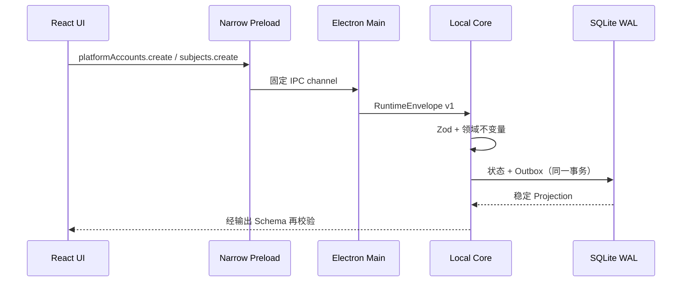

# Slice 1 增量：平台账号与监控对象

## 业务范围

本增量把原 BiliMonitor 中耦合在关注者监控配置里的“平台账号、监控主体、监控策略”拆成三个可独立演进的领域概念：

- `PlatformAccount`：平台上的外部账号引用，不保存 Cookie、Token 或二维码材料；
- `Subject`：用户真正关注的逻辑监控对象，可跨平台绑定多个账号；
- `SubjectMonitorPolicy`：绑定级监控能力，当前仅实现最小 300 秒间隔的 `follower.snapshot`。

原项目用于校准 B站 UID、空间主页地址和粉丝监控间隔等业务语义；新项目不复制原来的前后端部署结构，也不访问其数据库。

## 本地调用链

应用不启动业务 HTTP 服务。Renderer 无 Node、数据库和任意 IPC 权限，Preload 只暴露：

1. `platformAccounts.list`
2. `platformAccounts.create`
3. `subjects.list`
4. `subjects.create`
5. `subjects.bindAccount`

## 数据模型与不变量

SQLite schema v2 新增 `platform_account`、`subject`、`subject_account_binding` 和 `subject_monitor_policy`。创建账号、创建 Subject、绑定账号时均同步写入版本化 Outbox Envelope。

- 同一平台的 `external_id` 唯一；
- B站 UID 必须是大于 0 的纯数字；
- 同一 Subject 不能重复绑定同一账号；
- 粉丝策略必须属于已绑定账号，间隔为 300 到 604800 秒；
- Subject 列表是 Core 组装的稳定 Projection，UI 不拼接数据库实体；
- 所有 DTO 为严格对象，额外的 `cookieHeader` 等字段会被拒绝；
- Profile URL 未提供时，B站账号使用 `https://space.bilibili.com/{uid}`。

## UI 状态

“平台与账号”和“监控对象”页面使用 TanStack Query。每个页面显式覆盖加载、错误、空数据、成功、后台刷新和提交失败状态。创建账号仅录入平台公开引用；创建对象可选择已有账号并同时建立粉丝策略。右侧轨道展示实际能力状态，不显示弹幕、Agent 等演示事件。

当前认证状态固定从 `not_connected` 开始；这不是登录实现。后续扫码增量将把 Secret 写入 Windows Secret Vault，数据库只保存 `SecretRef`，并在 Core Policy 下发放短期 Lease。

## 错误与兼容

Core 对重复、缺失和未知方法返回稳定错误码，包括 `PLATFORM_ACCOUNT_CONFLICT`、`SUBJECT_NOT_FOUND`、`PLATFORM_ACCOUNT_NOT_FOUND`、`SUBJECT_ACCOUNT_CONFLICT` 和 `CORE_METHOD_NOT_FOUND`。公共消息使用 Runtime Envelope v1；账号/对象边界同时维护 Zod DTO 与 `packages/contracts/schemas/account-subject.v1.schema.json`。

## 本增量之外

本增量不声称已完成扫码登录、在线粉丝抓取、CAS 原始响应、Parser、历史 Parquet 或趋势分析。它们将沿用当前边界继续实现，而不会把平台网络、Secret 或 Worker 权限放入 Renderer。
