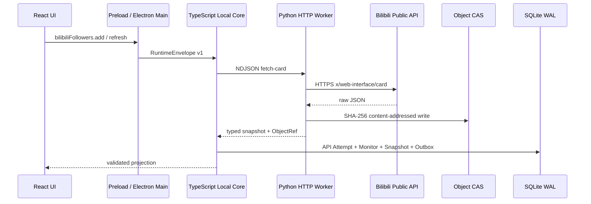

# 原 B/S 粉丝监控本地纵切

## 事实源与范围

本纵切不重新发明业务。实现时逐项对照本机原项目 `D:\codex_work\BiliMonitor`：

- `BilibiliFollowerMonitorController.java`：用户列表、添加、启停、间隔、立即刷新、删除、单用户历史和多用户趋势；
- `BilibiliFollowerMonitorService.java`：先取用户卡片、资料保留、端点回退、失败退避和到期批处理；
- `BilibiliApiClient.java`：B站端点、字段解析、错误分类、重试和限频；
- `BilibiliFollowerMonitorRepository.java`：Monitor 当前投影、Snapshot 时间桶、API Attempt 日志和删除语义；
- `BilibiliFollowerMonitorScheduler.java`：60 秒扫描、每批最多 10 个到期用户；
- `frontend/src/api/bilibili.ts`：前端可见的输入输出和趋势查询语义。

只替换部署形态：原 Controller/HTTP/服务端数据库调用被改为 Renderer → Preload → Electron Main → Local Core → SQLite/Python Worker，全程不开放业务端口。

## 原业务语义映射

| 原 B/S 行为 | 本地客户端实现 |
| --- | --- |
| 添加 UID 前请求用户卡片 | `addUser` 先调用 `x/web-interface/card`；成功后才创建 Monitor 和首条 Snapshot |
| 默认间隔 3600 秒 | Zod、JSON Schema、SQLite 和 UI 默认值保持 3600；合法范围 1～2592000 秒 |
| 暂停保留下次采集时间 | `PAUSED` 不重写 `next_collect_at` |
| 恢复立即到期 | 切换为 `ACTIVE` 时把 `next_collect_at` 设为当前时间 |
| 仅启用用户修改间隔后重排 | SQLite 使用条件更新；暂停用户保留原下次时间 |
| 卡片异常后按条件回退 | 只对解析、网络、服务端错误回退 `x/relation/stat`；风控/认证错误不做不安全回退 |
| 失败调度退避 | `max(300, min(intervalSeconds, 900))` |
| 重试与限频 | 每端点最小间隔 1500ms；最多 3 次；1500ms 起指数退避并加抖动 |
| 到期批处理 | Local Core 每 60 秒扫描一次，每批最多 10 个，只处理 `ACTIVE` 用户 |
| 秒级快照幂等 | `(monitor_id, captured_bucket)` 唯一，重复秒更新同一条快照 |
| 删除用户 | SQLite 外键级联删除该 Monitor 的全部 Snapshot；UI 明确二次确认 |
| 趋势 | 单用户历史和多用户趋势均读取真实 Snapshot；UI 最多同时选择 4 个用户 |

## 本地调用链

Python Worker 只执行有界网络请求和解析；Core 持有重试、回退、调度与持久化规则；Renderer 不接触网络权限、文件系统或数据库。

## 数据与契约

SQLite v3 新增：

- `bilibili_follower_monitor`：用户资料、当前粉丝/关注、状态、间隔、最近成功、下次采集和最近错误；
- `bilibili_follower_snapshot`：不可变历史事实和秒级幂等桶；
- `object_artifact`：CAS 路径、SHA-256、大小和媒体类型；
- `bilibili_api_call`：Task、Attempt、端点、状态码、耗时、错误类型、可重试性和证据引用。

Renderer 边界只暴露 `list`、`add`、`updateStatus`、`updateSettings`、`refresh`、`remove`、`trend`、`trends`。输入输出由 `packages/contracts/src/bilibili-follower.ts` 的 Zod Schema 校验，跨语言定义发布在 `packages/contracts/schemas/bilibili-follower.v1.schema.json`，Python Worker 用严格 Pydantic 模型拒绝额外字段。

## UI 状态

“B站粉丝监控”是独立一级业务页，不再借用泛化的账号/对象演示数据。页面覆盖：

- 首次加载、后台刷新、错误、空列表和提交失败；
- 昵称、头像、UID、粉丝、较上次变化、关注数、状态、上下次采集、来源端点和最近错误；
- 立即刷新、暂停/恢复、修改采集间隔和带级联说明的删除；
- 使用真实 Snapshot 生成的 SVG 历史趋势，而不是装饰性曲线。

## 后续纵切边界

- B站扫码登录态已由 `slice-3-bilibili-auth.md` 落地；粉丝接口仍按原项目使用公共 Web 接口，认证凭据不会注入不需要登录的 Follower Worker；
- Scrapy 大批量 Frontier、Checkpoint 和浏览器采集；
- Parquet 长期归档与 DuckDB 大规模查询；
- 原 B/S 项目的直播间、弹幕、榜单和场次业务。

这些功能必须继续从原项目提取业务语义后逐个迁移，不能用当前 UI 中的静态演示 ViewModel 作为完成依据。
