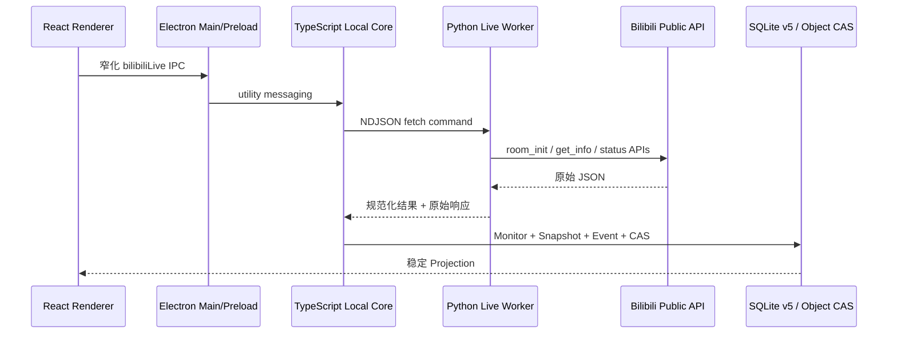

# 原 B/S B站直播间 REST 监控本地纵切

## 事实源

本纵切逐项对照原仓库基线 `01200f3c21c264963f2ad92a23b991ced5b0c9c0` 的以下实现，不以 UI 稿或通用采集概念替代原业务：

- `BilibiliLiveMonitorController.java`
- `BilibiliLiveMonitorService.java`
- `BilibiliLiveSnapshotApplicationService.java`
- `BilibiliLiveMonitorScheduler.java`
- `BilibiliLiveApiClient.java`
- `V4__bilibili_live_monitor.sql`
- `BilibiliLiveView.vue`

## 本地运行链路

应用不提供 Spring Controller，也不启动业务 HTTP 服务。Renderer 无法直接访问 B站、SQLite、文件系统或 Worker。

## 业务语义

- 添加时必须在 `roomId` 与 `uid` 中二选一；先访问平台验证，再创建首条真实快照。
- 房间号输入经过 `room_init` 解析短号和真实房间号，再读取 `get_info`；UID 输入优先走批量状态接口，缺失时按原项目规则回退 `getRoomInfoOld`。
- 已存在且暂停的房间再次添加时恢复监控并重排下次采集；已运行的重复房间不新增记录。
- 采集间隔范围为 `1..2592000` 秒；恢复和修改启用房间的间隔会重新安排采集。
- 调度只拉取到期且启用的房间，每批最多 30 个；网络、解析与平台错误按有界重试和失败退避处理，不能生成伪成功快照。
- 同一房间同一秒只保存一条快照；Monitor、Snapshot 和 Event 在同一事务中更新。
- 状态变化派生 `LIVE_STARTED`、`LIVE_ENDED`、`ROUND_STARTED`、`TITLE_CHANGED`、`ERROR_OCCURRED` 和 `ERROR_RECOVERED`。
- 删除房间时级联删除快照和状态事件。
- 趋势读取真实快照；多房间对比最多 4 个房间。

## 实现映射

| 层 | 当前实现 |
| --- | --- |
| Contract | `packages/contracts/src/bilibili-live.ts` |
| Core | `packages/core-runtime/src/bilibili-live-service.ts` |
| Worker transport | `packages/core-runtime/src/bilibili-live-worker-source.ts` |
| Python HTTP Worker | `workers/python/src/bmd_workers/bilibili_live.py` |
| SQLite | `packages/storage/src/control-database.ts` schema v5 |
| IPC | `apps/desktop/src/main/core-request-router.ts`、`index.ts`、Preload bridge |
| UI | `apps/desktop/src/renderer/src/BilibiliLiveWorkspace.tsx` |

## 页面能力

- 按房间号或 UID 添加并展示真实平台数据。
- 汇总总房间、运行中、直播中、异常和当前热度。
- 房间卡片展示主播、标题、分区、直播状态、热度、关注、最近成功、下次采集和错误。
- 立即刷新、暂停/恢复、修改间隔、删除。
- 状态事件时间线与最多 4 房间真实趋势。
- 浏览器预览只展示诚实空态且禁止写操作；真实业务操作仅在 Electron 客户端开放。

## 当前验收边界

- 自动测试覆盖 Contract、schema v5、事件派生、级联删除、Worker 消息、服务回退/调度、IPC、Preload 和 React 页面。
- 已完成真实链路 smoke：`LocalCoreRuntime -> Python Live Worker -> B站公开 API -> SQLite`，验证真实房间解析、中文传输和汇总投影。
- 本纵切不包含弹幕 WebSocket、榜单、直播场次、洞察和导出；这些仍必须按原项目依赖顺序迁移，完成前不进入导航。
