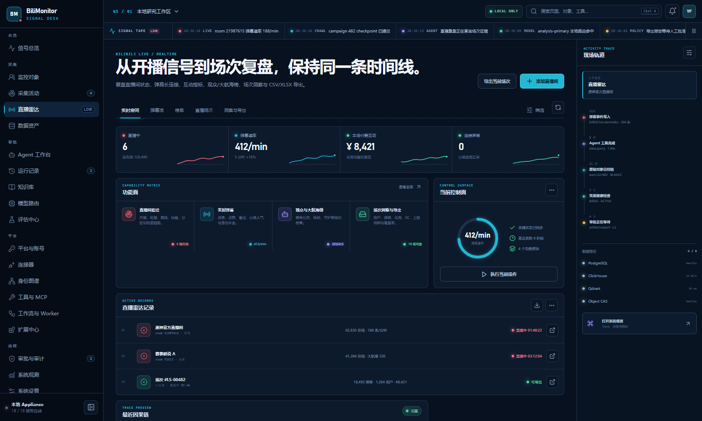
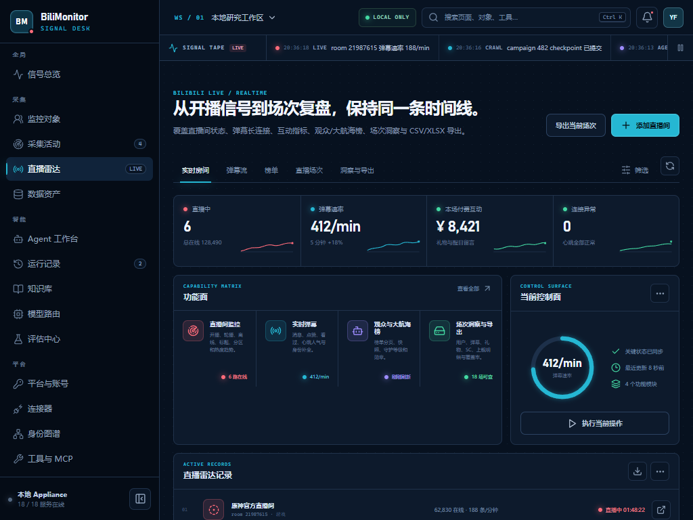
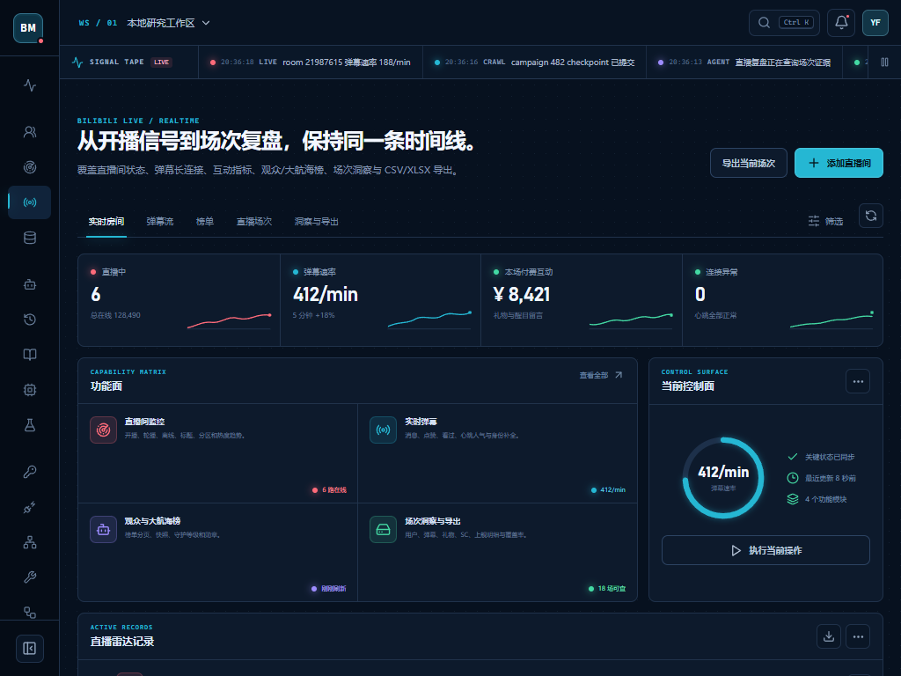

# Dogfood Report: BiliMonitor Desktop UI v0.1

| Field | Value |
| --- | --- |
| Date | 2026-08-22 |
| App URL | `http://127.0.0.1:5173` |
| Session | `bili-ui` |
| Scope | 桌面壳、19 项导航、命令搜索、直播雷达、平台账号、1600px/1024px 布局 |

## Summary

| Severity | Count |
| --- | --- |
| Critical | 0 |
| High | 0 |
| Medium | 1（已修复） |
| Low | 0 |
| Total | 1 |

本轮验证了侧栏页面切换、Hash 深链接、命令面板搜索“弹幕”、直播雷达页面、平台与账号页面和浏览器 Console。未观察到 JavaScript Error 或失败网络请求；Vite 开发日志和 React DevTools 提示不计为产品问题。

## Issues

### ISSUE-001：最小支持窗口不会自动收起侧栏

| Field | Value |
| --- | --- |
| Severity | medium |
| Category | visual / responsive |
| URL | `http://127.0.0.1:5173/#live-radar` |
| Repro Video | N/A |
| Status | Fixed and re-verified |

**Description**

Electron 最小窗口宽度为 1024px，原响应式断点为 940px。因此用户在最窄受支持窗口中无法触发自动折叠，236px 侧栏持续占据内容宽度，直播功能矩阵的四列文本过密。

**Repro Steps**

1. 在 1600×960 打开直播雷达，页面使用完整侧栏和右侧 Activity Rail。
   

2. 将视口设为 Electron 最小支持宽度 1024×768，右侧 Activity Rail 隐藏，但完整侧栏仍然存在。
   

3. 将自动折叠断点提高到 1100px。相同视口下侧栏变为 68px 图标栏，功能矩阵改为两列，中央内容恢复可读宽度。
   

**Verification**

浏览器条件检查：

```text
getComputedStyle(document.querySelector('.sidebar')).width === '68px'
→ true
```
